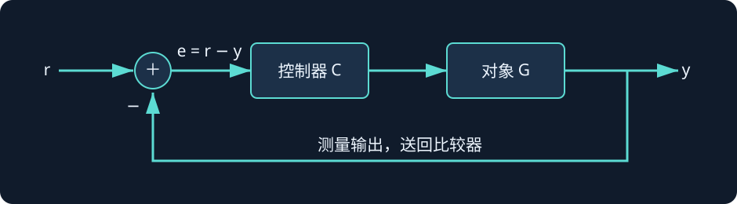
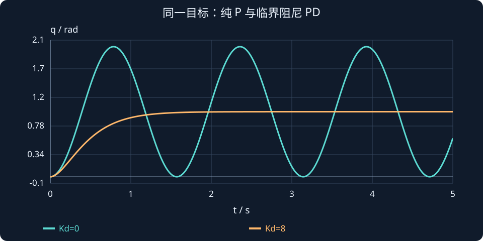

# 第 1 课：反馈控制与第一个 PD 控制器

> 本课目标：区分开环与闭环；理解反馈误差；从单关节动力学认识 P 控制、PD 控制；知道为什么“角度到位”不等于“已经停住”。

## 1. 从一个单关节机械臂开始

我们要让一个机械臂关节从 **0° 转到 90°，最终稳定停在 90°**。这个任务涉及三个不同问题：如何让它开始运动、如何判断是否到达目标、如何使它不再运动。

如果只给电机一个固定力矩并持续一段时间，这属于**开环控制**。我们执行预先决定的动作，却不利用实际角度纠正偏差。负载、摩擦、外界推力稍有变化，实际结果就可能偏离预期。更重要的是，力矩变为零也不意味着角速度立刻变为零。

**闭环控制**把测量到的输出反馈给控制器，持续比较目标与实际状态，修正控制输入：



定义位置误差为：


$$
e(t)=q_d(t)-q(t)
$$


- $q_d$：目标关节角度，单位通常为 rad；
- $q$：实际关节角度，单位通常为 rad；
- $e$：目标与实际角度之间的差，单位为 rad。

例如目标为 90°，实际为 60°，误差为 +30°；实际为 100°，误差为 −10°。不过，**只知道角度误差还不够**，因为一个关节可能在目标位置仍有较大的角速度。

## 2. 把机械臂写成动力学方程

为了把核心问题讲清楚，先假设：只有一个旋转关节；在水平面运动，不受重力转矩影响；忽略摩擦、电机电气过程和力矩饱和；转动惯量保持常数。模型为：


$$
J\ddot q=\tau
$$


这对应直线运动中的 $F=ma$：力矩决定角加速度。

| 符号 | 物理意义 | 常用单位 |
|---|---|---|
| $J$ | 绕关节轴的等效转动惯量 | kg·m² |
| $q$ | 关节角度 | rad |
| $\dot q$ | 关节角速度 | rad/s |
| $\ddot q$ | 关节角加速度 | rad/s² |
| $\tau$ | 施加在关节上的净驱动力矩 | N·m |

如果施加恒定正力矩，角加速度为正，速度会不断增加。**所以只给一个恒定力矩，不能自动保证关节在目标处停住。**

## 3. P 控制：根据位置误差施加力矩

最自然的控制律是：


$$
\tau=K_pe=K_p(q_d-q)
$$


$K_p$ 是比例增益。对这个直接用力矩驱动的关节，单位可理解为 N·m/rad。误差大，纠正力矩大；误差趋近 0，纠正力矩减小。

但请注意：**当 $q=q_d$ 时，P 控制输出为 0，关节可能依然运动。** 在无摩擦的理想模型里，纯 P 控制相当于为关节增加一个“虚拟弹簧”，它会围绕目标位置持续振荡。

将 P 控制代入动力学：


$$
J\ddot q=K_p(q_d-q)
$$


固定目标角度时，令 $e=q_d-q$，得到：


$$
J\ddot e+K_pe=0
$$


这是一种没有阻尼项的振动方程。

## 4. PD 控制：再用速度反馈让它停下

针对**目标角度固定**的定位任务，加入速度反馈：


$$
\boxed{\tau=K_p(q_d-q)-K_d\dot q}
$$


- **P 项** $K_p(q_d-q)$：位置偏差越大，朝目标修正的力矩越大，类似“弹簧”。
- **D 项** $-K_d\dot q$：沿运动速度反方向施加力矩，类似“阻尼器”，抑制冲过目标位置的趋势。

此处 $K_d$ 对应力矩/角速度，单位可理解为 N·m·s/rad。

考虑 $q_d=90°$，此时恰好 $q=90°$，但 $\dot q>0$：

- P 项为 0；
- D 项 $-K_d\dot q<0$；
- 输出负力矩，使关节减速。

这说明**“位置误差为零”与“系统已经稳定”是两个不同概念**。

> 注意：如果目标 $q_d(t)$ 是变化的轨迹，另一种常见写法是 $\tau=K_pe+K_d\dot e$，即使用速度误差。它与本课的 $-K_d\dot q$ 在目标恒定时一致；目标变化时则不完全相同。后续讲轨迹跟踪会区分。


## 到达目标位置时，关节为什么还需要刹车？

先不跑整段仿真，只看“此刻”控制器输出。目标与实际位置相同，但关节还在向正方向转：

$$
q_d=q=1\ \mathrm{rad},\quad \dot q=0.5\ \mathrm{rad/s},\quad
J=1\ \mathrm{kg\,m^2},\quad K_p=16,\quad K_d=8.
$$

比例项只看位置误差，因此此刻为零。速度反馈还会工作：

$$
\begin{aligned}
e&=q_d-q=0,\\
\tau_P&=K_pe=0,\\
\tau_D&=-K_d\dot q=-4\ \mathrm{N\,m},\\
\ddot q&=\tau/J=-4\ \mathrm{rad/s^2}.
\end{aligned}
$$

负角加速度表示此刻正在减小正向角速度，而不是“速度立刻变为零”。若只看这 0.01 s 的局部变化，速度约从 0.5 降到 0.46 rad/s；控制器随后还会根据新状态重新计算。这个局部近似不能当成整段恒定减速过程。

图中比较相同模型在纯 P 与 PD 下对 1 rad 目标的响应。P 有位置恢复作用，却没有耗散振动能量；D 增加制动，才能在理想模型中逐步停住。



**读图与操作**：先把 Kd 调到 0，再调到 8；看是否越过目标、振荡是否衰减。不要只比较第一次到达目标的时刻。

**使用条件**：目标恒定、力矩直接驱动、忽略摩擦与饱和；角度以 rad 参与计算。

### 先预测，再展开核对

若此刻速度为 −0.5 rad/s，D 项该向哪个方向施加力矩？

<details><summary>查看思路与答案</summary>

D 项变为 +4 N·m，抵抗负向运动。它的符号始终与测量速度相反。

</details>

## 5. 互动演示：观察 P 与 PD

调整下方 $K_d$，观察在同样的 $J$ 和 $K_p$ 下是否振荡、是否越过目标。为了突出规律，演示继续使用理想二阶模型，起点 0°、目标 90°。

:::demo response j=1 kp=16 kd=8
:::

建议依次比较：**$K_d=0$、$1$、$4$、$8$、$12$**。这个图用于直观观察；为什么不同增益会表现不同，第 2 课推导。

## 6. MATLAB：自己实现两种控制器

下面用 `ode45` 数值求解运动微分方程，不依赖控制系统工具箱：

```matlab
clc; clear; close all;
J = 1; Kp = 16;
q_ref = pi/2;           % 目标角度：90°
x0 = [0; 0];            % 状态：[角度; 角速度]
tspan = 0:0.01:5;

figure; hold on;
for Kd = [0, 8]
    f = @(t,x) [x(2);
                (Kp*(q_ref-x(1))-Kd*x(2))/J];
    [t,x] = ode45(f, tspan, x0);
    plot(t, rad2deg(x(:,1)), 'LineWidth', 1.5, ...
         'DisplayName', sprintf('Kd = %g', Kd));
end
yline(90,'k--','目标角度');
xlabel('时间 (s)'); ylabel('角度 (deg)');
legend; grid on;
```

`x(1)` 是角度，`x(2)` 是角速度；右侧的两行分别表示 $\dot x_1=x_2$ 与 $\dot x_2=\tau/J$。后面的状态空间方法就建立在这种描述之上。

## 7. 本课检查

1. 目标是 90°，实际也是 90°，但关节仍沿正方向转动：纯 P 控制和 PD 控制分别输出怎样的力矩？
2. 为什么没有测量实际角度的开环控制，很难在负载变化时精确停在目标位置？
3. 说说 $K_p$、$K_d$ 各自主要影响什么。暂时不用定量回答。

**课程小结：** 控制器不是简单地“让电机转”，而是在动力学模型上利用反馈持续调节输入。P 看位置，D 看速度；后面我们用二阶系统理论定量分析稳定性与响应速度。


## 课程衔接与条件检查

### 反馈信号、扰动与传感器不是一条通道

设控制器 C、对象 G、传感器 H，比较器误差为 $e_c=r-Hy$。若扰动 d 加在对象输入端，有 $y=G(Ce_c+d)$，所以 $y=[GC/(1+GCH)]r+[G/(1+GCH)]d$。只有 $H=1$ 时，比较器误差才等于实际跟踪误差 r−y。传感器偏差会使控制器在错误测量上达到平衡，反馈不能自动纠正传感器自身的系统性偏差。

例：目标 1 rad，传感器始终多报 0.1 rad，即使比较器误差为零，真实位置也可能只有 0.9 rad。请在图上分别标记参考、输出、测量和扰动，之后再使用简化的单位反馈公式。

**自查**：若此刻速度为 −0.5 rad/s，D 项该向哪个方向施加力矩？
