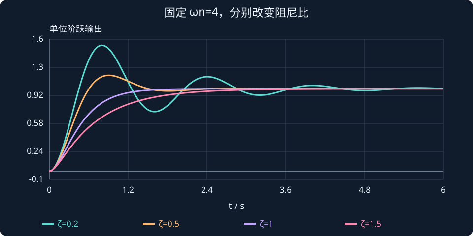

# 第 2 课：二阶系统、阻尼比与超调量

> 本课目标：从 PD 动力学得到误差方程；读懂自然角频率与阻尼比；理解超调和调节时间；解释为什么提高 $K_d$ 不总是更快。

## 1. 从 PD 控制得到闭环运动方程

我们继续使用理想单关节模型：


$$
J\ddot q=\tau
$$


对**固定目标角度** $q_d$ 使用上一课的 PD 控制器：


$$
\tau=K_p(q_d-q)-K_d\dot q
$$


代入并整理：


$$
J\ddot q+K_d\dot q+K_pq=K_pq_d
$$


令位置误差 $e=q_d-q$。因 $q_d$ 固定，所以 $\dot e=-\dot q$、$\ddot e=-\ddot q$。最终得到：


$$
\boxed{J\ddot e+K_d\dot e+K_pe=0}
$$


这就是误差动力学。与第一课只观察角度相比，它能直接告诉我们误差是否衰减到 0。

## 2. 与标准二阶系统比较

先将方程除以 $J$：


$$
\ddot e+\frac{K_d}{J}\dot e+\frac{K_p}{J}e=0
$$


经典控制中，标准二阶系统的误差方程写成：


$$
\ddot e+2\zeta\omega_n\dot e+\omega_n^2e=0
$$


逐项对比：


$$
\omega_n^2=\frac{K_p}{J},\qquad 2\zeta\omega_n=\frac{K_d}{J}
$$


得到两个关键公式：


$$
\boxed{\omega_n=\sqrt{\frac{K_p}{J}}}
$$


$$
\boxed{\zeta=\frac{K_d}{2\sqrt{JK_p}}}
$$


- $\omega_n$：无阻尼自然角频率，单位 rad/s（在指数和正弦函数中可视作 1/s）；反映系统的固有时间尺度。
- $\zeta$：阻尼比，无量纲；反映振荡及衰减特征。
- $J$：等效转动惯量；$K_p$：比例增益；$K_d$：微分增益。

两个增益都保持不变时，**增大负载惯量 $J$ 会降低 $\omega_n$ 与 $\zeta$**。因此负载变化常常会改变既有控制器的表现。

## 3. 四种阻尼状态

| 阻尼比 | 名称 | 典型响应表现 |
|---|---|---|
| $\zeta=0$ | 无阻尼 | 理想模型中持续等幅振荡 |
| $0<\zeta<1$ | 欠阻尼 | 振荡且逐渐衰减，通常有超调 |
| $\zeta=1$ | 临界阻尼 | 在同一 $\omega_n$ 的标准二阶零初速阶跃响应中，不超调且收敛较快 |
| $\zeta>1$ | 过阻尼 | 不振荡，但阻尼过大可能使响应变慢 |

例如 $J=1$、$K_p=16$ 时，


$$
\omega_n=4,\qquad \zeta=\frac{K_d}{8}
$$


- $K_d=0$：$\zeta=0$，持续振荡。
- $K_d=1$：$\zeta=0.125$，明显欠阻尼。
- $K_d=8$：$\zeta=1$，临界阻尼。
- $K_d=16$：$\zeta=2$，过阻尼。

:::demo response j=1 kp=16 kd=1
:::

**观察任务：** 把 $K_d$ 从 1 调到 8，再调到 16。注意超调和响应尾部的变化。单纯加大阻尼并不会使响应一直变快。

## 4. 三个常用时间响应指标

### （1）超调量 $M_p$

当目标值是 $y_\infty$（最终稳定值），响应最大值是 $y_{\max}$，对最终值为正的阶跃响应定义百分比超调为：


$$
M_p=\frac{y_{\max}-y_\infty}{|y_\infty|}\times100\%
$$


例如目标 90°、最大达到 120°，则 $M_p=(120-90)/90\times100\%\approx33.3\%$。

对**标准、无零点、单位直流增益的欠阻尼二阶系统**，阶跃超调满足：


$$
\boxed{M_p=e^{-\frac{\pi\zeta}{\sqrt{1-\zeta^2}}}\times100\%},\qquad 0<\zeta<1
$$


它让我们能够根据期望超调，反向估算阻尼比。适用条件很重要：不要不加判断地应用在任意含零点或非线性系统上。

### （2）调节时间 $T_s$

通常先规定容许误差带，例如最终值的 $\pm2\%$。从某时刻起，响应一直留在这个范围内，则该时刻叫 **2% 调节时间**。

目标为 90° 时，允许范围是 $[88.2°,91.8°]$。只进入范围一次还不够，之后不能再离开。

对欠阻尼标准二阶系统，一个常用的 **2% 近似** 是：


$$
\boxed{T_s\approx\frac{4}{\zeta\omega_n}}
$$


这不是普适精确公式；尤其在非常接近临界阻尼、过阻尼或者存在特殊零点时，应改用准确响应计算。

### （3）峰值时间 $T_p$

对 $0<\zeta<1$ 的标准二阶阶跃响应，达到第一个峰值的时间：


$$
T_p=\frac{\pi}{\omega_n\sqrt{1-\zeta^2}}
$$


$T_p$ 用秒计，$\omega_n\sqrt{1-\zeta^2}$ 称为阻尼振荡角频率 $\omega_d$。

## 5. 从负载变化理解参数调整

上一课的题目：

原来 $J=1,\ K_p=16,\ K_d=8$，所以 $\zeta=1$、$\omega_n=4$。

负载增加使 $J=4$，其余不变：


$$
\zeta=\frac{8}{2\sqrt{4\times16}}=0.5,\qquad\omega_n=\sqrt{16/4}=2
$$


系统变成欠阻尼，自然角频率也下降。如果只要求再次达到临界阻尼：


$$
K_d=2\sqrt{JK_p}=2\sqrt{4\times16}=16
$$


所以你的练习答案“$K_d$ 翻倍”是正确的。但请注意：**恢复 $\zeta=1$ 并不等于恢复原来的响应速度**，因为 $\omega_n$ 仍从 4 降到了 2。


## 把阻尼比变成一条真正的时间曲线

把直流增益为 1 的二阶系统写成：

$$
T(s)=\frac{\omega_n^2}{s^2+2\zeta\omega_n s+\omega_n^2}.
$$

取自然角频率 4 rad/s、阻尼比 0.5。先算振荡频率，再算峰值时间与超调：

$$
\begin{aligned}
\omega_d&=\omega_n\sqrt{1-\zeta^2}=2\sqrt3\approx3.464\ \mathrm{rad/s},\\
t_p&=\frac\pi{\omega_d}\approx0.907\ \mathrm{s},\\
M_p&=e^{-\pi\zeta/\sqrt{1-\zeta^2}}\approx0.163.
\end{aligned}
$$

所以 1 rad 阶跃的第一次峰值约为 1.163 rad。163% 与 16.3% 要分清：1.163 是峰值相对目标的比例，超出的部分才是 16.3%。2% 调节时间经验式给出约 2 s，但实际进入并持续保持误差带的时刻应由曲线再测。

图中固定自然角频率，只改变阻尼。轻阻尼的首次上升可能很快，但尾部振荡长；过阻尼不振荡，却可能由一个慢实极点拖住。



**读图与操作**：先固定 Kp/J，再调 Kd 看阻尼；若同时改多个参数，就无法判断曲线变化来自哪里。

**使用条件**：无零点、零初态、单位直流增益的标准二阶阶跃；超调与峰值公式限定 $0<ζ<1$。

### 先预测，再展开核对

将自然角频率从 4 加倍到 8，阻尼比不变时，超调比例和峰值时间怎样变？

<details><summary>查看思路与答案</summary>

超调比例不变，峰值时间约减半；这是标准二阶模型的结论，不适用于任意有零点或限幅系统。

</details>

## 6. MATLAB：对比不同阻尼

```matlab
clc; clear; close all;
J = 1; Kp = 16; q_ref = pi/2;
tspan = 0:0.01:5; x0 = [0;0];
figure; hold on;
for Kd = [0,1,4,8,16]
    f = @(t,x) [x(2);
       (Kp*(q_ref-x(1))-Kd*x(2))/J];
    [t,x] = ode45(f,tspan,x0);
    plot(t,rad2deg(x(:,1)), 'LineWidth',1.4, ...
      'DisplayName',sprintf('Kd=%g',Kd));
end
yline(90,'k--');
xlabel('时间 (s)'); ylabel('角度 (deg)');
legend('Location','best'); grid on;
```

## 7. 本课检查

1. $J=1,K_p=16,K_d=4$：计算 $\omega_n$ 与 $\zeta$，判断阻尼类型。
2. 固定 $J,K_p$，为什么把 $K_d$ 从临界阻尼继续增大可能使响应变慢？
3. $J$ 从 1 增加到 4，希望仍满足 $\zeta=1$，在 $K_p=16$ 不变时需要怎样调整 $K_d$？恢复了哪些指标，哪些没有恢复？

**课程小结：** 标准二阶系统让我们从“看曲线调参数”进步到“通过 $J,K_p,K_d$ 定量预测曲线”。


## 课程衔接与条件检查

### 从阻尼分类连接实际参数

带恢复力的机械模型 $J\ddot q+b\dot q+kq=u$，对应 $\omega_n=\sqrt{k/J}$、$\zeta=b/(2\sqrt{Jk})$。取 $J=2$、$b=4$、$k=10$，得到 $\omega_n=\sqrt5$ rad/s、$\zeta\approx0.447$，属于欠阻尼。J 变大但 b、k 不变时，固有频率和阻尼比都会变化，不能只说“惯量大所以慢”。

标准超调公式通常针对无零点、标准二阶、零初态的阶跃响应；高阶系统、有显著零点或限幅时，不能直接当成精确结论。

**自查**：将自然角频率从 4 加倍到 8，阻尼比不变时，超调比例和峰值时间怎样变？
