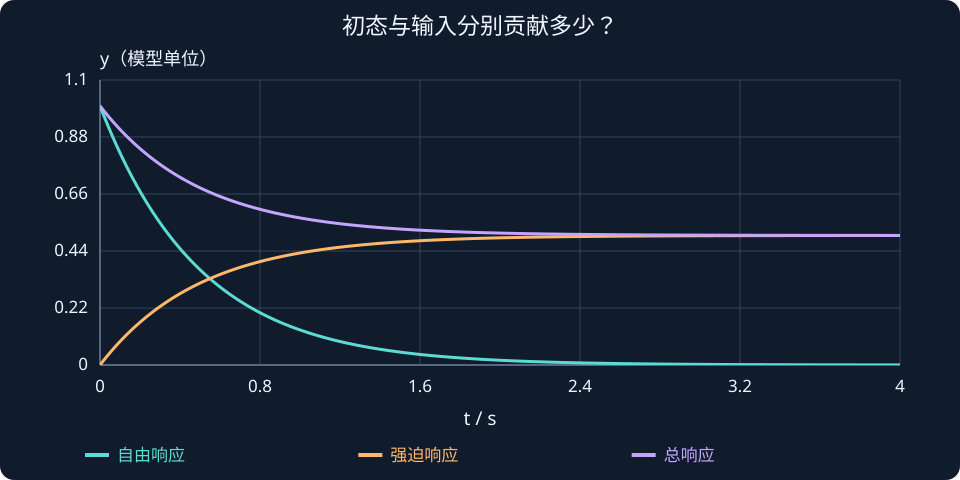

# 第 3 课：拉普拉斯变换与传递函数

> 本课目标：弄清时域与 $s$ 域的关系；独立从关节动力学推导开环与闭环传递函数；认识极点和稳态增益；用 MATLAB 验证。

## 1. 为什么不一直直接解微分方程？

第 2 课得到：


$$
J\ddot q+K_d\dot q+K_pq=K_pq_d
$$


它直接描述机械臂的运动。但如果电机、传感器、滤波器、机械负载等环节越来越多，直接解联立微分方程会很繁琐。

拉普拉斯变换把**线性常系数微分方程**转化为关于复变量 $s$ 的代数关系。这样便于组合子系统、计算极点、推导响应。

记号为：


$$
Q(s)=\mathcal{L}\{q(t)\}=\int_0^\infty q(t)e^{-st}\,dt
$$


这里 $q(t)$ 是时域函数，$Q(s)$ 是它的拉普拉斯变换，$s=\sigma+j\omega$ 是复变量，$j^2=-1$。你暂时不需要推导这个积分，但要知道变换有适用条件。

## 2. 导数如何变成关于 s 的表达式？

拉普拉斯变换的导数公式是：


$$
\mathcal L\{\dot q(t)\}=sQ(s)-q(0)
$$


$$
\mathcal L\{\ddot q(t)\}=s^2Q(s)-sq(0)-\dot q(0)
$$


**传递函数按定义采用零初始条件。** 如果 $q(0)=0$、$\dot q(0)=0$，公式就简化为：


$$
\mathcal L\{\dot q\}=sQ(s),\qquad\mathcal L\{\ddot q\}=s^2Q(s)
$$


所以在零初始条件下，求导对应乘以 $s$，求二阶导对应乘以 $s^2$。但不能忘记初始条件，不是所有问题都能直接这样简化。

## 3. 推导开环机械臂传递函数

先忽略控制器，只看被控对象：


$$
J\ddot q=\tau
$$


零初始条件下，拉普拉斯变换：


$$
Js^2Q(s)=\mathcal T(s)
$$


其中 $\mathcal T(s)=\mathcal L\{\tau(t)\}$ 是输入**力矩**的变换，不是闭环传递函数。两边相除：


$$
\boxed{G(s)=\frac{Q(s)}{\mathcal T(s)}=\frac{1}{Js^2}}
$$


这表示从力矩输入到角度输出的**开环对象传递函数**。它在 $s=0$ 处有二重极点，所以理想的无阻尼自由转动关节本身不是渐近稳定的。

```text
力矩 τ ──► [被控对象 G(s)=1/(Js²)] ──► 角度 q
```

## 4. 推导 PD 控制后的闭环传递函数

固定目标角度下的控制律：


$$
\tau=K_p(q_d-q)-K_d\dot q
$$


代入对象后：


$$
J\ddot q+K_d\dot q+K_pq=K_pq_d
$$


零初始条件下：


$$
Js^2Q(s)+K_dsQ(s)+K_pQ(s)=K_pQ_d(s)
$$


合并 $Q(s)$：


$$
(Js^2+K_ds+K_p)Q(s)=K_pQ_d(s)
$$


得到**闭环传递函数**：


$$
\boxed{T(s)=\frac{Q(s)}{Q_d(s)}=\frac{K_p}{Js^2+K_ds+K_p}}
$$


这个 $T(s)$ 的输入是**目标角度**，输出是**实际角度**。不要把它和对象从“力矩到角度”的 $G(s)$ 混淆。

> 条件提醒：上述闭环表达式对应 D 项反馈实际角速度，且推导传递函数时假定目标指令变化由 $K_pq_d$ 通道进入。如果使用速度误差 $K_d(\dot q_d-\dot q)$ 跟踪变化的参考轨迹，目标输入通道会多出 $K_ds$ 项。

## 5. 传递函数能告诉我们什么？

以第 2 课增加负载之后的参数为例：$J=4,K_p=16,K_d=8$。


$$
T(s)=\frac{16}{4s^2+8s+16}=\frac{4}{s^2+2s+4}
$$


### （1）极点来自分母

令分母为零：


$$
s^2+2s+4=0
$$


得到：


$$
s_{1,2}=-1\pm\sqrt3 j
$$


两个极点实部均为 -1，故这个理想闭环系统渐近稳定；虚部非零，说明存在振荡模式。第 4 课会更系统地解释。

### （2）直流增益与稳态跟踪


$$
T(0)=\frac44=1
$$


由于系统稳定，对于固定的阶跃目标角度，这个模型能在最终稳态准确到达目标值。

这里的结论依赖模型。真实机械臂受到重力、摩擦与外部扰动时，简单 PD 通常不能保证完全无稳态误差；以后会学习重力补偿和积分控制。

### （3）同一组参数，传递函数说明什么？

由 $J,K_p,K_d$ 可以写出分母、算出极点，从而分析稳定性、阻尼和收敛特征。这就是第 2 课与第 3 课之间的联系。


## 同一个传递函数，为什么初始位置不同，曲线也不同？

先用一阶对象看清“输入响应”与“自由响应”。微分方程为：

$$
\dot y+2y=u,\qquad y(0)=1.
$$

对单位阶跃输入变换时，把初值带上：

$$
\begin{aligned}
sY(s)-1+2Y(s)&=\frac1s,\\
Y(s)&=\frac1{s(s+2)}+\frac1{s+2},\\
y(t)&=\frac12(1-e^{-2t})+e^{-2t}.
\end{aligned}
$$

第一项是零初态下由输入产生的强迫响应，第二项是初态产生的自由响应。二者相加，起点为 1，最后趋于 0.5。若把初值忘掉，只会得到“从 0 上升到 0.5”，起点就错了。

传递函数仍是 $G(s)=1/(s+2)$，因为它按零初态输入输出关系定义。模型不因初值变成另一个传递函数；只是总响应需要额外加上自由响应。将输入设成零时，剩下的正是初态衰减。



**读图与操作**：新交互可分别显示强迫响应、自由响应和二者之和。把初值依次设成 0、1、−1，再把输入设成 0。

**使用条件**：连续线性时不变一阶对象，$a>0$；叠加原理要求系统线性。

:::demo transfer-lab
:::

### 先预测，再展开核对

同一模型改成 $y(0)=−1$，单位阶跃下最终值和初始值分别是多少？

<details><summary>查看思路与答案</summary>

初始值 −1，最终值仍为 0.5；总响应为 0.5−1.5exp(−2t)。输入和模型没变，稳定自由响应会衰减。

</details>

## 6. MATLAB：用 tf、step、pole 分析

下列代码需要 **Control System Toolbox**：

```matlab
clc; clear; close all;
J = 4; Kp = 16; Kd = 8;
s = tf('s');

G = 1/(J*s^2);                     % 关节对象
T = Kp/(J*s^2+Kd*s+Kp);           % 闭环：目标角度 -> 实际角度

disp('对象传递函数：'); G
disp('闭环传递函数：'); T
disp('闭环极点：'); pole(T)

q_ref = pi/2;                     % 弧度
figure;
step(q_ref*T,8); grid on;
title('90°目标角度的闭环阶跃响应');
ylabel('角度 (rad)'); xlabel('时间 (s)');
```

没有 Control System Toolbox，也能直接求极点：

```matlab
J = 4; Kp = 16; Kd = 8;
p = roots([J, Kd, Kp]);
disp(p);
```

`[J,Kd,Kp]` 是二次多项式 $Js^2+K_ds+K_p$ 按降幂排列的系数。`roots` 就是在解这个多项式的根。

## 7. 本课检查

1. 已知 $2\ddot q=\tau$，从力矩到角度的对象传递函数是什么？
2. $J=2,K_p=18,K_d=6$，推导闭环 $T(s)$。
3. 比较 $1/(s+2)$ 和 $1/(s-2)$ 的极点位置，猜测哪个稳定。第 4 课会解释原因。

**课程小结：** 拉普拉斯变换是分析工具；$G(s)$ 说明对象怎样响应力矩，$T(s)$ 说明闭环怎样跟随目标。


## 课程衔接与条件检查

### 传递函数的零初态约定

对 $\ddot q+3\dot q+2q=u$ 变换，完整式为 $(s^2+3s+2)Q=U+(s+3)q(0)+\dot q(0)$。因此 $U=0$ 不代表 $Q=0$。$G=1/(s²+3s+2)$ 仍是系统的传递函数，但零初值输入响应之外还要叠加自由响应。

例：$q(0)=1$、速度为零、输入为零时，$q(t)=2e^{-t}-e^{-2t}$。这与阶段 0 的矩阵指数例子描述同一个运动过程。

**自查**：同一模型改成 $y(0)=−1$，单位阶跃下最终值和初始值分别是多少？
