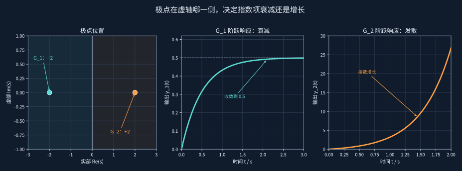
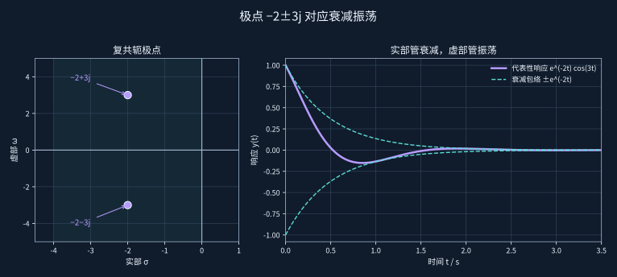
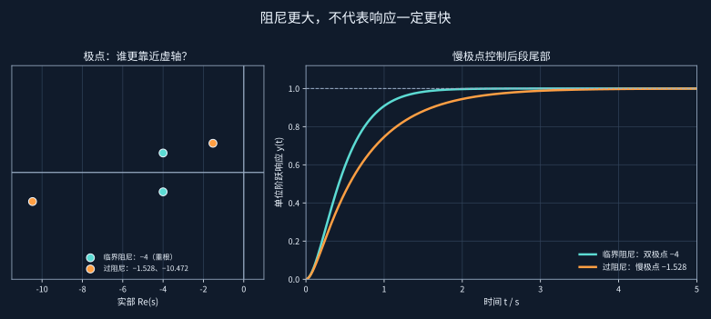
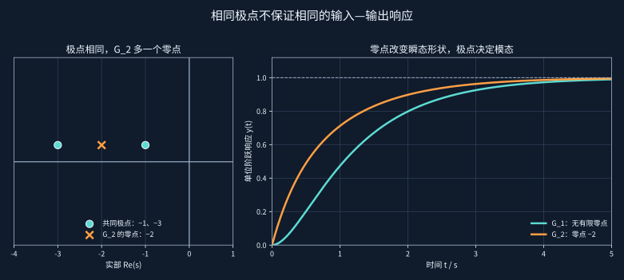
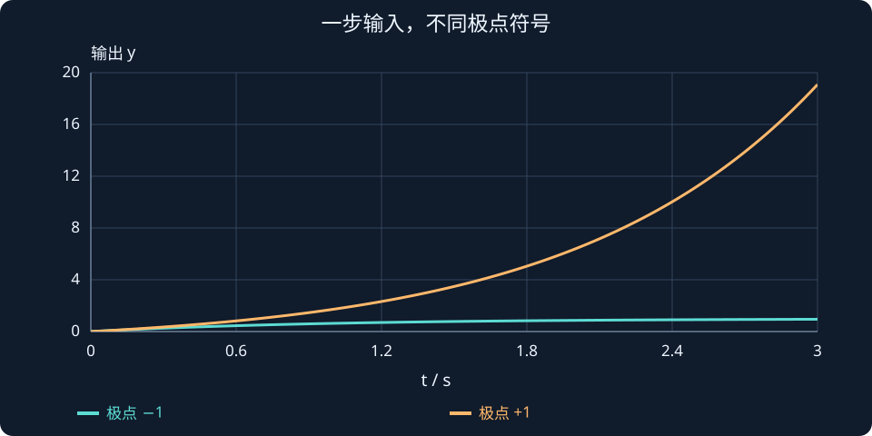

# 第 4 课：极点、零点与系统稳定性

> 本课目标：从极点位置预测衰减、增长或振荡；理解阻尼改变时极点为何移动；认识零点的作用；初步理解“慢极点”。

## 1. 极点为什么决定稳定性？

我们先比较两个一阶传递函数：


$$
G_1(s)=\frac{1}{s+2},\qquad G_2(s)=\frac{1}{s-2}
$$


二者输入均为单位阶跃 $u(t)=1$（$t\ge0$），零初始条件下，它们的响应分别为：


$$
y_1(t)=\frac12(1-e^{-2t})
$$


$$
y_2(t)=\frac12(e^{2t}-1)
$$


第一种含 $e^{-2t}$，随时间增大而衰减，输出收敛到 0.5；第二种含 $e^{2t}$，随时间增长而发散。

决定这类指数动态的数，就是极点。



左侧标出两个系统的极点，右侧对照各自的阶跃响应：负实极点对应衰减并趋于有限值，正实极点对应指数发散。两幅响应图使用各自的纵轴范围，请比较变化趋势。

## 2. 如何计算极点和零点？

一般的有理传递函数写作：


$$
G(s)=\frac{N(s)}{D(s)}
$$


- **极点**：在传递函数约简以后，使分母 $D(s)=0$ 的复数 $s$。
- **零点**：在传递函数约简以后，使分子 $N(s)=0$ 的复数 $s$。

例如：


$$
G(s)=\frac{s+5}{s^2+4s+3}=\frac{s+5}{(s+1)(s+3)}
$$


零点是 $s=-5$；极点是 $s=-1$ 与 $s=-3$。

要注意：有些数学表达式表面上有可相消的极点和零点；传递函数约简后，不能仅凭可见传递函数保证一个物理实现内部没有隐藏的不稳定动态。本阶段主要研究无相消的常见模型。

## 3. 复平面上的极点

记 $s=\sigma+j\omega$：横坐标 $\sigma$ 为实部，纵坐标 $\omega$ 为虚部。

对于连续时间线性时不变的**完整系统动态**：

| 极点情形 | 对应动态 |
|---|---|
| 全部极点实部严格小于 0 | 系统渐近稳定，各模态衰减 |
| 至少一个极点实部大于 0 | 系统不稳定，存在增长模态 |
| 极点位于虚轴（实部为 0） | 不能判定渐近稳定；要考虑重复阶数等 |

例如，极点 $-2+3j$ 和 $-2-3j$ 对应如下类型的实数响应：


$$
y_h(t)=e^{-2t}(A\cos3t+B\sin3t)
$$


其中 $e^{-2t}$ 让振幅衰减，正弦、余弦项让响应振荡。于是出现**衰减振荡**。



图中用 $e^{-2t}\cos(3t)$ 展示一个代表性响应；虚线 $\pm e^{-2t}$ 是振幅包络。实部 $-2$ 决定振幅衰减速度，虚部大小 $3$ 决定振荡频率。

## 4. 把极点重新连接到 PD 控制

上一课已得到：


$$
T(s)=\frac{K_p}{Js^2+K_ds+K_p}
$$


极点由分母特征方程决定：


$$
Js^2+K_ds+K_p=0
$$


应用一元二次方程求根公式：


$$
\boxed{s_{1,2}=\frac{-K_d\pm\sqrt{K_d^2-4JK_p}}{2J}}
$$


当 $J>0,K_p>0$，$K_d$ 的大小决定判别式的符号：

- $K_d^2<4JK_p$：共轭复根，若 $K_d>0$ 则为衰减振荡。
- $K_d^2=4JK_p$：二重负实根，临界阻尼。
- $K_d^2>4JK_p$：两个负实根（需 $K_d>0$），过阻尼。

对 $J=1,K_p=16$，有：


$$
s_{1,2}=\frac{-K_d\pm\sqrt{K_d^2-64}}{2}
$$


| $K_d$ | 两个极点（约数） | 典型表现 |
|---|---|---|
| 0 | $\pm4j$ | 无阻尼振荡 |
| 4 | $-2\pm3.464j$ | 衰减振荡 |
| 8 | $-4,-4$ | 临界阻尼 |
| 12 | $-1.528,-10.472$ | 过阻尼，存在慢模态 |

:::demo poles j=1 kp=16 kd=4
:::

拖动 $K_d$，观察两个极点从虚轴附近的共轭位置向左移动，在 $-4$ 相遇，再分开成为两个实数极点。

## 5. 为什么过阻尼可能更慢？

比较两个分母：


$$
s^2+8s+16=(s+4)^2
$$


$$
s^2+12s+16=(s+1.528\cdots)(s+10.472\cdots)
$$


当 $K_d$ 从 8 增加到 12 时，虽然一个极点远离虚轴、变得很快，**另一个极点却变成 -1.528，更靠近虚轴**。响应尾部会受到这个慢衰减模式影响，因此并非阻尼越大越快。



两种系统的最终值相同，但过阻尼系统含有较慢的极点 $-1.528$，因此后段由慢模态主导，收敛尾部更长。

上一轮练习里，把这种速度差别归因于“零点不同”是不正确的：这两个闭环传递函数的分子都是非零常数，没有有限零点。**关键是慢极点的位置不同。**

## 6. 零点的作用：为什么极点一样响应也可能不同？

考虑：


$$
G_1(s)=\frac{3}{(s+1)(s+3)}
$$


$$
G_2(s)=\frac{1.5(s+2)}{(s+1)(s+3)}
$$


它们的极点都在 $-1$ 和 $-3$，直流增益均为 1；但第二个系统有一个零点 $-2$。

虽然两者具有相同的固有指数衰减模式，输入通过不同的分子进入后，**各模式的权重和瞬态响应形状可以不同**。后面学习根轨迹、频率响应时，会进一步认识零点。



两系统的极点和稳态值相同，零点不同却改变了暂态形状。图中可见，零点会改变各动态模态在输出中的权重。

在本阶段的直觉是：**极点特别重要于稳定性和固有动态；零点影响输入—输出响应的形状。**


## 极点相同，为什么“能不能看见”仍然不同？

先比较稳定与不稳定的一阶阶跃：

$$
\begin{aligned}
G_a(s)&=\frac1{s+1},& y_a(t)&=1-e^{-t},\\
G_b(s)&=\frac1{s-1},& y_b(t)&=e^t-1.
\end{aligned}
$$

一个根为 −1，一个根为 +1；在图上前者收敛，后者增长。这是“左半平面对应衰减”的最直接例子。

再看零点与相消的边界。表达式 (s−1)/[(s−1)(s+2)] 约简后得到 1/(s+2)，只描述该输入输出通道。但若实际装置内部还有一个 +1 的状态模态，它可能被该通道隐藏。不能用纸面相消使真实不稳定状态消失。

阶段 1 会用一个具体状态矩阵复现隐藏模态。现在先记住两个检查对象：约简传递函数的极点用于相应输入输出分析；内部稳定需要检查完整模型。图中的复平面位置与右侧时间曲线是一一对应的指数规律。



**读图与操作**：拖动极点或阻尼后，同时看极点实部与响应尾部；不要把 Nyquist 图上的坐标当成极点坐标。

**使用条件**：有理线性模型；最小实现之外不能将约简极点直接等同于所有内部特征值。

### 先预测，再展开核对

极点 −0.2 和 −3，谁通常让响应尾部更慢？还缺什么前提？

<details><summary>查看思路与答案</summary>

−0.2 对应较慢的指数衰减；前提是该模态被初态或输入激发，且能在所选输出中观察到。

</details>

## 7. MATLAB：计算极点

```matlab
clc; clear;
J = 1; Kp = 16;
for Kd = [0 4 8 12]
    poles = roots([J, Kd, Kp]);
    fprintf('\nKd = %.1f\n', Kd);
    disp(poles);
end
```

不需要 Control System Toolbox。以后使用 C++ 时，也可以直接根据二次方程求根公式实现。

## 8. 本课检查与前四课串联

1. 极点 $-3\pm2j$ 的实部、虚部分别说明什么？
2. $G(s)=(s+5)/(s^2+4s+3)$ 的零点和极点各是什么？
3. $T(s)=16/(s^2+12s+16)$ 的极点是 $-6\pm2\sqrt5$。说明为什么它是稳定、过阻尼的，且可能比极点都位于 $-4$ 的系统收敛更慢。

**课程小结：** 第 1 课通过反馈建立控制器；第 2 课用阻尼比分析响应；第 3 课把微分方程变成传递函数；第 4 课终于可以用极点从数学上理解稳定性与快慢。


## 课程衔接与条件检查

### 输入输出稳定与内部稳定的区别

考虑系统

$$
\dot x=\mathrm{diag}(-1,1)x+[1,0]^{\mathsf T}u
$$

若输出 $y=x_1$，约简传递函数为 $1/(s+1)$，看起来稳定；但内部状态满足

$$
x_2(t)=e^t x_2(0),
$$

因此只要 $x_2(0)\ne0$ 就会发散。这是输入输出通道看不到的不稳定模态。

所以“所有极点在左半平面”用于约简传递函数时，讨论的是相应输入输出稳定性；完整状态模型还需检查 A 的全部特征值。工程上也不要依赖不稳定极点与零点精确相消。

**自查**：极点 −0.2 和 −3，谁通常让响应尾部更慢？还缺什么前提？
