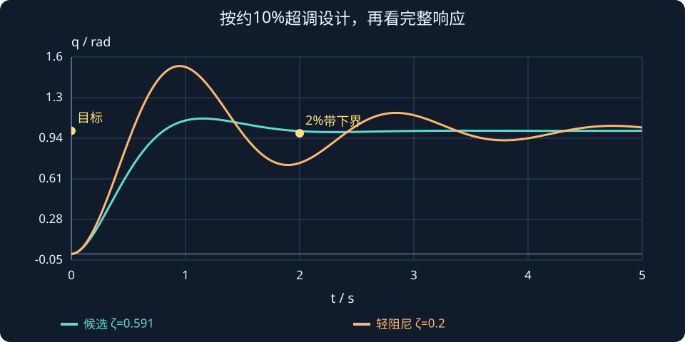

# 第 5 课：时间响应指标与 PD 控制器参数设计

> 本课目标：从“已知增益，分析响应”转向“根据超调与调节时间要求，设计 PD 参数”；了解设计公式的假设、误差和验证方法。完成本课后，你应能从指标要求独立计算 $K_p$、$K_d$ 并用 MATLAB 检查。

## 1. 为什么要从分析走向设计？

前四课我们已会求单关节闭环传递函数、阻尼比、极点。实际控制任务往往先给你**性能要求**，而不是增益。例如：

> 机械臂从 $0^\circ$ 运动到 $90^\circ$，超调量不超过 $10\%$，2% 调节时间不超过 $2\;\mathrm s$。已知转动惯量 $J=1\;\mathrm{kg\cdot m^2}$，请设计 PD 控制器。

还是沿用此前的理想模型：


$$
\boxed{J\ddot q=\tau},\qquad\boxed{\tau=K_p(q_d-q)-K_d\dot q}
$$


假设：目标角度 $q_d$ 固定；初始位置、速度为零；忽略重力、摩擦、外部扰动、电机力矩限制、时延和采样影响。这些条件使系统可以按标准线性二阶模型分析。**真实工程需要在此基础上再做约束验证。**

## 2. 四个阶跃响应性能指标

| 指标 | 符号 | 含义及注意事项 |
|---|---|---|
| 上升时间 | $T_r$ | 从较低响应百分比上升到较高百分比的时间。常用 10%–90%，但也有 0%–100% 的约定 |
| 峰值时间 | $T_p$ | 第一次达到超调峰值的时间；典型欠阻尼阶跃可计算 |
| 百分比超调量 | $M_p$ | 响应峰值超过最终稳定值的比例 |
| 调节时间 | $T_s$ | 响应进入、并在之后**始终保持**于指定误差带内所需的时间 |

### 百分比超调量

对于从零开始、最终正向稳定在 $y_\infty$ 的阶跃响应：


$$
\boxed{M_p=\frac{y_{\max}-y_\infty}{|y_\infty|}\times100\%}
$$


更一般地，正向阶跃应以最终变化量 $|y_\infty-y_0|$ 为分母。例如目标 $90^\circ$，最大到达 $108^\circ$，那么：


$$
M_p=\frac{108-90}{90}\times100\%=\boxed{20\%}
$$


如果最高只到 $99^\circ$，则超调量为 $10\%$。

### 2% 调节时间

目标 $90^\circ$，2% 允许误差为 $1.8^\circ$，因此范围是：


$$
\boxed{[88.2^\circ,\;91.8^\circ]}
$$


**第一次进入这个范围不算结束**。只有进入后再也不离开，这个时刻才是调节时间。超调比较大的欠阻尼响应可能多次进出误差带。

## 3. 将 PD 闭环系统写为标准二阶形式

对于本课的理想机械臂，闭环传递函数为：


$$
T(s)=\frac{Q(s)}{Q_d(s)}=\frac{K_p}{Js^2+K_ds+K_p}
$$


把分子、分母同时除以 $J$：


$$
T(s)=\frac{K_p/J}{s^2+\frac{K_d}{J}s+\frac{K_p}{J}}
$$


标准、无有限零点、直流增益为 1 的二阶传递函数：


$$
\boxed{T(s)=\frac{\omega_n^2}{s^2+2\zeta\omega_ns+\omega_n^2}}
$$


比较系数：


$$
\omega_n^2=\frac{K_p}{J},\qquad 2\zeta\omega_n=\frac{K_d}{J}
$$


因此：


$$
\boxed{\omega_n=\sqrt{\frac{K_p}{J}}},\qquad\boxed{\zeta=\frac{K_d}{2\sqrt{JK_p}}}
$$


- $\zeta$：阻尼比，无量纲，主要反映振荡和超调特性。
- $\omega_n$：自然角频率（rad/s），反映系统固有时间尺度。
- $J$：等效转动惯量；$K_p$：位置增益；$K_d$：速度反馈增益。

此处两个参数的直观作用是：**先用阻尼比选振荡幅度，再用自然角频率调整响应快慢。** 这是标准二阶系统下的分工，不可直接推广到所有非线性机器人系统。

## 4. 第一步：根据超调量设计阻尼比

对 $0<\zeta<1$ 的标准欠阻尼二阶系统：


$$
\boxed{M_p=e^{-\frac{\pi\zeta}{\sqrt{1-\zeta^2}}}\times100\%}
$$


若目标反过来是从允许超调求 $\zeta$，先把百分比变成小数：


$$
m_p=\frac{M_p}{100}
$$


反解得到：


$$
\boxed{\zeta=\frac{-\ln(m_p)}{\sqrt{\pi^2+[\ln(m_p)]^2}}},\qquad0<m_p<1
$$


**不要把 $10\%$ 直接代入 10，应该代入 0.10。**

本题要求 $M_p\leq10\%$，因此：


$$
\zeta_{\min}=\frac{-\ln(0.1)}{\sqrt{\pi^2+[\ln(0.1)]^2}}\approx\boxed{0.591}
$$


我们选择留有余量的 $\zeta=0.7$，其标准二阶阶跃的理论超调约：


$$
M_p\approx\boxed{4.6\%}
$$


| 允许的最大超调量 | 最小阻尼比（约） |
|---|---:|
| $20\%$ | 0.456 |
| $10\%$ | 0.591 |
| $5\%$ | 0.690 |
| $2\%$ | 0.780 |
| $1\%$ | 0.826 |

要求无超调时，可以考虑 $\zeta\geq1$，但此时不能使用上面的**欠阻尼超调反解式**。并且 $\zeta$ 过大可能因慢极点而延长响应尾部（回顾第 4 课）。

## 5. 第二步：根据调节时间设计自然角频率

标准欠阻尼二阶系统常用的 **2% 调节时间工程近似**：


$$
\boxed{T_s\approx\frac{4}{\zeta\omega_n}}
$$


它基于指数衰减包络的简化估算，并非严格的调节时间公式；特别接近性能边界时，一定要以真实阶跃曲线或数值仿真核对。

要求 $T_s\leq2\;\mathrm s$、已选择 $\zeta=0.7$，代入：


$$
\frac{4}{0.7\omega_n}\leq2\quad\Longrightarrow\quad\omega_n\gtrsim2.857\;\mathrm{rad/s}
$$


取一个方便计算的值：


$$
\boxed{\omega_n=3\;\mathrm{rad/s}}
$$


估算结果：


$$
T_s\approx\frac{4}{0.7\times3}=\boxed{1.90\;\mathrm s}
$$


**这里有一个近似误差需要注意：** 本题精确标准二阶阶跃响应的 2% 调节时间约为 **1.99 s**，而不是精确等于 1.90 s。1.90 s 来自近似式；1.99 s 来自最后一次穿越 2% 误差带的时刻。因此离 2 s 设计边界非常近，真实电机应进一步留余量。

对欠阻尼标准二阶系统，还可以引入阻尼振荡角频率及首次峰值时间：


$$
\omega_d=\omega_n\sqrt{1-\zeta^2}
$$


$$
\boxed{T_p=\frac{\pi}{\omega_d}=\frac{\pi}{\omega_n\sqrt{1-\zeta^2}}}
$$


当 $\zeta=0.7$、$\omega_n=3$ 时，$T_p\approx1.47\;\mathrm s$。

## 6. 第三步：计算 PD 增益

由标准二阶形式的系数对应关系：


$$
\omega_n^2=\frac{K_p}{J},\qquad 2\zeta\omega_n=\frac{K_d}{J}
$$


得到控制器设计的**两条关键公式**：


$$
\boxed{K_p=J\omega_n^2}
$$


$$
\boxed{K_d=2\zeta J\omega_n}
$$


本题 $J=1$、$\zeta=0.7$、$\omega_n=3$：


$$
K_p=1\times3^2=\boxed{9\;\mathrm{N\cdot m/rad}}
$$


$$
K_d=2\times0.7\times1\times3=\boxed{4.2\;\mathrm{N\cdot m\cdot s/rad}}
$$


代回控制律：


$$
\boxed{\tau=9(q_d-q)-4.2\dot q}
$$


这里 $q$ 用弧度 rad，$\dot q$ 用 rad/s。代码或实物接口如使用“度”，必须先转换单位，否则控制器增益的物理意义会变。


## 从“最多超调多少”倒推一套 PD 参数

对 $J=1$ 的理想惯量关节，希望 1 rad 阶跃的超调不超过约 10%，2% 调节时间约 2 s。先由超调反算阻尼比：

$$
\zeta=\frac{-\ln(0.1)}{\sqrt{\pi^2+[\ln(0.1)]^2}}\approx0.591.
$$

再用经验调节时间选择自然角频率：

$$
\begin{aligned}
\omega_n&\approx\frac4{\zeta t_s}\approx3.383\ \mathrm{rad/s},\\
K_p&=J\omega_n^2\approx11.45,\\
K_d&=2\zeta J\omega_n\approx4.00.
\end{aligned}
$$

这里先通过指标得到候选极点，再得到增益，而不是在两个滑块上盲目试。两条约束都带模型条件，尤其调节时间公式只是近似；最终应以仿真或解析响应量测为准。

图中画出这套候选设计与更轻阻尼的对照。比较时记录超调、进入误差带的时刻和控制力矩；“图看着更快”不足以说明设计更好。



**读图与操作**：在设计交互中设 $ζ≈0.591$、$ωn≈3.383$，再增加惯量；核对生成的增益以及目标响应。

**使用条件**：固定目标的 PD、无延迟、无零点、无饱和；$ts≈4/(ζωn)$ 是2%经验式。

### 先预测，再展开核对

若惯量增加为 2，仍要保持同样二阶特性，Kp、Kd 如何变化？

<details><summary>查看思路与答案</summary>

两者都应乘 2，约为 22.9、8.0；若执行器力矩不够，就不能假设响应指标仍可实现。

</details>

## 7. 交互演示：从二阶参数自动生成 PD 控制器

调整 $J$、$\zeta$、$\omega_n$，观察它们如何影响 $K_p$、$K_d$、超调以及响应速度。初始值就是上面设计的 $J=1,\zeta=0.7,\omega_n=3$。

:::demo design j=1 zeta=0.7 wn=3
:::

**观察任务：**

1. 固定 $J,\zeta$，把 $\omega_n$ 从 3 调到 5：超调百分比基本不变，但响应更快，所需增益增大。
2. 固定 $J,\omega_n$，逐步增大 $\zeta$：振荡减弱；进入过阻尼区后不一定更快。
3. 固定 $\zeta,\omega_n$，把 $J$ 加倍：理想位置曲线保持接近不变，但是 $K_p, K_d$ 都需加倍，这不代表实际电机的力矩一定足够。

## 8. MATLAB：仿真并测量实际性能

以下使用 MATLAB 自带的 `ode45`，**不需要 Control System Toolbox**。代码完整包括控制器计算、常微分方程、超调量和 2% 调节时间计算。

```matlab
clc;
clear;
close all;

% 1. 机械臂和目标
J = 1;              % kg*m^2
zeta = 0.7;         % 阻尼比
wn = 3;             % 自然角频率 rad/s
q_ref = pi/2;       % 固定目标 90 deg (rad)

% 2. 反算PD参数
Kp = J*wn^2;
Kd = 2*zeta*J*wn;

% 3. 状态方程 x = [角度; 角速度]
f = @(t,x) [
    x(2);
    (Kp*(q_ref-x(1))-Kd*x(2))/J
];

% 4. 轨迹仿真
tspan = linspace(0,6,1201);
x0 = [0;0];
[t,x] = ode45(f,tspan,x0);
q_deg = x(:,1)*180/pi;
q_target = 90;

% 5. 超调与2%调节时间
Mp = max(0, (max(q_deg)-q_target)/q_target*100);
band = 0.02*q_target;
outside = find(abs(q_deg-q_target) > band);
if isempty(outside)
    Ts = 0;
elseif outside(end)==numel(t)
    Ts = NaN;  % 观察窗口结束时仍不满足
else
    Ts = t(outside(end)+1);
end
fprintf('Kp = %.2f, Kd = %.2f\n',Kp,Kd);
fprintf('Mp = %.2f %%\n', Mp);
fprintf('Ts(2%%) = %.3f s\n',Ts);

% 6. 绘制阶跃响应
figure;
plot(t,q_deg,'b','LineWidth',1.5);
hold on;
yline(90,'k--','目标 90°');
yline(91.8,'r:','2%上限');
yline(88.2,'r:','2%下限');
xlabel('时间 (s)');
ylabel('关节角度 (deg)');
title('性能指标驱动的PD参数设计');
grid on;
```

**预期：** $K_p=9$，$K_d=4.2$，超调约 4.6%，2% 调节时间约 1.99 s。数值结果受采样点、ODE 求解容差影响，会有少量偏差。

### 工程检查：控制力矩是否可实现？

起始时刻 $q(0)=0,\dot q(0)=0$，目标为 $\pi/2$，故：


$$
\tau(0)=K_p\frac{\pi}{2}=9\frac{\pi}{2}\approx\boxed{14.14\;\mathrm{N\cdot m}}
$$


若真实电机的输出力矩最大只有 5 N·m，控制器初始指令已经超限，理想曲线自然无法原样实现。因此“数学上满足超调、调节时间”不等同于“真实硬件可直接部署”。

## 9. 本课练习与参考解答

### 练习一：计算控制器增益

给定 $J=2$、$\zeta=0.7$、$\omega_n=4$，求 $K_p$、$K_d$。

<details><summary>参考答案</summary>


$$
K_p=J\omega_n^2=2\times4^2=\boxed{32}
$$


$$
K_d=2\zeta J\omega_n=2\times0.7\times2\times4=\boxed{11.2}
$$


</details>

### 练习二：超调不能超过 5%

计算阻尼比的下限。提示：$m_p=0.05$。

<details><summary>参考答案</summary>


$$
\zeta\geq\frac{-\ln(0.05)}{\sqrt{\pi^2+[\ln(0.05)]^2}}\approx\boxed{0.690}
$$


可选择 $\zeta=0.7$，其超调约 4.6%。

</details>

### 练习三：自然角频率加倍

当 $J$ 与 $\zeta$ 不变、$\omega_n$ 加倍时，$M_p$、$T_s$、$K_p$、$K_d$ 怎样变化？

<details><summary>参考答案</summary>

- $M_p$ **不变**，因为标准二阶欠阻尼系统的超调由 $\zeta$ 决定。
- 2% 调节时间的近似值**减半**。
- $K_p$ **变为四倍**：$K_p=J\omega_n^2$。
- $K_d$ **变为两倍**：$K_d=2\zeta J\omega_n$。

</details>

## 10. 本课总结：一条完整的设计链

1. **指标要求** → 确定允许的超调与调节时间。
2. **超调指标** → 反算 $\zeta$；**时间指标** → 估算 $\omega_n$。
3. **控制增益** → $K_p=J\omega_n^2$、$K_d=2\zeta J\omega_n$。
4. **仿真验证** → 检查数值调节时间、超调、力矩限制、扰动影响。

本课建立的是“理想单关节线性二阶模型”的入门设计方法。复杂机械臂还有重力、耦合、负载变化、传感噪声、采样延迟等问题，不能直接套用这里的公式而忽略这些条件。

**第 5 课已完成；第 6 课尚未开始。**


## 课程衔接与条件检查

### PD 是简单状态反馈的物理入口

恒定目标下，令误差状态 $x_e=[q-q_d,\dot q]^{\mathsf T}$，则 $u=-K_px_{e1}-K_dx_{e2}$。这就是使用位置、速度两个状态的反馈。后续的状态反馈会推广到更多状态。

若参考随时间变化，$\dot e=\dot q_d-\dot q$，使用误差导数与只对测量速度做微分不再完全等价。例：参考位置突然跳变时，直接微分参考会产生冲击趋势；对测量微分则避免这部分冲击，实际还需要滤波。

**自查**：若惯量增加为 2，仍要保持同样二阶特性，Kp、Kd 如何变化？
