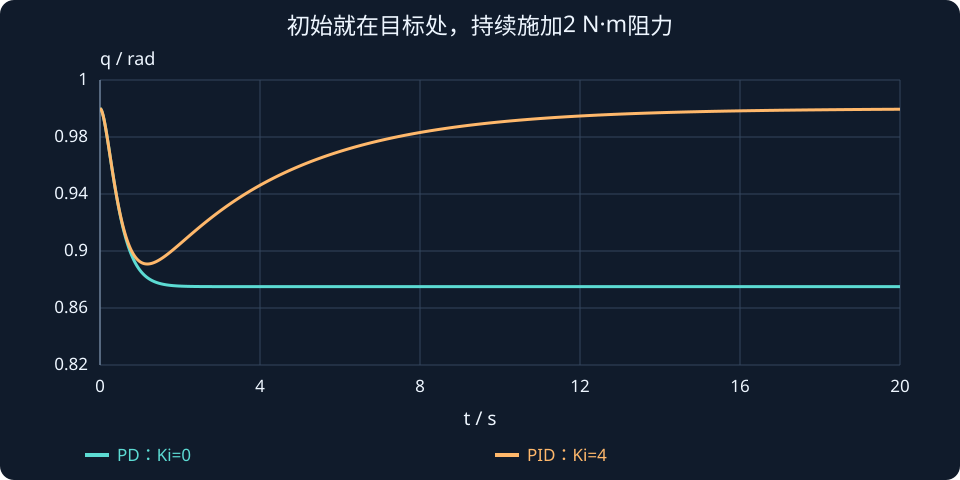

# 第 6 课：积分控制、稳态误差与积分饱和

> **内容来源说明**：本课根据课程交接信息和已找回的练习批改记录重建，不是对原始讲解逐字恢复。历史答案与批改单独标注；讲解部分为补全知识链而扩写的版本。

## 本课想解决的问题

前几课学习了 P、PD 控制。本课从一个实际现象开始：电机把关节转到目标附近后，为什么它会停在差一点点的位置？积分项为什么能把这段误差消掉？又为什么加入积分后，有时反而会冲过头？

## 1. 一个持续外力作用下的关节

先用最简单的转动惯量模型：

$$
J\ddot q=\tau-d
$$

$q$ 是关节角度，$\dot q$ 是角速度，$\ddot q$ 是角加速度；$J$ 是转动惯量，越大越难加速；$\tau$ 是电机力矩；$d$ 是持续存在的外扰，例如负载重力、摩擦的近似影响。这里约定 $d>0$ 会抵消电机产生的正向力矩。

控制目标是角度 $q_d$，位置误差定义为：

$$
e=q_d-q
$$

$e>0$ 表示还没到目标；$e<0$ 表示已经超过目标。

## 2. PD 控制为什么留下静差

固定目标时，PD 控制为：

$$
\tau=K_pe-K_d\dot q
$$

比例项根据“差了多少”产生力矩；微分项根据当前运动速度提供阻尼。假设关节已经停稳，便有 $\dot q=0$、$\ddot q=0$。动力学要求电机力矩正好抵消外扰：

$$
0=J\ddot q=\tau-d\quad\Longrightarrow\quad\tau=d
$$

此时微分项为零，控制力矩只剩 $K_pe$，所以：

$$
K_pe_{ss}=d
\quad\Longrightarrow\quad
\boxed{e_{ss}=\frac{d}{K_p}}
$$

这不是控制器“没把位置调准”，而是 P 项需要保留一段误差来继续产生抵消外力的力矩。若误差完全为零，P 项也为零，电机就没有力矩抵消 $d$，关节会重新偏移。

### 数值例子

令 $K_p=16$、$d=2\;\mathrm{N\cdot m}$：

$$
e_{ss}=\frac{2}{16}=0.125\;\mathrm{rad}
\approx 7.16^\circ
$$

若目标为 $90^\circ$，最终角度约为 $82.84^\circ$。把 $K_p$ 加倍到 32，静差减半到 $0.0625$ rad，但有限的 $K_p$ 仍会留下非零误差。无限增大 $K_p$ 也不现实，因为它会使控制力矩更激进、放大噪声并更容易撞上执行器上限。

## 3. 积分项为什么能补偿扰动

积分状态把误差随时间累积起来：

$$
z(t)=\int_0^t e(\lambda)\,d\lambda
$$

可以把它想成误差的“记账本”：误差连续为正，账本上的数逐渐增大；误差连续为负，账本往负方向变化。误差后来变为零时，积分值不会自动清零，而是保留已经记下来的值。

PID 控制律写为：

$$
\tau=K_pe+K_i z-K_d\dot q
$$

$K_i z$ 是积分力矩。固定目标并停稳后，微分项为零，积分力矩与比例力矩一起抵消外扰：

$$
d=K_pe_{ss}+K_i z_{ss}
$$

如果稳态时误差仍为一个常数，积分状态就会继续以 $\dot z=e_{ss}$ 的速度变化，系统并没有真正达到平衡。于是，只要闭环稳定、$K_i>0$、执行器没有饱和且有足够力矩，系统会继续调整，让误差趋近零，并由积分项留下所需的保持力矩。

仍取 $d=2$ N·m、$K_i=4$。若最终 $e_{ss}=0$，保持扰动所需的是 $K_i z_{ss}=2$，所以积分状态会留在 $z_{ss}=0.5$，由积分项提供保持力矩。

**适用条件要记住**：加了积分并不保证任何情况下误差都为零。若外扰超过电机能力、执行器饱和、闭环不稳定或系统无法达到稳态，结论不成立。

## 4. 积分的副作用：windup

想象关节从 $0^\circ$ 转向 $90^\circ$，电机力矩最多只能输出 $5$ N·m：

1. 初始误差很大，控制器希望输出远大于 $5$ N·m。
2. 电机实际只能输出上限 $5$ N·m，关节运动速度受限。
3. 如果积分器仍按误差持续累积，内部记下的积分越来越大。
4. 关节接近目标甚至超过目标时，P、D 项已经要求减速或反向。
5. 但积分项里还存着很大的正值，合成命令仍可能是正的。
6. 控制器要先“消掉旧积分”，才能真正反向制动。

结果就是超调很大、回正很慢，或长时间顶在力矩上限。这称为**积分饱和**（integral windup）。

类比：如果你最多每秒搬 5 箱，控制器却一直要求每秒搬 20 箱并把没完成的任务记成欠账，后来任务方向反了，你还得先处理旧欠账。执行器达不到的命令被积分器不断记账，就是 windup。

## 5. 简单处理：积分限幅

限制积分状态大小：

$$
z\leftarrow\operatorname{clip}(z,-z_{\max},z_{\max})
$$

每次更新后若 $z$ 超出范围，就把它夹回上下限。这能防止积分无限增长，但限值太宽，windup 还是可能严重；限值太窄，积分又可能不够补偿扰动。第 8 课会进一步学习“饱和时该暂停还是允许积分”。


## 积分到底存了什么，为什么能提供“保持力矩”？

设恒定阻力 d=2 N·m 与驱动方向相反，模型为：

$$
J\ddot q=\tau-d,\qquad
\tau=K_pe+K_iz-K_d\dot q,\qquad \dot z=e.
$$

若只有 PD，静止时速度与加速度都为零，需要比例力矩抵消阻力：

$$K_pe_{ss}=d\quad\Longrightarrow\quad e_{ss}=\frac2{16}=0.125\ \mathrm{rad}.$$

加入积分后，如果稳定收敛且执行器能提供所需力矩，误差可以为零，而积分状态停在非零值：

$$K_iz_{ss}=d\quad\Longrightarrow\quad z_{ss}=\frac24=0.5\ \mathrm{rad\,s}.$$

这就是积分器的记忆：误差已经消失，先前积累的 z 仍保留，因此仍能输出 2 N·m。它不是“误差为零就清零”。若把 z 每周期重置，保持力矩也会丢失。

图中从目标处受到阻力开始比较 PD 与 PID，PD 留下静差，PID 在本例稳定参数下恢复目标。下方交互还带限幅，增大阻力时可能失去恢复能力，需要同时看可实现力矩。



**读图与操作**：先固定 Kp=16、阻力2，比较 Ki=0 与 Ki=4；再增大阻力。注意演示初始位置与本节静差对照图不同，平衡关系相同。

**使用条件**：阻力方向明确、恒定目标；积分消静差以稳定、无积分泄漏和输入可实现为前提。

:::demo design
:::

### 先预测，再展开核对

将 Ki 从 4 改成 8，所需的积分保持状态是多少？能否因此保证收敛更好？

<details><summary>查看思路与答案</summary>

平衡所需 zss=0.25 rad·s；平衡值变小不代表动态更好，仍需检查稳定性、过冲和饱和。

</details>

## 6. MATLAB：比较 PD 与 PID

下面用简单欧拉积分模拟一个惯量和常值扰动。为专注观察静差，本例暂不加入力矩饱和。

```matlab
clear; clc
J = 1; d = 2; qd = pi/2;
Kp = 16; Kd = 5; Ki = 4;
dt = 0.001; T = 8; N = round(T/dt)+1;
t = (0:N-1)'*dt;
qPD=zeros(N,1); vPD=zeros(N,1);
qPID=zeros(N,1); vPID=zeros(N,1); z=0;

for k=1:N-1
    ePD=qd-qPD(k);
    tauPD=Kp*ePD-Kd*vPD(k);
    aPD=(tauPD-d)/J;
    vPD(k+1)=vPD(k)+aPD*dt;
    qPD(k+1)=qPD(k)+vPD(k+1)*dt;

    e=qd-qPID(k);
    tauPID=Kp*e+Ki*z-Kd*vPID(k);
    aPID=(tauPID-d)/J;
    vPID(k+1)=vPID(k)+aPID*dt;
    qPID(k+1)=qPID(k)+vPID(k+1)*dt;
    z=z+e*dt;
end
plot(t,qPD*180/pi,'LineWidth',1.4); hold on
plot(t,qPID*180/pi,'LineWidth',1.4);
yline(qd*180/pi,'--'); grid on
xlabel('时间 (s)'); ylabel('角度 (deg)');
legend('PD','PID','目标');
```

PD 曲线应停在目标以下；PID 在误差累积后会逐渐补偿扰动。仿真里若加入力矩限幅，再观察积分状态，就能看到 windup。

## 7. 练习及已知批改

1. $K_p=20$、$K_d=5$、$d=4\;\mathrm{N\cdot m}$，计算 PD 稳态误差。
2. 选择正确说法：A. 积分累积持续误差，并在理想稳定且未饱和时补偿常值扰动；B. 积分只看当前误差，与过去无关。
3. 解释积分为何会导致超调、执行器限幅会带来什么影响，并提出改进和局限。

**历史提交与批改：**

- 第 1 题你答 $4/20$，正确，$e_{ss}=0.2$ rad，约 $11.46^\circ$。
- 第 2 题你选 A，正确。
- 第 3 题你指出上升阶段的误差会持续累积，积分力矩会增长；执行器受力矩上限限制时不能及时反向。你提出给积分状态设最大值，方向正确。限幅能控制积分规模，但不一定完全消除 windup；条件积分和反算方法能更直接处理饱和期间的积分状态。

## 本课小结

P 看现在差多少；I 看误差累计了多久、累计多少；D 看运动有多快。积分能留下保持力矩、补偿持续扰动，但执行器饱和时也可能留下过量的积分“欠账”。真实控制器要把积分与力矩上限、抗饱和逻辑一起考虑。

## 课程衔接与条件检查

### 型别分析与积分器的稳定代价

积分作用在误差持续存在时累积输入，可提供保持目标所需的恒定力矩，但不保证任意积分增益都稳定。理想无阻尼惯量配 PID 时，闭环特征式为 $Js^3+K_ds^2+K_ps+K_i$；正参数之外，还需 $K_dK_p>JK_i$。若只有 PI 且模型完全无阻尼，s² 项为零，正积分增益不能得到严格稳定。

例如 J=1、Kd=3、Kp=2 时，需 0<Ki<6。这与 Routh 课的例子完全相连。随后“稳态误差与终值定理”会补上型别、输入类型和适用条件。

**自查**：将 Ki 从 4 改成 8，所需的积分保持状态是多少？能否因此保证收敛更好？
