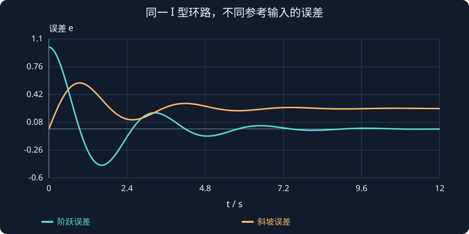

# 第 7 课：稳态误差与终值定理

> 阶段 0 · 从机械臂能否准确到达目标出发，理解稳态误差、积分环节和终值定理。

## 1. 机械臂停下了，就到达目标了吗？

想象你让机械臂转到 **1 rad**。它从零开始转动，后来停在 0.8 rad，不再继续移动。它的运动稳定下来了，但距离目标还差 0.2 rad。

用 $r(t)$ 表示目标位置，$y(t)$ 表示实际位置，二者的差叫作**跟踪误差**：

$$
e(t)=r(t)-y(t).
$$

例如目标为 1 rad、实际位置为 0.8 rad，则误差为 0.2 rad。如果误差过了很长时间趋近于一个固定值，这个值叫**稳态误差**：

$$
e_{ss}=\lim_{t\to\infty}e(t).
$$

下标 ss 是 steady state（稳态）的缩写。系统能稳定停下、停得快、停得准，是需要分别判断的事情。若误差一直振荡、始终没有确定的极限，就不能直接说它有某个稳态误差。

## 2. 先动手：为什么有的系统最后还差一点？

下面的交互比较两个单位负反馈环路：0 型 $L(s)=K/(s+1)$，和 I 型 $L(s)=K/[s(s+1)]$。纵轴画的是**误差**，不是机械臂位置。保持 $K=4$，先选单位阶跃，再切换型别。

:::demo bridge-lab mode=steady
:::

请依次观察：

1. 选 **0 型、单位阶跃**：误差从 1 逐渐下降，最后接近 0.2。
2. 保持 $K=4$，改选 **I 型**：误差会经历振荡，但最终趋近于零。
3. 把输入改成**单位斜坡**：I 型的误差最终接近 0.25。观察时间有限时，曲线末端只是近似值。

这两个模型用于展示积分环节和输入类型的影响。接下来我们把数值逐步算出来。

## 3. 单位负反馈的误差从哪里来？


为看清反馈关系，先假设零初始条件、单位负反馈，目标和输出的拉普拉斯变换分别为 $R(s)$、$Y(s)$。把控制器 $C(s)$ 和对象 $G(s)$ 相乘，记为环路传递函数：

$$
L(s)=C(s)G(s).
$$

误差是目标减输出，而误差通过环路产生输出：

$$
E(s)=R(s)-Y(s),\qquad Y(s)=L(s)E(s).
$$

将第二个式子代入第一个式子，一步一步整理：

$$
\begin{aligned}
E(s)&=R(s)-L(s)E(s),\\
[1+L(s)]E(s)&=R(s),\\
E(s)&=\frac{R(s)}{1+L(s)}.
\end{aligned}
$$

这就是本课的起点：**先写出目标输入 $R(s)$ 和环路 $L(s)$，再算误差 $E(s)$。** 如果反馈不是单位反馈，比较点信号未必等于真实的 $r-y$，要重新根据框图推导。

## 4. 0 型例子：目标为 1，为什么最后差 0.2？

取交互中的 0 型环路：

$$
L(s)=\frac4{s+1}.
$$

目标从 0 跳到 1 并一直保持，叫单位阶跃；它的拉普拉斯变换为 $R(s)=1/s$。代入误差公式：

$$
\begin{aligned}
E(s)&=\frac{1/s}{1+4/(s+1)}\\
&=\frac{s+1}{s(s+5)}\\
&=\frac{0.2}{s}+\frac{0.8}{s+5}.
\end{aligned}
$$

回到时间域：

$$
e(t)=0.2+0.8e^{-5t}.
$$

开始时 $e(0)=1$；随着时间增加，指数项 $0.8e^{-5t}$ 逐渐消失，最终只剩 $0.2$。因此目标是 1 时，输出趋于 $1-0.2=0.8$。

这个闭环的特征方程是 $s+5=0$，极点为 $-5$，所以这里的响应会收敛。增益增大可减小这个例子的误差；增益能否无限增大仍要看实际系统稳定性和执行器限制。

## 5. 只求最后的误差：终值定理

每次都求完整的 $e(t)$ 有时比较麻烦。如果满足终值定理条件，可以从 $E(s)$ 直接求最终值：

$$
e_{ss}=\lim_{s\to0}sE(s).
$$

对上面的例子：

$$
\begin{aligned}
e_{ss}&=\lim_{s\to0}s\frac{s+1}{s(s+5)}\\
&=\lim_{s\to0}\frac{s+1}{s+5}\\
&=0.2.
\end{aligned}
$$

这相当于跳过求整条时间曲线，直接找长期结果。

### 为什么不能直接套？

例如 $E(s)=1/(s^2+1)$ 对应 $e(t)=\sin t$。形式上计算 $\lim_{s\to0}sE(s)=0$，但 $\sin t$ 一直振荡，并没有最终值。

对本课的有理函数，要先检查约分后 $sE(s)$ 的极点是否全部严格位于左半平面。还要留意模型中可能被约掉的内部不稳定动态。**先检查条件，再使用终值定理。**

## 6. 多一个积分，为什么阶跃误差可以为零？

现在选择 I 型环路：

$$
L(s)=\frac4{s(s+1)}.
$$

其中 $1/s$ 是积分环节。先检查闭环：

$$
1+L(s)=0\quad\Longrightarrow\quad s^2+s+4=0.
$$

它的根是 $-1/2\pm j\sqrt{15}/2$，实部小于零。对单位阶跃：

$$
\begin{aligned}
E(s)&=\frac{1/s}{1+4/[s(s+1)]}\\
&=\frac{s+1}{s^2+s+4},\\
e_{ss}&=\lim_{s\to0}\frac{s(s+1)}{s^2+s+4}=0.
\end{aligned}
$$

直觉上，积分会积累过去的误差。当目标是固定值，积分器可以保留已经积累的作用，帮助提供维持输出所需的输入。这与第 6 课的“保持力矩”相联系。

注意结论的条件：**本例闭环稳定**。单纯增加积分环节不能保证闭环稳定，也不能忽略实际执行器饱和。

<details><summary>想一想：目标从 0 跳到 2，最终误差是多少？</summary>

对同一个稳定模型，输入从单位阶跃变为幅值 2 的阶跃。根据线性系统的比例关系，误差也变成原来的两倍；原来的稳态误差为 0，两倍仍为 0。

</details>

## 7. 目标一直移动，还能完全跟上吗？

固定目标相当于“到达一个位置”；现在让目标每秒增加 1：

$$
r(t)=t,\qquad R(s)=\frac1{s^2}.
$$

这叫单位斜坡输入。对刚才稳定的 I 型环路：

$$
\begin{aligned}
E(s)&=\frac{1/s^2}{1+4/[s(s+1)]}\\
&=\frac{s+1}{s(s^2+s+4)},\\
e_{ss}&=\lim_{s\to0}\frac{s+1}{s^2+s+4}=0.25.
\end{aligned}
$$

这意味着，暂态衰减后，输出和目标都持续增加，输出大约落后 0.25。比如目标到 10 时，输出大约是 9.75；目标继续到 11 时，输出大约是 10.75。**误差为 0.25 不等于输出停在 0.75。**



回到上方交互，固定 I 型和 $K=4$，切换阶跃与斜坡，比较误差最终的变化。若斜坡改为 $r(t)=2t$，由于这个线性闭环稳定，误差随输入幅值加倍，稳态误差为 0.5。

## 8. 0 型、I 型、II 型与误差常数

系统型别数的是**环路 $L(s)$ 约分后原点极点的个数**。例如 $4/(s+1)$ 是 0 型，$4/[s(s+1)]$ 是 I 型。原点极点可以来自控制器，也可以来自对象。

下表适用于单位负反馈、对应闭环稳定且终值定理适用的情况。单位抛物线输入指 $r(t)=t^2/2$。

| 型别 | 单位阶跃误差 | 单位斜坡误差 | 单位抛物线误差 |
|---|---|---|---|
| 0 型 | $1/(1+K_p)$ | 通常无界 | 通常无界 |
| I 型 | 0 | $1/K_v$ | 通常无界 |
| II 型 | 0 | 0 | $1/K_a$ |

其中三个**静态误差常数**定义为：

$$
K_p=\lim_{s\to0}L(s),\qquad
K_v=\lim_{s\to0}sL(s),\qquad
K_a=\lim_{s\to0}s^2L(s).
$$

这里的 $K_p$ 是位置误差常数，和 PID 中的比例增益可能恰好同名，但定义不同。对本课 I 型例子：

$$
K_v=\lim_{s\to0}\frac4{s+1}=4,\qquad e_{ss}=\frac1{K_v}=0.25.
$$

不要只看型别查表。例如 $L(s)=K/s^2$（$K>0$）虽然是 II 型，闭环极点为 $\pm j\sqrt K$，会持续振荡；此时不能按上表声称稳态误差为零。

## 9. 跟踪误差和抗扰误差

前面的推导关注参考输入。如果扰动 $d$ 加在对象输入端，单位负反馈下：

$$
Y=GC(R-Y)+GD,\qquad
E=\frac{R}{1+GC}-\frac{GD}{1+GC}.
$$

目标和扰动通过不同通道影响误差。判断能否消除扰动，需要说明扰动加在哪里、是什么信号，以及闭环是否稳定；执行器受限时还要检查是否有足够的力矩补偿。

## 10. MATLAB：把刚才的曲线画出来

下面使用 Control System Toolbox；先看闭环极点，再分别画误差对阶跃和斜坡的响应。

```matlab
s = tf('s');
L0 = 4/(s+1);
L1 = 4/(s*(s+1));
S0 = feedback(1,L0);  % 参考输入到误差
S1 = feedback(1,L1);

disp(pole(feedback(L1,1))); % 先检查闭环极点
t = (0:0.01:20)';
figure; step(S0,S1,t); grid on;
legend('0型阶跃误差','I型阶跃误差');
figure; lsim(S1,t,t); grid on;
title('I型单位斜坡误差，最终应接近 0.25');
```

## 11. 练习与自查

1. 单位负反馈下，$L=9/(s+2)$。先求闭环极点，再求单位阶跃稳态误差。
2. 单位负反馈下，$L=6/[s(s+3)]$。先判断稳定性，再求单位阶跃和单位斜坡稳态误差。
3. 为什么不能仅凭 $L=K/s^2$ 是 II 型，就断定误差最终为零？
4. 一个系统跟踪单位斜坡时误差趋于 0.25，这是否意味着输出趋于 0.75？请用 $r(t)=t$ 举例。

<details><summary>展开答案与核对过程</summary>

1. 闭环极点为 $-11$；$K_p=9/2$，故单位阶跃误差为 $1/(1+9/2)=2/11$。
2. 特征方程为 $s^2+3s+6=0$，两根实部为 $-1.5$，闭环稳定。它是 I 型，阶跃误差为 0；$K_v=6/3=2$，单位斜坡误差为 $1/2$。
3. 对 $K>0$，闭环极点为 $\pm j\sqrt K$，持续振荡，不满足直接应用终值定理的条件。
4. 不是。暂态衰减后 $y(t)\approx t-0.25$，目标与输出都在增加，两者相差约 0.25。

</details>

**本课连接：** 第 6 课解释了积分如何积累误差；本课用输入类型、闭环稳定性和终值定理判断长期精度。下一课继续研究 PID 参数与执行器饱和。
