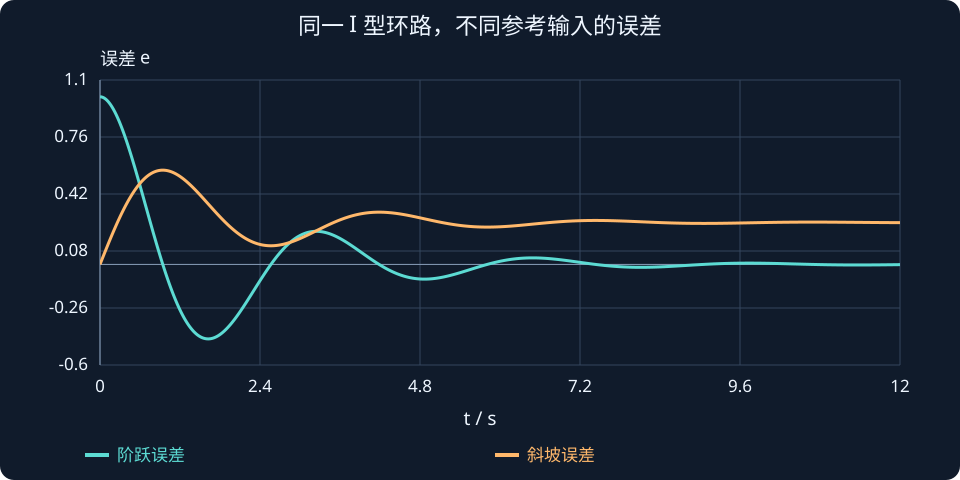

# 第 7 课：稳态误差与终值定理

> 阶段 0 · 接续积分控制，先检查稳定，再计算误差最终是否消失。


## 1. 跟上目标和最终没有误差是两回事

恒定目标为 1 时，输出最后停在 0.8，意味着稳态误差为 0.2；若输出不断振荡或增长，就不能说“最后差多少”。稳态误差评价长期跟踪精度，不评价超调、速度，也不能代替稳定性判断。

本课先限定单位负反馈：误差 $e=r-y$，控制器与对象乘积记为开环环路 $L=CG$。由 $Y=LE$ 和 $E=R-Y$ 得：


$$
E(s)=\frac{R(s)}{1+L(s)}.
$$


若传感器增益不是 1，比较器误差不再必然等于实际跟踪误差，必须回到信号关系重新推导。

## 2. 终值定理需要先验条件

在适用条件下 $e_{ss}=\lim_{s\to0}sE(s)$。对有理模型，常用充分条件是 sE(s) 的全部极点严格位于左半平面。操作顺序是：写 E，检查极点与内部稳定性，再代入极限。代入得到有限数并不能反过来证明定理适用。

反例 $E(s)=1/(s^2+1)$ 的时域误差是 $\sin t$。形式上 $\lim_{s\to0}sE(s)=0$，但正弦误差没有终值。错在把代数极限当成了时间极限。

## 3. 型别、参考输入与误差常数要一起看

型别数的是环路中的净积分环节，而不是对象阶数。先写：

$$
L(s)=\frac{K\widetilde L(s)}{s^\nu},\qquad 0<|\widetilde L(0)|<\infty.
$$

ν=0、1、2 分别称为 0 型、I 型、II 型。控制器中的积分也包括在 L 中。接下来区分参考输入：

| 参考 | 时域表达 | 拉普拉斯变换 |
|---|---|---|
| 单位阶跃 | t≥0 时为 1 | $1/s$ |
| 单位斜坡 | t | $1/s^2$ |
| 单位抛物线 | $t^2/2$ | $1/s^3$ |

对于单位阶跃，先从误差通道推导：

$$
\begin{aligned}
E(s)&=\frac{1}{s[1+L(s)]},\\
e_{ss}&=\lim_{s\to0}\frac{1}{1+L(s)}.
\end{aligned}
$$

如果低频环路增益有限，定义静态位置误差常数，得到：

$$
K_p=\lim_{s\to0}L(s),\qquad e_{ss}=\frac{1}{1+K_p}.
$$

这里 Kp 是整个环路的误差常数，与 PID 比例增益可能重名，但不一定是同一个数。若有足够积分使低频环路增益趋于无穷，稳定条件下的阶跃误差才趋于零。

对于单位斜坡：

$$
\begin{aligned}
E(s)&=\frac{1}{s^2[1+L(s)]},\\
e_{ss}&=\lim_{s\to0}\frac{1}{s[1+L(s)]},\\
K_v&=\lim_{s\to0}sL(s).
\end{aligned}
$$

稳定 I 型系统的单位斜坡误差为 1/Kv。斜坡幅值每秒增加，控制器即便最终保持固定落后距离，误差也不等于零。

| 型别 | 单位阶跃误差 | 单位斜坡误差 | 单位抛物线误差 |
|---|---|---|---|
| 0 型 | $1/(1+K_p)$ | 通常无界 | 通常无界 |
| I 型 | 0 | $1/K_v$ | 通常无界 |
| II 型 | 0 | 0 | $1/K_a$ |

表格的前提是相关闭环及终值条件成立。Ka 定义为低频 s²L 的极限；表格不能拿来证明稳定。

## 4. 两个正例与一个反例

### 4.1 0 型：增益 4 为什么仍有 0.2 误差？

$$
L(s)=\frac4{s+1},\qquad
E(s)=\frac{s+1}{s(s+5)}.
$$

将误差变换拆开：

$$
\begin{aligned}
E(s)&=\frac{0.2}{s}+\frac{0.8}{s+5},\\
e(t)&=0.2+0.8e^{-5t}.
\end{aligned}
$$

初始误差为 1，衰减后保留 0.2。增大比例增益可以减小该误差，但有限增益并没有让系统凭空多出积分。

### 4.2 I 型：位置阶跃能跟上，匀速斜坡仍有固定落后

$$
L(s)=\frac4{s(s+1)},\qquad
s^2+s+4=0.
$$

闭环根的实部都为 −0.5，系统稳定。计算两种输入：

$$
\begin{aligned}
\text{单位阶跃：}\quad e_{ss}&=0,\\
K_v&=\lim_{s\to0}\frac4{s+1}=4,\\
\text{单位斜坡：}\quad e_{ss}&=\frac14.
\end{aligned}
$$

在交互里，先用同一模型切换阶跃和斜坡，再比较误差曲线。不要把“斜坡误差 0.25”误读为“输出最终停在 0.75”：斜坡输入和输出都还在继续增加。

### 4.3 II 型不自动意味着稳定

$$
L(s)=\frac K{s^2},\qquad s^2+K=0,
\qquad s=\pm j\sqrt K\quad(K>0).
$$

该系统没有渐近稳定，不能套 II 型表格宣称跟踪优良。先判断稳定性，再计算稳态误差，这是本课必须坚持的顺序。


## 5. 跟踪误差和抗扰误差要分开推

若扰动 d 加在对象输入端，输出为 $Y=GC(R-Y)+G D$。因此 $E=R/(1+GC)-G D/(1+GC)$。参考信号与扰动通过不同通道影响误差。仅说“有积分，所以所有扰动都能消除”不够，还要交代扰动位置、类型、闭环稳定与执行器限幅。

工程上，积分器会累积误差，但力矩限幅后，所需平衡输入可能根本无法实现。应回到抗饱和和输入可行性检查，而不是继续增大积分增益。


## 斜坡误差为 0.25，不是“输出停在 0.75”

对环路 4/[s(s+1)]，闭环稳定。令参考为 r(t)=t，也就是每秒增加 1 个单位。单位斜坡误差的变换为：

$$
\begin{aligned}
E(s)&=\frac{s+1}{s(s^2+s+4)},\\
\omega_d&=\frac{\sqrt{15}}2,\\
e(t)&=\frac14+e^{-t/2}\left[-\frac14\cos(\omega_dt)+\frac{7}{8\omega_d}\sin(\omega_dt)\right].
\end{aligned}
$$

指数项衰减后，误差趋于 0.25，而输出近似为 y(t)=t−0.25。t=10 s 附近，参考约为 10，输出约为 9.75；再过 1 s，两者都继续上升，固定落后量不变。

图中把阶跃误差与斜坡误差放在同一坐标，注意曲线表示误差，不是输出。阶跃最终误差为零，斜坡最终误差为0.25，同一个闭环会因输入类型不同得到不同结论。



**读图与操作**：固定 I 型和 K=4，在阶跃/斜坡之间切换；预测初始误差，再观察长期误差。不要只看有限仿真终点。

**使用条件**：单位负反馈、零初态、稳定 I 型环路；误差单位与参考单位相同。

### 先预测，再展开核对

斜坡速度改成每秒 2 个单位，稳态误差是多少？

<details><summary>查看思路与答案</summary>

在线性且相同稳定条件下为 0.5；误差随斜坡斜率成比例。

</details>

## 交互实验

选择 0 型或 I 型模型，再选择单位阶跃或单位斜坡。比较理论稳态误差与有限时间曲线。K 变大不会改变系统型别；斜坡的有限时间误差也不一定已经达到稳态。

:::demo bridge-lab mode=steady
:::

## MATLAB 验证

```matlab
s=tf('s'); L0=4/(s+1); L1=4/(s*(s+1));
S0=feedback(1,L0); S1=feedback(1,L1);
t=(0:0.01:20)';
figure; step(S0,S1,t); grid on; legend('0型阶跃误差','I型阶跃误差');
figure; lsim(S1,t,t); grid on; title('I型单位斜坡误差：应趋于0.25');
disp(pole(feedback(L1,1)));
```

本例使用 Control System Toolbox。请先预测趋势，再运行程序核对；这里给出可运行示例，不代表已在 MATLAB 中执行。

## 公式、条件与符号


$$
E=\frac{R}{1+L},\qquad e_{ss}=\lim_{s\to0}sE(s).
$$


E 为误差的拉普拉斯变换，R 为参考输入变换，L=CG 为单位负反馈环路。终值定理需满足相应极点条件；还应排查隐藏不稳定模态。


$$
K_p=\lim_{s\to0}L(s),\quad K_v=\lim_{s\to0}sL(s),\quad K_a=\lim_{s\to0}s^2L(s).
$$


分别用于单位阶跃、斜坡、抛物线的误差分析。对于其他幅值，误差按参考输入幅值缩放。型别由环路在原点的净极点数确定，不能直接代表闭环稳定性。


## 练习与理解检查

1. 求 $L=9/(s+2)$ 的单位阶跃稳态误差，先检查闭环极点。
2. 求 $L=6/[s(s+3)]$ 的阶跃与斜坡误差。
3. 解释为什么 $L=K/s^2$ 不能只按 II 型表格下结论。
4. 把恒定扰动加到对象输入端，重新推导误差通道。


完成练习后逐题解释依据，问题澄清后再进入下一课。
