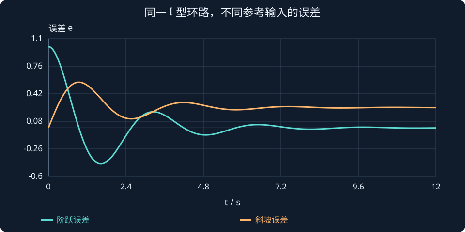

# 第 7 课：稳态误差与终值定理 · 复习

> 先理解误差是否收敛，再计算最终剩多少。

## 1. 三个概念

- 误差：$e(t)=r(t)-y(t)$。
- 稳态误差：$e_{ss}=\lim_{t\to\infty}e(t)$，前提是该极限存在。
- 系统稳定不代表稳态误差一定为零；误差持续振荡时不能直接套终值定理。

## 2. 常用公式与条件

对零初态、单位负反馈，令 $L=CG$：

$$
E(s)=\frac{R(s)}{1+L(s)},\qquad
e_{ss}=\lim_{s\to0}sE(s).
$$

对本课有理函数，终值定理要求约分后的 $sE(s)$ 的全部极点严格位于左半平面；内部隐藏的不稳定模式也需要单独考虑。

$$
K_p=\lim_{s\to0}L(s),\qquad K_v=\lim_{s\to0}sL(s),\qquad K_a=\lim_{s\to0}s^2L(s).
$$

型别数的是环路约分后原点极点的个数。这里的 $K_p$ 是位置误差常数，需与 PID 比例增益区分。

## 3. 两个对照例子

- $L=4/(s+1)$：闭环极点为 $-5$，单位阶跃稳态误差为 $0.2$。
- $L=4/[s(s+1)]$：闭环极点实部为 $-0.5$，单位阶跃误差为 0；单位斜坡误差为 $0.25$。

斜坡误差 0.25 表示目标和输出一直增长，输出最终落后约 0.25；不表示输出停在 0.75。

## 4. 动手核对

:::demo bridge-lab mode=steady
:::

固定 $K=4$，比较两种型别的阶跃误差，再比较 I 型对阶跃与斜坡的误差。曲线末端可能还没完全达到稳态。

## 5. 自查

1. $L=9/(s+2)$ 的闭环极点和单位阶跃误差是多少？
2. $L=6/[s(s+3)]$ 的单位斜坡误差是多少？
3. 为什么 $L=K/s^2$（$K>0$）不能直接按 II 型表格判断最终误差？

查看答案

1. 极点为 $-11$，误差为 $2/11$。
2. 闭环稳定，$K_v=2$，误差为 $1/2$。
3. 闭环存在一对虚轴极点，不能直接应用终值定理。

