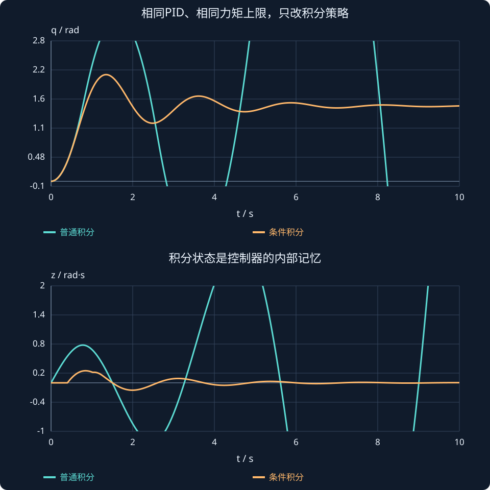

# 第 8 课：PID 参数整定与积分抗饱和

> **内容来源说明**：本课按课程交接和可找回的练习批改记录重建；原始讲解未完整保留，以下为扩写后的教学版本。

## 本课要回答的问题

第 6 课学到积分能消静差，也学到它可能积累过多。本课继续研究：

1. 积分增益 $K_i$ 能否一直调大？
2. 控制器命令超过电机上限时，积分器要不要继续工作？
3. 为什么“只要饱和就冻结积分”有时会让系统更难退出饱和？

## 1. 三个 PID 参数，三种作用

对于关节位置控制，误差为 $e=q_d-q$，一个常见控制律为：

$$
\tau=K_pe+K_i z-K_d\dot q,\qquad \dot z=e
$$

- **比例 $K_p$**：差得越多，拉回去的力越大。太小会反应慢、抗扰弱；太大可能过冲、振荡，且命令更容易超过电机上限。
- **微分 $K_d$**：关节速度越大，制动力越强，像减震器。太小压不住振荡；太大可能使控制钝化，也会让速度噪声更多地进入力矩。
- **积分 $K_i$**：误差持续存在时，额外保持力矩逐渐增加。太小，静差消得慢；太大，积分状态变化快，可能导致过冲或不稳定。

所以“所有参数都尽可能大”不是整定方法。通常先让 P 项能推动系统靠近目标，再用 D 项控制振荡，最后只加足够补偿持续误差的 I 项，并检查执行器限幅。

## 2. 理想模型的稳定条件从哪里来

用惯量模型 $J\ddot q=\tau$，固定目标，研究目标附近的小偏差。令目标为零，控制律为：

$$
\tau=-K_pq-K_i\int q\,dt-K_d\dot q
$$

代入 $J\ddot q=\tau$，再把积分写成拉普拉斯形式 $1/s$：

$$
Js^2q=-\left(K_p+\frac{K_i}{s}+K_ds\right)q
$$

两边乘以 $s$，整理出特征多项式：

$$
Js^3+K_ds^2+K_ps+K_i=0
$$

特征方程的根就是闭环极点。直观地说，极点决定系统自由响应中的指数衰减、振荡或增长：极点在左半平面时响应衰减；若有极点进入右半平面，误差会增长。

这里先使用一个三阶稳定性结果，理解“积分不能无限增大”。**Routh 表的构造方法在第 10 课完整学习，本课不要求提前掌握其算法。** 表格作为后续推导的预览：

| 幂次 | 第一列 | 第二列 |
|---|---:|---:|
| $s^3$ | $J$ | $K_p$ |
| $s^2$ | $K_d$ | $K_i$ |
| $s^1$ | $(K_dK_p-JK_i)/K_d$ | 0 |
| $s^0$ | $K_i$ | |

在 $J,K_p,K_d,K_i$ 都为正时，第一列还必须满足：

$$
K_dK_p-JK_i>0
\quad\Longrightarrow\quad
\boxed{K_dK_p>JK_i}
$$

这条不等式说明：$K_i$ 不能无限增大。积分项多引入了一个动态状态，过强时会压过系统已有的阻尼。

### 数值例子

$J=2$、$K_p=12$、$K_d=4$ 时：

$$
4\times12>2K_i
\quad\Longrightarrow\quad
0<K_i<24
$$

所以 $K_i=4$ 和 $K_i=12$ 满足此理想模型的条件，$K_i=30$ 不满足。

**重要边界**：这是没有执行器饱和、延迟、滤波和结构柔性的理想模型检查。满足条件不等于响应一定好看；不满足则说明该简化模型不能保证稳定。真实机器人仍需仿真、限幅分析和测试。

## 3. 电机饱和：命令不等于实际输出

控制器算出的力矩是 $\tau_{cmd}$。电机有最大力矩 $\tau_{max}$，实际输出只能是：

$$
\tau_{sat}=\operatorname{clip}(\tau_{cmd},-\tau_{max},\tau_{max})
$$

若控制器要求 $8$ N·m，但电机上限是 $5$ N·m，关节实际受到的只有 $5$ N·m。多出来的 $3$ N·m 只存在于控制器计算中。

若积分器仍根据误差增加，控制器内部会觉得“还差得很多”，积分越记越大。等关节终于快到目标时，这些电机从未真正输出过的额外力矩仍藏在积分状态中。这就是第 6 课 windup 的来源。

## 4. 条件积分：饱和时先看误差方向

条件积分的规则是：

> 若误差会把控制命令推得更深地进入饱和，就暂停积分；若误差帮助命令退出饱和，就允许积分。

假设正误差产生正向积分力矩：

| 当前状态 | 误差 | 积分变化的效果 | 处理 |
|---|---|---|---|
| 正向饱和：$\tau_{cmd}>\tau_{max}$ | $e>0$ | 继续增加正命令，让饱和更严重 | 暂停 |
| 正向饱和：$\tau_{cmd}>\tau_{max}$ | $e<0$ | 减小旧的正积分，帮助退出正向饱和 | 允许 |
| 负向饱和：$\tau_{cmd}<-\tau_{max}$ | $e<0$ | 继续增加负命令，让饱和更严重 | 暂停 |
| 负向饱和：$\tau_{cmd}<-\tau_{max}$ | $e>0$ | 积分往正方向变化，帮助退出负向饱和 | 允许 |

因此，正向饱和时如果 $e<0$，虽然电机仍被卡在正向上限，但误差已经要求往回收；让积分继续变化正好能减小旧的正积分。不能见到“输出饱和”就一律停止积分。

判定要看误差 $e$ 和饱和方向，不能只看误差变化率 $\dot e$。$e$ 表示误差当前在哪边；$\dot e$ 只表示它正在增大还是减小，二者不是一回事。

## 5. 条件积分的程序逻辑

下面是一个简化的 C++ 风格示意：

```cpp
double tau_cmd = kp * error + ki * integral - kd * velocity;
double tau_sat = std::clamp(tau_cmd, -tau_max, tau_max);

bool drives_further_into_saturation =
    (tau_cmd > tau_max && error > 0.0) ||
    (tau_cmd < -tau_max && error < 0.0);

if (!drives_further_into_saturation) {
    integral += error * dt;
}
```

程序先算未限幅命令，再算实际可输出命令，然后判断误差是不是正在加深饱和。代码还需处理角度环绕、积分限幅、$K_i=0$、采样时间和执行器故障；这段只展示核心符号逻辑。

## 6. 反算抗饱和：让积分知道电机做不到

反算方法不只是暂停积分，而是把电机实际输出与控制器原命令的差反馈给积分器：

$$
\dot z=e+\frac{K_{aw}}{K_i}(\tau_{sat}-\tau_{cmd})
$$

没有饱和时，$\tau_{sat}=\tau_{cmd}$，补偿项为零，积分正常累计。

若控制器命令 $8$ N·m、电机只输出 $5$ N·m，则差值为负，会把过大的正积分往回拉。$K_{aw}$ 决定回拉速度：太小，积分释放慢；太大，积分修正过猛，可能引入抖动。

等价地，也可以直接更新积分力矩 $\tau_I=K_i z$：

$$
\dot\tau_I=K_i e+K_{aw}(\tau_{sat}-\tau_{cmd})
$$

## 7. 只减小 $K_i$ 为什么不够

降低 $K_i$ 通常会减慢新积分变成力矩的速度，所以可能缓和超调。但它不一定清除已经累计的积分状态；如果把 $K_i$ 降得太小，持续扰动下的静差又会消除得很慢。

因此，降低 $K_i$ 是调参手段，条件积分和反算才是在处理“执行器输出受限、内部积分仍继续记账”的机制。是否采用哪种方法，要结合力矩上限和实测曲线。


## 饱和时什么时候该暂停积分，什么时候应该继续？

假设力矩上限为 5 N·m，当前位置误差为正，控制器期望力矩却达到 10 N·m。实际只能执行 5；若继续增加正积分，会让期望与实际差得更远。

$$
\tau_{raw}=K_pe+K_iz-K_d\dot q,\qquad
\tau_{act}=\operatorname{clip}(\tau_{raw},-5,5).
$$

条件积分要判断“误差会不会加深当前饱和”：

$$
\begin{aligned}
\tau_{raw}>5\ \text{且}\ e>0&:\ \text{暂停积分},\\
\tau_{raw}>5\ \text{且}\ e<0&:\ \text{允许积分回落}.
\end{aligned}
$$

例如正饱和时 e=−0.2、采样周期0.01 s，若允许积分，z 每步减少0.002 rad·s；这正帮助退出正饱和。若一见饱和就冻结，反而会把已经过大的积分保留住。负饱和时按同样逻辑反向判断。

图中比较同样增益、同样力矩限制，仅积分策略不同的响应。两者都遵守同一执行器上限，差异来自积分内部状态，不能把抗饱和误解为“允许电机输出更大力矩”。



**读图与操作**：固定力矩上限，比较普通积分和条件积分；再调低上限。观察超调和恢复，不把某个参数下的改善当成普遍保证。

**使用条件**：条件积分逻辑假定 Ki>0、积分状态 z=∫e；若积分状态定义变了，须重新检查符号。

:::demo design
:::

### 先预测，再展开核对

若 τraw=−8、下限−5，此时误差为正，应暂停还是继续积分？

<details><summary>查看思路与答案</summary>

应允许积分增大，帮助原本过负的命令回到可实现范围；若误差为负才会加深负饱和。

</details>

## 8. MATLAB：观察条件积分

下面用离散步进比较普通积分与条件积分，设置一个力矩上限。它只展示 anti-windup 的核心，不含电机电流环、延迟和噪声。

```matlab
J=1; Kp=10; Kd=3; Ki=16;
tauMax=5; qd=1.5; dt=0.001; T=5;
N=round(T/dt); t=(0:N-1)'*dt;
q=zeros(N,2); v=zeros(N,2); z=zeros(1,2);

for k=1:N-1
    for mode=1:2
        e=qd-q(k,mode);
        tauCmd=Kp*e+Ki*z(mode)-Kd*v(k,mode);
        tau=min(tauMax,max(-tauMax,tauCmd));
        deepen=(tauCmd>tauMax&&e>0)||(tauCmd< -tauMax&&e<0);
        q(k+1,mode)=q(k,mode)+v(k,mode)*dt;
        v(k+1,mode)=v(k,mode)+tau/J*dt;
        if mode==1 || ~deepen
            z(mode)=z(mode)+e*dt;
        end
    end
end

plot(t,q(:,1),'LineWidth',1.3); hold on
plot(t,q(:,2),'LineWidth',1.3); yline(qd,'--'); grid on
legend('普通积分','条件积分','目标');
xlabel('时间 (s)'); ylabel('角度 (rad)');
```

观察两条曲线接近目标后是否越过得很多，并同时记录 $z$。只看位置曲线、不看积分状态，很难解释 windup 为什么发生。

## 9. 练习与已知批改

1. $J=2,K_p=12,K_d=4$。判断 $K_i=4,12,30$ 哪个不满足 $K_dK_p>JK_i$。
2. 执行器上限为 $5$，$\tau_{cmd}=8$、$e=-0.2$。应暂停还是允许积分？说明原因。
3. 为什么越过目标后仍可能持续输出正向力矩？条件积分判断用 $e$ 还是 $\dot e$？只减小 $K_i$ 能否保证解决 windup？

**历史批改：**第 1 题 $K_i=30$ 不满足条件，要求 $0<K_i<24$。第 2 题是正向饱和但 $e<0$，应允许积分，因为它减小正积分量，帮助退出饱和。第 3 题中，旧积分可能很大，即使 P、D 已反向，合成命令仍为正；条件积分根据 $e$ 是否加剧饱和，不看 $\dot e$。减小 $K_i$ 可减慢 windup，但不保证清除已积累积分。

## 本课小结

先检查理想 PID 的线性稳定条件，再分析执行器饱和。条件积分要看误差方向是否让饱和更严重；反算抗饱和会利用实际输出修正积分。稳定条件、整定质量和执行器限幅是相关但不同的问题。

## 课程衔接与条件检查

### 用模型给调参增加一道依据

对理想惯量 PID，先用 Routh 得到可稳定的参数区间，再在区间内调整时域响应；有饱和时还要检查积分恢复。以 J=1、Kd=3、Kp=2、Ki=4 为例，线性模型稳定；若执行器只能输出很小力矩，初期长时间饱和仍可能导致显著过冲。

抗饱和不是给线性稳定性“补证”，它处理的是实际控制输入与控制器期望输入不一致时的积分状态。使用回算时，应先统一误差和回算符号，再检查饱和解除后积分是否回落。

**自查**：若 τraw=−8、下限−5，此时误差为正，应暂停还是继续积分？
