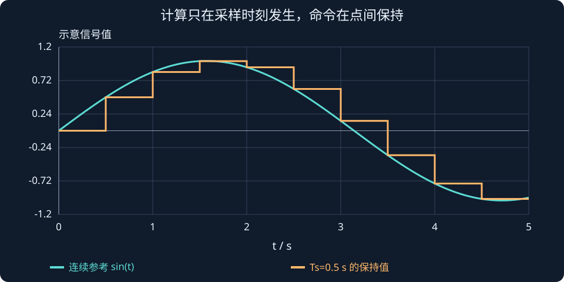

# 第 9 课：数字 PID 实现

> 第 2 周 · 第 3 节｜把连续控制公式变成一次次执行的程序：采样周期、离散积分、速度差分、微分滤波和零阶保持。

这页依据本对话中重新讲解的第 9 课与已确认的练习记录重写。原有完整历史讲稿未恢复，不将补写内容当作原始逐字记录。

本课围绕一个问题：**电脑每隔一小段时间算一次控制量，积分、速度和 PID 应当怎样计算？** 以后读机器人控制工程中的定时循环，这些步骤会反复出现。

## 一、控制器怎样在电脑里工作？

仍用电机带动关节。目标角度为 $q_d$，实际角度为 $q$，误差：

$$
e=q_d-q
$$

前面学过的控制器可以写为：

$$
\boxed{\tau(t)=K_pe(t)+K_iz(t)-K_d\dot q(t)},\qquad
z(t)=\int_0^t e(\lambda)\,d\lambda
$$

| 量 | 意义 | 在关节控制里的单位 |
| --- | --- | --- |
| $q,q_d$ | 实际角度、目标角度 | rad |
| $e$ | 位置误差 | rad |
| $z$ | 累计误差 | rad·s |
| $\dot q$ | 实际角速度 | rad/s |
| $\tau$ | 输出力矩 | N·m |
| $K_p$ | 比例增益 | N·m/rad |
| $K_i$ | 积分增益 | N·m/(rad·s) |
| $K_d$ | 速度反馈增益 | N·m·s/rad |

这里微分反馈用实际速度，所以前面带负号：正在向正方向运动，就给一部分负力矩，提供阻尼。

连续公式允许时间不断变化，电脑却只能一次次读取数据和执行计算。一次计算通常包括：

1. 读取传感器或状态估计模块提供的位置。
2. 计算目标与实际位置之差。
3. 更新累计误差，估计并滤波速度。
4. 计算力矩，结合限幅与抗饱和处理。
5. 发送指令，保存本次状态供下次使用。

## 二、采样周期与下标 $k$ 是什么意思？

假设每隔 10 ms 执行一次：

$$
T_s=10\,\mathrm{ms}=0.01\,\mathrm{s},\qquad f_s=\frac1{T_s}=100\,\mathrm{Hz}
$$

程序在 0、0.01、0.02、0.03 s 等时刻读取位置。$k$ 表示第几次采样，$q_k$ 是本次位置，$q_{k-1}$ 是上次位置：

$$
q_k=q(kT_s),\qquad e_k=q_{d,k}-q_k
$$

例如 $q_5$ 对应 $t=5T_s$ 的采样值。下标只是编号，真正的时间间隔由 $T_s$ 决定。

固定周期算法常用预设 $T_s$。若循环间隔存在明显变化，需要根据所用算法和数据时间戳正确处理实际间隔。代码里的 <code>dt</code> 一般使用秒，不能把 10 ms 直接填成 10。

## 三、比例项：拿本次误差直接乘

目标为 1 rad，本次实际位置为 0.8 rad，则：

$$
e_k=1-0.8=0.2\,\mathrm{rad}
$$

如果 $K_p=10\,\mathrm{N\cdot m/rad}$：

$$
\tau_{P,k}=K_pe_k=2\,\mathrm{N\cdot m}
$$

~~~cpp
double error = target - position;
double torque_p = Kp * error;
~~~

比例项只使用本次误差，不需要记住过去。积分与微分则需要保存历史数据。

## 四、积分项：累计“多大的误差，持续了多久”

### 4.1 积分为什么与时间有关？

假设误差一直为 0.5 rad，持续 0.02 s，新增积分量是 $0.5\times0.02=0.01$ rad·s；持续 2 s，则为 1 rad·s。同样的误差，持续越久，累计量越大。

从图形看，积分是误差曲线与时间轴之间的有符号面积。误差为正时增加，误差为负时减少。

程序每次只能处理一小段时间。把本次误差近似看成这段时间内的代表值，就得到一块小矩形：

$$
\Delta z_k\approx e_kT_s
$$

于是本次累计量为：

$$
\boxed{z_k=z_{k-1}+e_kT_s}
$$

可以把 $z$ 想成账户余额：旧余额加上本次新增量；误差为负时，本次新增量也为负，并非所有历史误差都按绝对值累加。

### 4.2 完整算一次

给定：

$$
z_{k-1}=0.3\,\mathrm{rad\cdot s},\quad
e_k=0.5\,\mathrm{rad},\quad T_s=0.02\,\mathrm{s}
$$

则：

$$
z_k=0.3+0.5\times0.02=0.31\,\mathrm{rad\cdot s}
$$

若 $K_i=4$，积分力矩为：

$$
\tau_{I,k}=K_iz_k=1.24\,\mathrm{N\cdot m}
$$

$z_k$ 是累计误差，$K_iz_k$ 才是积分力矩，别把两者混成一个变量的意义。

~~~cpp
integral += error * dt;
double torque_i = Ki * integral;
~~~

### 4.3 为什么一定要乘时间间隔？

误差始终为 1 rad，持续 1 秒：

| 周期 | 每秒次数 | 每次新增量 | 一秒合计 |
| --- | --- | --- | --- |
| 0.01 s | 100 | 0.01 rad·s | 1 rad·s |
| 0.001 s | 1000 | 0.001 rad·s | 1 rad·s |

使用正确时间间隔，同一段真实时间、同样的误差，积分量应基本相同。若只写 <code>integral += error</code>，循环频率提高 10 倍，一秒积分量也变为 10 倍，控制器行为就变了。

积分近似并非只有这一种形式；本课先掌握矩形近似的物理意义与单位，不必同时背多种离散公式。

## 五、速度估计：位置变化除以时间

传感器或状态估计模块若能提供可靠速度，可以直接使用；只有位置时，可以用相邻采样差分：

$$
\boxed{v_k=\frac{q_k-q_{k-1}}{T_s}}
$$

它估计的是相邻两次采样之间的平均角速度，不是每一时刻的精确瞬时速度。

例如：

$$
q_{k-1}=0.40,\quad q_k=0.43,\quad T_s=0.01
$$

得到：

$$
v_k=\frac{0.43-0.40}{0.01}=3\,\mathrm{rad/s}
$$

若 $K_d=2$：

$$
\tau_{D,k}=-K_dv_k=-6\,\mathrm{N\cdot m}
$$

正方向运动，微分反馈提供负方向力矩，帮助抑制过快运动。它不保证任意时刻总力矩都反向，因为总力矩还包含比例和积分。

~~~cpp
double velocity = (position - previous_position) / dt;
// 算完后再保存；如果先覆盖，差值就会变为零。
previous_position = position;
~~~

### 5.1 为什么这里用实际速度？

固定目标时，$\dot q_d=0$，于是：

$$
\dot e=\dot q_d-\dot q=-\dot q
$$

因此 $K_d\dot e$ 与 $-K_d\dot q$ 相同。移动目标时，两种写法不完全相同；对实际位置作微分反馈，还能避免目标阶跃直接造成误差微分的尖峰。本课统一使用 $-K_dv_k$。

## 把一次控制更新从输入算到力矩

给定相邻两次采样位置0.30、0.31 rad，采样周期0.01 s，目标0.50 rad。旧积分状态为0.02 rad·s，当前采用先更新积分再输出的约定：

$$
\begin{aligned}
e_k&=0.50-0.31=0.19\ \mathrm{rad},\\
\hat v_k&=(0.31-0.30)/0.01=1.0\ \mathrm{rad/s},\\
z_k&=0.02+0.19(0.01)=0.0219\ \mathrm{rad\,s}.
\end{aligned}
$$

若 Kp=10、Ki=2、Kd=0.5，未限幅输出为：

$$\tau_k=10(0.19)+2(0.0219)-0.5(1)=1.4438\ \mathrm{N\,m}.$$

若软件误把周期填成0.1 s，差分速度会被算成0.1，积分会变成0.039，输出变为1.928 N·m。同一组传感器读数，因为时间单位错了，控制器表现就变了。

图中展示零阶保持：每次算出命令后保持到下次更新；点间连成光滑曲线只是绘图习惯，真实数字命令在两次计算之间不会自动插值。

**读图与操作**：先用 timing 模式对比真实周期与设定周期，再用 filter 模式比较差分噪声和滤波滞后；一次只改变一个因素。

**使用条件**：位置以 rad、时间以 s；此例无滤波、无饱和，用后向差分估速，矩形法更新积分。

### 先预测，再展开核对

如果程序采用先输出、再更新积分，本次力矩应是多少？

查看思路与答案

本次使用旧积分0.02，输出为1.44 N·m；两种更新约定都要前后一致，并明确一次采样延迟的含义。

## 六、交互实验一：时间间隔填错会怎样？

真实循环从 10 ms 改成 1 ms，但代码仍写 <code>dt = 0.01</code>：每次真实只过 0.001 s，却按 0.01 s 计算。

:::demo design mode=timing
:::

演示使用恒定误差 0.5 rad、匀速运动 2 rad/s，使时间缩放的影响容易比较；它不是带反馈的完整关节运动仿真。

### 6.1 积分会怎样？

真实每次该加 $e_k\times0.001$，程序却加 $e_k\times0.01$。每次多 10 倍，单位真实时间内累计也快约 10 倍。

### 6.2 速度估计会怎样？

真实速度为 2 rad/s，1 ms 内位置变化是：

$$
\Delta q=2\times0.001=0.002\,\mathrm{rad}
$$

代码用错误的分母：

$$
v_k=\frac{0.002}{0.01}=0.2\,\mathrm{rad/s}
$$

只剩真实值的十分之一，微分阻尼相应算小。

| 计算内容 | 填入的时间间隔过大 |
| --- | --- |
| 积分 $e_k\,dt$ | 累计得过多 |
| 速度 $\Delta q/dt$ | 估计得过小 |

机械系统本身没有因此自动慢十倍，是控制器低估了速度。之后错误控制量会继续影响机械运动，所以闭环后果不能只靠这两个比例就全部预测出来。

## 七、为什么位置差分容易产生噪声？

关节没动，真实位置一直为 1 rad，但两次测量是 1.000 与 1.002 rad：

$$
v_k=\frac{1.002-1.000}{0.001}=2\,\mathrm{rad/s}
$$

实际没动，程序却估计有 2 rad/s 的速度。下次读数降回来，可能又估计成负速度，微分力矩就正负跳动。

对相同大小的测量差值，分母越小，估计速度波动越大。但不能故意把 <code>dt</code> 填大来压噪声，否则真实速度也会算错。

更严格地说，微分倾向于放大高频变化；对于相邻独立测量噪声，其差分速度的噪声幅度还与采样周期有关。因此采样更快并不自动意味着估计更平滑。

## 八、交互实验二：微分滤波怎样平滑速度？

一阶低通滤波常写为：

$$
\boxed{\hat v_k=\alpha\hat v_{k-1}+(1-\alpha)v_k^{raw}}
$$

| 符号 | 意义 |
| --- | --- |
| $v_k^{raw}$ | 本次直接差分速度 |
| $\hat v_{k-1}$ | 上次滤波速度 |
| $\hat v_k$ | 本次滤波速度 |
| $\alpha$ | 保留旧结果的权重，通常在 0～1 之间 |

若上次滤波值为 0，原始速度突然为 2，取 $\alpha=0.9$：

$$
\hat v_k=0.9\times0+0.1\times2=0.2
$$

结果只变到 0.2，没有直接跳到 2。但如果真实速度确实突然增加，滤波结果也要经过几次更新才能跟上。

常用参数关系：

$$
\boxed{\alpha=\frac{\tau_f}{\tau_f+T_s}}
$$

$\tau_f$ 为滤波时间常数，单位秒。固定 $T_s$ 时，$\tau_f$ 越大，$\alpha$ 越接近 1，通常更平滑但跟随更慢。

:::demo design mode=filter
:::

建议先把噪声设为零，调大时间常数，单独看滞后；再增加噪声，看原始差分的尖峰和平滑后的曲线。演示采用确定的高频测量扰动，重复调整时便于比较。

第 12 课会用频率响应解释：低通为什么削弱快速变化，同时带来滞后。

## 九、零阶保持：两次计算之间输出什么？

每 10 ms 算一次力矩。第一次算出 2 N·m，就保持到下一次；下一次算出 1.8 N·m，再保持 1.8。

这叫零阶保持（Zero-Order Hold，ZOH）：

$$
\tau(t)=\tau_k,\qquad kT_s\le t<(k+1)T_s
$$

保持的是指令，电机和关节在这段时间里仍持续运动。就像每隔一会调整一次水龙头，两次调整之间开度不变，水仍然在流。

ZOH 处理的是两次更新之间的输出方式；正确 <code>dt</code> 处理的是计算所用时间间隔。ZOH 不会替你修复积分或差分的时间错误。

## 十、把一次 PID 计算完整算出来

给定：

$$
\begin{aligned}
q_d&=1.0\,\mathrm{rad},&q_k&=0.8\,\mathrm{rad}\\
q_{k-1}&=0.79\,\mathrm{rad},&T_s&=0.01\,\mathrm{s}\\
z_{k-1}&=0.1\,\mathrm{rad\cdot s}
\end{aligned}
$$

取 $K_p=10,K_i=4,K_d=2$，暂时不加滤波和输出限幅：

$$
\begin{aligned}
e_k&=1.0-0.8=0.2\\
z_k&=0.1+0.2\times0.01=0.102\\
v_k&=(0.8-0.79)/0.01=1\\
\tau_{P,k}&=10\times0.2=2\\
\tau_{I,k}&=4\times0.102=0.408\\
\tau_{D,k}&=-2\times1=-2\\
\tau_k&=2+0.408-2=0.408\,\mathrm{N\cdot m}
\end{aligned}
$$

关节还没到目标，比例项继续推；关节已经向目标运动，微分项提供阻尼，避免冲得太快。三个部分会相加，不能只看某一项判断总力矩方向。

## 十一、写成 C++ 控制循环

下面是用于理解状态更新的最小控制器。实际接入电机还需要输出限幅、第 8 课的抗积分饱和，以及传感器与异常状态处理。

~~~cpp
#include <stdexcept>

class DigitalPID {
public:
    DigitalPID(double kp, double ki, double kd, double tau_f)
        : kp_(kp), ki_(ki), kd_(kd), tau_f_(tau_f) {
        if (tau_f < 0.0)
            throw std::invalid_argument("tau_f must be nonnegative");
    }

    double update(double target, double position, double dt) {
        if (!(dt > 0.0))
            throw std::invalid_argument("dt must be positive");

        const double error = target - position;
        integral_ += error * dt;

        double raw_velocity = 0.0;
        if (!first_sample_)
            raw_velocity = (position - previous_position_) / dt;

        const double alpha = tau_f_ / (tau_f_ + dt);
        filtered_velocity_ =
            alpha * filtered_velocity_ + (1.0 - alpha) * raw_velocity;

        const double torque =
            kp_ * error + ki_ * integral_ - kd_ * filtered_velocity_;

        previous_position_ = position;
        first_sample_ = false;
        return torque;
    }

private:
    double kp_, ki_, kd_, tau_f_;
    double integral_ = 0.0;
    double previous_position_ = 0.0;
    double filtered_velocity_ = 0.0;
    bool first_sample_ = true;
};
~~~

三个成员变量需要跨循环保存：积分余额、上次位置、上次滤波速度。如果每次都把积分清零，它就失去长期累计作用；如果丢掉上次位置，就不能算相邻采样速度。

第一次采样尚无历史位置，代码将差分速度初始化为零，避免拿当前位置减一个任意的“初始零值”。这不代表第一次采样时真实速度必然为零。

## 十二、MATLAB 实验：观察噪声与滤波

以下代码不依赖 Control System Toolbox：

~~~matlab
clc;
clear;
close all;
rng(8);                         % 固定随机种子，便于比较
Ts = 0.001;
t = 0:Ts:2;
q_true = sin(2*pi*t);
v_true = 2*pi*cos(2*pi*t);

q_measured = q_true + 0.002*randn(size(t));
v_raw = [0 diff(q_measured)/Ts];

tau_f = 0.02;
alpha = tau_f/(tau_f+Ts);
v_filtered = zeros(size(t));
for k = 2:numel(t)
    v_filtered(k) = alpha*v_filtered(k-1) ...
                  + (1-alpha)*v_raw(k);
end

figure;
subplot(2,1,1);
plot(t,q_true,'b');
hold on;
plot(t,q_measured,'Color',[0.6 0.6 0.6]);
grid on;
xlabel('时间 (s)');
ylabel('位置 (rad)');
legend('真实位置','测量位置');

subplot(2,1,2);
plot(t,v_raw,'Color',[0.75 0.75 0.75]);
hold on;
plot(t,v_true,'b','LineWidth',1.2);
plot(t,v_filtered,'r','LineWidth',1.2);
grid on;
xlabel('时间 (s)');
ylabel('速度 (rad/s)');
legend('原始差分','真实速度','滤波速度');
~~~

先将噪声幅度 0.002 改为 0，看滤波本身的滞后；再恢复噪声，比较速度差分的尖峰。将 $\tau_f$ 从 0.005 改到 0.1，观察平滑与滞后的权衡。初始几次的估计还受初始化影响。

## 十三、练习与批改记录

### 历史练习：已确认的提交与纠正

1. $z_{k-1}=0.3,e_k=0.5,T_s=0.02$：你写了 $0.3+0.5\times0.02$，正确，结果 0.31。
2. 位置从 0.40 到 0.43 rad，间隔 0.01 s：你选 B，即 3 rad/s，正确。
3. 你指出位置差分容易放大噪声，正确。更准确地说，快速测量波动会变为明显的速度尖峰。
4. 真实循环从 10 ms 改到 1 ms，代码仍用 0.01：你提到积分饱和和 ZOH。需要补全：单位真实时间内积分约快 10 倍；速度估计只剩真实值的十分之一，微分阻尼约小 10 倍。机械运动本身并不自动慢十倍，ZOH 不能代替正确 dt。

### 本次重讲后的自测：尚未提交

1. 误差保持 0.5 rad，持续 1 秒。分别取 $T_s=0.01$ s 与 0.001 s，正确计算的新增积分量各是多少？
2. 关节没动但测量有小波动，为什么差分速度可能很抖？增大 $K_d$ 后对输出的影响怎样？
3. 积分更新、速度估计、零阶保持分别负责什么？

将答案发回课程对话，我会逐题批改。批改后等待你明确说“下一课”。

## 课程衔接与条件检查

### 采样模型稳定不等于任意数值算法稳定

标量 $\dot x=-2x$ 的精确离散模型为 $x_{k+1}=e^{-2T_s}x_k$。前向 Euler 则近似为 $x_{k+1}=(1-2T_s)x_k$，只有 0<Ts<1 s 时满足离散渐近稳定条件。Ts=1.2 s 时，近似模型系数 −1.4 导致发散，而真实连续模型稳定。

因此要区分控制采样、模型离散化与仿真积分步长。C++ 循环还应保存上一周期误差和积分状态，明确当前测量、当前计算和下一次执行各发生在何时。

**自查**：如果程序采用先输出、再更新积分，本次力矩应是多少？
