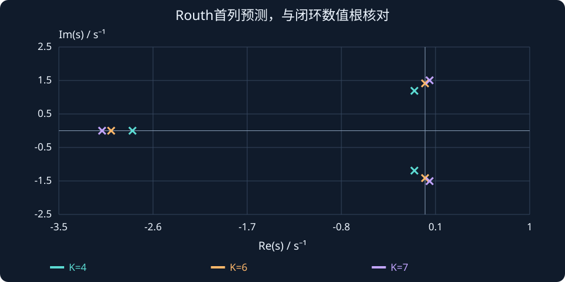

# 第 10 课：Routh稳定判据

> 阶段 0 · 不必求出全部高阶根，也能判断右半平面根数和增益稳定范围。


## 1. 二阶经验为什么不够？

对二阶多项式 $s^2+a_1s+a_0$，$a_1>0,a_0>0$ 可保证严格稳定。更高阶时，系数全正仍不充分。例如 $s^3+2s^2+s+4$ 的系数全正，Routh 判据却能发现两个右半平面根。

Routh 表把多项式系数按规则重排，首列符号变化次数等于右半平面根数。先将首项系数归一为正，不要把开环分母误当闭环特征多项式。

## 2. 先从三阶把规则算清楚

对于 $p(s)=s^3+a_2s^2+a_1s+a_0$，按次数降序排列，缺失项也要填零：

| 行 | 第一列 | 第二列 |
|---|---|---|
| $s^3$ | 1 | $a_1$ |
| $s^2$ | $a_2$ | $a_0$ |
| $s^1$ | $(a_2a_1-a_0)/a_2$ | 0 |
| $s^0$ | $a_0$ | 0 |

第三行第一项由前两行交叉相乘再相减得到。一般地，新行首项用“上一行首项×上上行第二项−上上行首项×上一行第二项”，再除以上一行首项。每次都记录使用的两行，避免符号顺序颠倒。

当没有首列零和全零行等特殊情况时，首列无符号变化表示没有右半平面根。要得出严格稳定，还要排除虚轴根。

## 3. 完整求一个参数区间

取 $p(s)=s^3+3s^2+2s+K$。首列依次是 $1,3,(6-K)/3,K$。严格稳定要求全部为正，所以 $0<K<6$。

$K=4$ 时首列为 $1,3,2/3,4$，无变号。$K=7$ 时为 $1,3,-1/3,7$，从正到负再到正，共两次变号，故有两个右半平面根。这里“两个”是根数而非不稳定程度。

$K=0$ 时多项式为 $s(s+1)(s+2)$，有原点根。$K=6$ 时为 $(s+3)(s^2+2)$，有虚轴根 $\pm j\sqrt2$。两端均不能纳入严格稳定范围。

## 4. 第一列为零，但整行不全零

若首项为零导致下一步除零，可用正小量 ε 暂代，按 $\varepsilon\to0^+$ 检查首列符号。不要直接把零跳过，也不要凭软件的小数正负判断。

例如 $s^3+2s+1$ 的前两行是 $[1,2]$、$[0,1]$。用 $[\varepsilon,1]$ 代替第二行，下一行首项 $2-1/\varepsilon$ 为负，末行是 1；首列正、正、负、正，有两个右半平面根。

## 5. 全零行要用辅助多项式

对于 $K=6$ 的例子，$s^1$ 行全零。用上一行 $s^2$ 行构造辅助多项式 $A(s)=3s^2+6$，求导得 $A'(s)=6s$，用导数系数替代全零行继续计算；同时求辅助多项式根以识别对称根。本例就是虚轴根。

全零行意味着存在关于原点对称的根结构，并不在所有例子中都只意味着纯虚根。最终还应结合辅助多项式与因式分解判断。

## 6. 工程使用顺序

先写出 $1+L(s)=0$ 对应的多项式，再排 Routh 表，求参数不等式的交集，最后单独分析边界。稳定区间只解决“会不会发散”，不保证超调、调节时间、稳态误差或输入限幅符合要求。接下来的根轨迹会补充极点如何移动的信息。


## 先数变号，再去看根，避免只背稳定区间

对同一族特征多项式：

$$p(s)=s^3+3s^2+2s+K,$$

把三种增益的首列并排写出：

| K | 首列 | 从上往下的符号 | 右半平面根数 |
|---|---|---|---|
| 4 | 1，3，2/3，4 | ＋＋＋＋ | 0 |
| 6 | 1，3，0，6 | 出现全零行 | 单独分析虚轴边界 |
| 7 | 1，3，−1/3，7 | ＋＋−＋ | 2 |

$K=7$ 时并不是“有一个负数所以有一个不稳定根”，而是正到负、负到正两次变号，所以是两个右半平面根。图中将首列变化与数值根位置并排对照。

边界 $K=6$ 必须回到精确分解：

$$
p(s)=(s+3)(s^2+2),\qquad s=-3,\;\pm j\sqrt2.
$$

“右半平面根数为零”仍不能保证严格稳定，因为还可能有虚轴根。Routh、直接求根和边界因式分解承担的是互补检查。



**读图与操作**：从4调到6再到7；先纸上排表，再打开数值结果。边界不按普通首列变号规则硬算。

**使用条件**：实系数特征多项式，首项已归一为正；全零行与首列单零按各自规则处理。

### 先预测，再展开核对

若 $K=−1$，首列符号是什么？有几个右半平面根？

<details><summary>查看思路与答案</summary>

首列为1、3、7/3、−1，符号＋＋＋−，一次变号，因此有一个右半平面根。

</details>

## 交互实验

依次试 $K=4$、5、6、7、0、−1。对照首列符号变化和右半平面根数。$K=0$、6 是边界，要单独分析，不能包含在渐近稳定区间里。

:::demo bridge-lab mode=routh
:::

## MATLAB 验证

```matlab
for K=[0 4 6 7]
 p=[1 3 2 K]; r=roots(p);
 fprintf('K=%g, RHP roots=%d\n',K,sum(real(r)>1e-8)); disp(r);
end
% K=0、6 还须识别原点/虚轴根，不能只看RHP根数为0。
```

本例只使用基础 MATLAB 的 roots 函数，不需要控制工具箱；边界根需结合精确因式分解判断。

## 公式、条件与符号


$$
p(s)=s^3+a_2s^2+a_1s+a_0.
$$


首列为 $1,a_2,(a_2a_1-a_0)/a_2,a_0$。三阶严格稳定条件为 $a_2>0,a_1>0,a_0>0,a_2a_1>a_0$。首项系数已归一为 1。

一般多项式的首列符号变化数等于右半平面根数。首列零用正小量极限法；全零行构造上一行辅助多项式并用其导数继续，同时分析边界根。


## 练习与理解检查

1. 为 $s^3+4s^2+5s+K$ 求严格稳定区间。
2. 给 $s^3+2s^2+s+4$ 排表并数出右半平面根。
3. 为什么 $K=6$ 不能包含在本课例子的稳定区间内？
4. 分别说明“首列单个零”和“全零行”的处理方法。


完成练习后逐题解释依据，问题澄清后再进入下一课。
