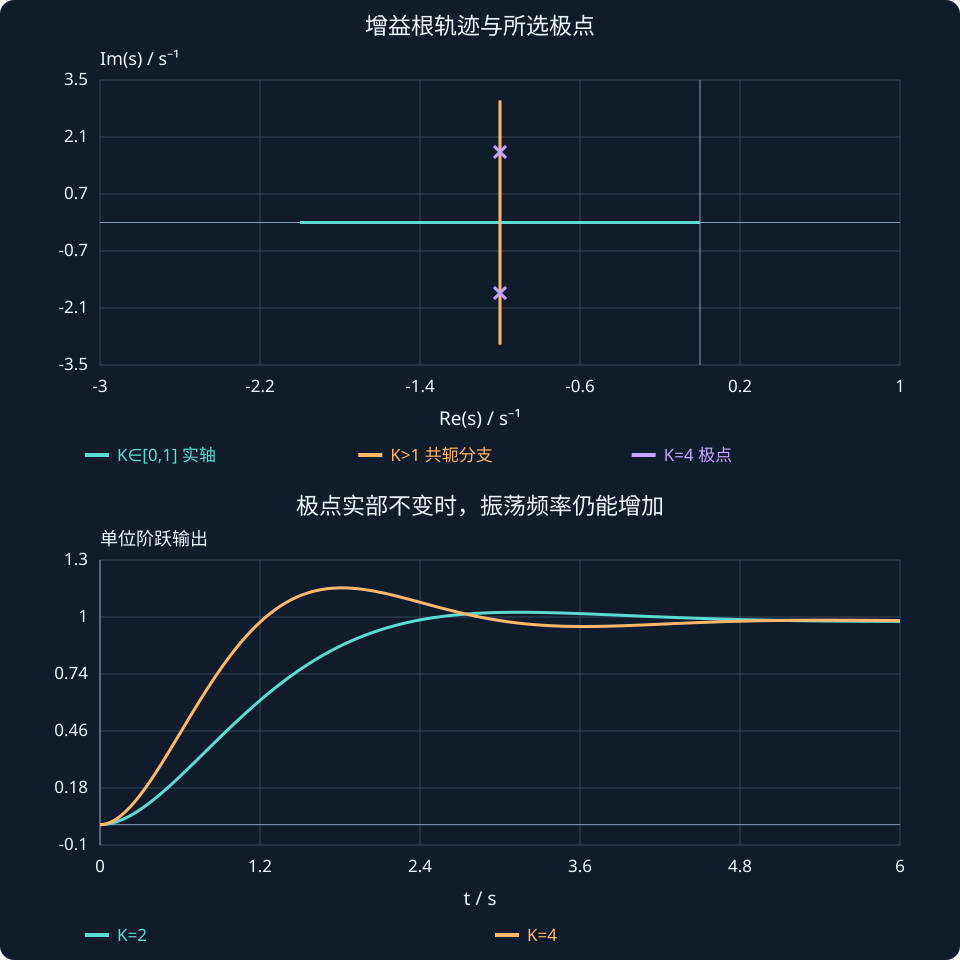

# 第 11 课：根轨迹与增益设计

> 阶段 0 · 把增益变化与闭环极点移动、阻尼和响应性能联系起来。


## 1. 固定对象、改变一个增益

设单位负反馈环路 $L(s)=KG_0(s)$，$K≥0$。闭环特征式为 $1+KG_0(s)=0$。根轨迹就是 K 从零增大到无穷时，闭环特征根在复平面上的运动轨迹。

开环极点是轨迹起点，闭环极点是某一 K 对应的点；二者只有在特定极限或参数下才会重合。轨迹显示的是一族闭环系统，不是单个系统的时间轨迹。

## 2. 一个不靠规则也能算完的例子

取 $G_0=1/[s(s+2)]$，特征式 $s^2+2s+K=0$，根为：


$$
s=-1\pm\sqrt{1-K}.
$$


$K=0$ 时在 0、−2；$K=0.5$ 时约 −0.293、−1.707；$K=1$ 时重合于 −1；$K=4$ 时变为 $-1\pm j\sqrt3$。先沿实轴靠近，再垂直离开实轴，这就是根轨迹的直观来源。

$K>0$ 时均严格稳定，但 K 增大并不等于阻尼增加。与标准二阶式对比得到 $\omega_n=\sqrt K$、$\zeta=1/\sqrt K$。K 从 1 增至 4，固有频率上升，阻尼比下降到 0.5，阶跃超调约 16.3%。欠阻尼区实部固定 −1，因此衰减包络速率没有随 K 一起增加。

## 3. 幅值条件与相角条件

特征根满足 $KG_0(s)=-1$。所以 $|KG_0(s)|=1$，相角为 $(2\ell+1)180^\circ$。先用相角条件判断候选点是否可能在轨迹上，再用幅值条件求 $K=1/|G_0(s)|$。

例如希望极点在 −1+j，代入 $s(s+2)=-2$，得 $K=2$。若希望在 −2+j，对本例的轨迹并不可行，单靠改变 K 无法实现；这说明控制器结构也可能需要改变。

## 4. 常用绘图规则的来源

n 个开环极点产生 n 条分支，终点是 m 个有限零点，其余 n−m 条走向无穷远。实轴上一点若右侧有奇数个实极点和实零点，满足正 K 的相角条件，就属于根轨迹。

无穷远分支的渐近线角度是 $(2\ell+1)180^\circ/(n-m)$，交点为 $(\sum p_i-\sum z_i)/(n-m)$，其中按重数计数。它们是远处趋势，不是所有有限位置的实际轨迹。

分离点可由 $K(s)=-1/G_0(s)$ 求导得到候选点，再检查点是否在正增益根轨迹上。本例 $K=-s(s+2)$，导数 $−2s−2=0$，得到 $s=−1$，$K=1$。

## 5. 由性能指标反推候选极点

当二阶主导近似合理时，可由阻尼比和固有频率提出期望极点，再查看轨迹能否经过。不要只匹配两个极点就忽略其他慢极点或附近零点。也要检查控制输入、稳态误差与参数变化。

本例没有输入限幅、延迟和未建模高频动态；真实系统中为了减小误差而持续提高 K，可能放大噪声或激发振荡。根轨迹需要和 Bode、稳定裕度一起使用。


## 增益加大，极点为什么不一定继续向左？

对环路 K/[s(s+2)]，闭环特征根可直接求出：

$$s_{1,2}=-1\pm\sqrt{1-K}.$$

$K=0.5$ 时两根约为−0.293、−1.707；$K=1$ 时重合于−1；$K=4$ 时为−1±j√3。图中箭头表示增益增加方向，不是时间流逝方向。

在 $K>1$ 的欠阻尼区，两个根的实部始终是−1，但虚部继续增大。对单位阶跃：

$$y(t)=1-e^{-t}\left[\cos(\sqrt{K-1}\,t)+\frac{\sin(\sqrt{K-1}\,t)}{\sqrt{K-1}}\right].$$

指数包络的速率没有随着 K 同时变快，振荡却更快、阻尼比更小。因此第一次到目标更早，并不意味着整个调节过程一定明显缩短。

若想要−2±j，本例仅靠正比例 K 无法实现，因为轨迹离开实轴后位于 $Re(s)=−1$。设计失败可能来自控制器结构限制，而不是调参不够耐心。



**读图与操作**：选K=0.5、1、4，对照当前极点和响应；把“增益轨迹”与状态相轨迹分开。

**使用条件**：单参数正增益根轨迹；闭环输入输出模型为 K/(s²+2s+K)，零初态、单位阶跃。

### 先预测，再展开核对

$K=2$ 时极点在哪里？能否借此得到自然频率和阻尼比？

<details><summary>查看思路与答案</summary>

极点−1±j，自然频率√2 rad/s，阻尼比1/√2。

</details>

## 交互实验

从 $K=0$ 逐渐增大到 1，再到 4。观察极点先在实轴上靠近，再离开实轴。蓝线为 $K≥0$ 的根轨迹，橙点为当前闭环极点；坐标轴是实部和虚部。

:::demo bridge-lab mode=locus
:::

## MATLAB 验证

```matlab
s=tf('s'); G0=1/(s*(s+2));
figure; rlocus(G0); grid on;
figure; step(feedback(0.5*G0,1),feedback(2*G0,1),feedback(4*G0,1));
legend('K=0.5','K=2','K=4'); grid on;
disp(pole(feedback(2*G0,1)));
```

本例使用 Control System Toolbox。请先预测趋势，再运行程序核对；这里给出可运行示例，不代表已在 MATLAB 中执行。

## 公式、条件与符号


$$
1+KG_0(s)=0,\quad \angle G_0(s)=(2\ell+1)180^\circ,\quad K=1/|G_0(s)|.
$$


K 为非负标量增益，$G_0$ 为固定环路部分。相角条件用来确定轨迹，幅值条件求某点对应的增益。


$$
\sigma_a=\frac{\sum p_i-\sum z_i}{n-m},\qquad \theta_\ell=\frac{(2\ell+1)180^\circ}{n-m}.
$$


只在 $n>m$ 时使用无穷远渐近线公式，$\ell=0,\ldots,n-m-1$。p、z 为开环极点与零点，按重数计。


## 练习与理解检查

1. 手算 $K=0.5$、1、2、4 的闭环极点并画在复平面。
2. 本例能否仅靠 K 把极点放到 −2±j？说明依据。
3. $K=4$ 时求阻尼比、阻尼振荡频率和预计超调。
4. 为 $G_0=1/[s(s+1)(s+3)]$ 求渐近线交点与角度。


完成练习后逐题解释依据，问题澄清后再进入下一课。
