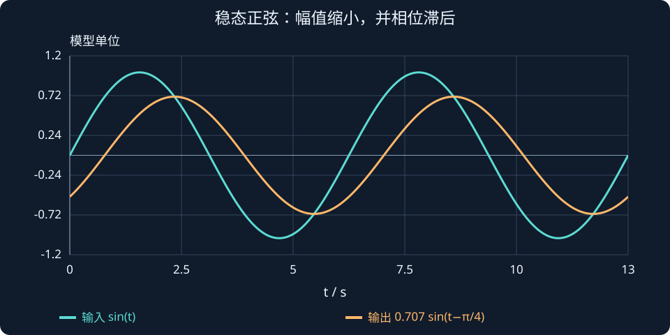

# 第 12 课：频率响应与 Bode 图

> 第 3 周 · 第 1 节｜先观察物理现象，再用两个交互实验理解，接着推导公式，最后用 MATLAB 验证。

本页按你提供的“第 12 课（重新讲解）”重建。四道练习尚未提交批改。

学习目标：理解机器人为什么能跟踪慢目标却跟不上快目标；理解幅值增益、相位差、$s=j\omega$ 的依据，以及 Bode 图的读法。

## 一、先从一个机器人运动问题开始

假设控制单关节机械臂持续往复摆动。以前我们研究从 0° 转到 90° 后保持，现在目标角度本身一直在变化。

| 任务 | 目标 | 评价内容 |
| --- | --- | --- |
| 固定角度 | 从 0° 到 90° 后保持 | 上升时间、超调量、调节时间 |
| 周期运动 | 持续往复摆动 | 实际摆幅够不够、运动是否落后 |

每 5 秒摆动一次，可能容易完成；每 0.05 秒摆动一次，还能准确跟踪吗？机械臂有惯性，电机有力矩、速度与带宽限制，传感器、通信和计算也可能引入延迟。

于是研究：**面对不同变化频率的输入，输出会怎样改变？** 这就是频率响应（Frequency Response）。

## 二、频率到底是什么？

先看正弦目标：

$$
\boxed{q_d(t)=A\sin(\omega t)}
$$

| 符号 | 意义 | 单位 |
| --- | --- | --- |
| $q_d(t)$ | 目标关节角度 | rad |
| $A$ | 摆动幅值 | rad |
| $\omega$ | 角频率 | rad/s |
| $t$ | 时间 | s |

例如 $q_d(t)=0.5\sin(2\pi t)$：目标在 −0.5 rad 到 +0.5 rad 之间变化，每秒完成一次完整往复。幅值为 0.5 rad，峰峰值为 1 rad，两者不同。

### 2.1 普通频率与角频率

$f$ 的单位为 Hz，表示每秒完成多少个周期；$\omega$ 的单位为 rad/s，表示相位每秒变化多少弧度。一个周期对应 $2\pi$，因此：

$$
\boxed{\omega=2\pi f},\qquad
\boxed{T=\frac1f=\frac{2\pi}{\omega}}
$$

| 普通频率 | 周期 | 运动特点 |
| --- | --- | --- |
| 0.2 Hz | 5 s | 缓慢往复 |
| 1 Hz | 1 s | 每秒一次 |
| 10 Hz | 0.1 s | 快速往复 |
| 20 Hz | 0.05 s | 非常快速 |

频率不是关节的瞬时角速度。对目标轨迹求导：

$$
\dot q_d=A\omega\cos(\omega t),\qquad
\ddot q_d=-A\omega^2\sin(\omega t)
$$

摆幅相同时，频率提高 10 倍，需要的最大角速度提高 10 倍，最大角加速度提高 100 倍。这也是快速往复对执行器要求更高的原因。

## 三、频率响应最重要的两个现象

给稳定的线性时不变系统输入 $u(t)=A\sin(\omega t)$，暂态结束后的输出仍为同频正弦：

$$
\boxed{y_{ss}(t)=B\sin(\omega t+\phi)}
$$

这里讨论正弦稳态。出现饱和等非线性时，实际波形可能畸变，不能简单假设只改变幅值与相位。

### 3.1 幅值增益：摆动幅度变化多少？

$$
\boxed{M(\omega)=\frac BA}
$$

输入幅值为 1 rad、输出幅值为 0.5 rad，增益就是 0.5，实际摆幅只有目标的一半。同一线性模型、同一频率下，输入幅值变为 2 rad，输出幅值就变为 1 rad。

### 3.2 相位差：输出比输入晚多少？

$$
\boxed{\phi=\text{输出相位}-\text{输入相位}}
$$

$\phi=-90^\circ$ 表示输出落后四分之一个周期，称为相位滞后（Phase Lag）。在指定频率下，负相位可以换成等效时间偏移：

$$
\Delta t=-\frac{\phi}{\omega}\qquad(\phi\text{ 用弧度})
$$

相同的 −45° 在不同频率对应不同时间，不是“落后 45 秒”；频率相关的相位也不能一概理解成固定纯延迟。

记住：幅值增益衡量“跟得有多大”，相位差衡量“跟得有多晚”。

## 一个正弦波经过系统后，每个数字怎样算出来？

选一个没有额外增益的一阶低通：

$$G(s)=\frac1{s+1},\qquad u(t)=\sin(\omega t).$$

其稳态正弦的幅值比例与相位滞后为：

$$
|G(j\omega)|=\frac1{\sqrt{1+\omega^2}},\qquad
\phi(\omega)=-\arctan\omega.
$$

取ω=1 rad/s，则幅值变成约0.707，相位为−45°，在本频率对应约0.785 s 的滞后；输入周期是2π s。相位不是固定时间延迟，同一个一阶模型在其他频率的“等效滞后时间”不同。

$$
y_{ss}(t)=0.707\sin(t-\pi/4),\qquad
20\log_{10}(0.707)\approx-3.01\ \mathrm{dB}.
$$

图中只画稳态正弦，已经去掉初态产生的瞬态。若从零初态刚启动，还需叠加一个衰减指数项，不能要求一开始就贴在稳态曲线上。

**读图与操作**：先在正弦演示中改变频率，看振幅和相位，再在 Bode 演示中找同一个频率的读数。

**使用条件**：稳定一阶线性对象；正弦稳态解释建立在瞬态已衰减的基础上。

### 先预测，再展开核对

$ω=10$ rad/s 时幅值比例与相位大约是多少？

查看思路与答案

幅值$1/\sqrt{101}\approx0.0995$，相位约−84.29°；约−20.04 dB，频率越高越难通过。

## 四、交互实验一：改变频率，观察输出

先研究一阶系统：

$$
\boxed{G(s)=\frac1{0.1s+1}}
$$

它可以近似描述某些一阶滞后过程，例如简化的电机速度响应。这里借助简化机械臂示意幅值和相位，不代表完整机械臂动力学。

:::demo design mode=wave
:::

### 建议按这个顺序观察

1. 选 **1 rad/s**：输入和输出几乎重合。
2. 选 **10 rad/s**：输出幅值减小，峰值后移。
3. 选 **100 rad/s**：输出幅值很小，相位接近落后四分之一周期。
4. 拖动观察时刻，看同一时刻两条简化机械臂的位置。

蓝线表示目标输入，橙线表示稳态输出。机械臂使用 45° 的输入摆幅，只作模型示意。

横轴为周期位置 $t/T$，不是固定长度的真实时间。各频率都显示两个周期，便于比较波形；真实周期 $T=2\pi/\omega$ 会随频率变化。

## 五、为什么频率响应和传递函数有关？

### 5.1 从一阶微分方程开始

$$
\boxed{\tau\dot y(t)+y(t)=u(t)}
$$

$\tau$ 是时间常数，单位秒，不是之前表示力矩的符号。输出与输入有差距时，会逐渐向输入调整，不能瞬间完成变化。

零初始条件下作拉普拉斯变换：

$$
\begin{aligned}
\tau sY(s)+Y(s)&=U(s)\\
(\tau s+1)Y(s)&=U(s)\\
G(s)=\frac{Y(s)}{U(s)}&=\frac1{\tau s+1}
\end{aligned}
$$

令 $\tau=0.1\,\mathrm{s}$，就是刚才的演示模型。

### 5.2 为什么令 $s=j\omega$？

$j$ 为虚数单位，满足 $j^2=-1$。欧拉公式说明：

$$
e^{j\omega t}=\cos(\omega t)+j\sin(\omega t)
$$

可以先分析复指数，再取实部或虚部得到对应的正弦响应。它有一个特殊性质：

$$
\frac{d}{dt}e^{j\omega t}=j\omega e^{j\omega t}
$$

求导相当于乘 $j\omega$，不会改变基本形式。

令输入为 $e^{j\omega t}$，尝试寻找稳态输出 $He^{j\omega t}$，其中 $H$ 是复数。代回原方程：

$$
\begin{aligned}
\tau(j\omega He^{j\omega t})+He^{j\omega t}&=e^{j\omega t}\\
(1+j\omega\tau)H&=1\\
H&=\frac1{1+j\omega\tau}
\end{aligned}
$$

恰好等于：

$$
\boxed{G(j\omega)=G(s)\big|_{s=j\omega}}
$$

所以这不是随意替换符号，而是利用复指数在微分运算下的特殊性质。本课稳定的一阶系统暂态会衰减，最终留下正弦稳态响应。

## 六、复数为什么能表示幅值和相位？

复数的模表示大小，辐角表示方向。例如 $1+j$ 对应复平面点 $(1,1)$，长度为 $\sqrt2$，角度为 45°。

对于 $z=a+jb$：

$$
|z|=\sqrt{a^2+b^2},\qquad
\arg z=\operatorname{atan2}(b,a)
$$

将 $G(j\omega)$ 写成 $|G(j\omega)|e^{j\phi}$，乘到输入上：

$$
G(j\omega)Ae^{j\omega t}
=A|G(j\omega)|e^{j(\omega t+\phi)}
$$

取虚部，得到 $A|G(j\omega)|\sin(\omega t+\phi)$。模变成幅值增益，辐角变成相位差。

### 6.1 计算幅值

分母的模为 $\sqrt{1+(\omega\tau)^2}$，所以：

$$
\boxed{|G(j\omega)|=\frac1{\sqrt{1+(\omega\tau)^2}}}
$$

### 6.2 计算相位

分母 $1+j\omega\tau$ 的相位为 $\arctan(\omega\tau)$，取倒数后相位变负：

$$
\boxed{\phi(\omega)=-\arctan(\omega\tau)}
$$

反正切返回弧度时，要乘 $180/\pi$ 才变成角度。

### 6.3 代入三个频率

令 $\tau=0.1\,\mathrm{s}$：

| 角频率 | 幅值增益 | 相位差 |
| --- | --- | --- |
| 1 rad/s | 0.995 | −5.71° |
| 10 rad/s | 0.707 | −45° |
| 100 rad/s | 0.0995 | −84.29° |

这与交互实验一致。在这个模型中，频率越高，幅值越小，滞后越明显。但并非所有系统都单调变化，例如欠阻尼二阶系统可能有共振峰，在部分频率放大输入。

## 七、Bode 图到底是什么？

对 0.1～1000 rad/s 等范围内的很多频率分别计算幅值和相位，再绘成曲线，就是 Bode 图（波特图）。

| 图 | 横轴 | 纵轴 | 回答的问题 |
| --- | --- | --- | --- |
| 幅频曲线 | 频率，通常取对数刻度 | 幅值增益，常用 dB | 放大或衰减多少？ |
| 相频曲线 | 相同频率刻度 | 相位差，常用角度 | 超前或滞后多少？ |

### 7.1 为什么用对数频率？

0.1、1、10、100、1000 放在线性坐标里，低频会挤在一起。对数坐标让每次频率提高 10 倍的间距相同，方便跨数量级比较。

从 1 到 10 与从 10 到 100 占相同宽度；向右移动相同距离，不表示频率增加相同数值。

### 7.2 为什么换成 dB？

$$
\boxed{L(\omega)=20\log_{10}|G(j\omega)|}
$$

| 幅值增益 | dB | 含义 |
| --- | --- | --- |
| 10 | +20 | 幅值为输入 10 倍 |
| 2 | +6.02 | 幅值约为输入 2 倍 |
| 1 | 0 | 幅值不变 |
| 0.5 | −6.02 | 幅值减半 |
| 0.1 | −20 | 幅值为输入十分之一 |

**0 dB 不是没有输出，而是幅值比为 1。** 20 倍对数用于幅值比；功率比常用 10 倍对数，不要混用。对数还会将串联增益的乘法变成 dB 加法，方便后续分析。

## 八、交互实验二：观察 Bode 图

同时调整输入频率与时间常数，观察当前工作点和截止频率：

:::demo design mode=bode
:::

### 8.1 怎样读两张图？

先设 $\tau=0.1\,\mathrm{s}$，选定横轴频率，再找两张曲线对应点：

- 幅频图低频接近 0 dB，频率提高后下降。
- 相频图低频接近 0°，频率提高后趋向 −90°。
- 橙色标记为当前频率，绿色虚线为截止角频率。

很高频率下，$M\approx1/(\omega\tau)$。频率提高 10 倍，幅值约变成十分之一。高频渐近斜率为 −20 dB/dec，即每十倍频程下降 20 dB。

### 8.2 什么是截止频率？

对于本课一阶低通：

$$
\boxed{\omega_c=\frac1\tau},\qquad
\boxed{f_c=\frac1{2\pi\tau}}
$$

在这个频率下：

$$
\begin{aligned}
|G(j\omega_c)|&=\frac1{\sqrt2}\approx0.707\\
20\log_{10}|G(j\omega_c)|&\approx-3.01\,\mathrm{dB}\\
\phi(\omega_c)&=-45^\circ
\end{aligned}
$$

即稳态幅值降到低频幅值约 70.7% 时的频率。超过它仍可能有输出，也不表示系统马上失稳。

若低频增益不是 1，−3 dB 通常是相对低频平台下降 3 dB，不一定对应绝对 −3 dB；复杂模型需结合具体带宽定义。

### 8.3 改变时间常数

把 $\tau$ 从 0.1 s 调到 0.5 s，截止角频率从 10 rad/s 降到 2 rad/s。曲线向低频移动，在更低频率就出现明显衰减与滞后。

同样观察 10 rad/s：原来 $\omega\tau=1$，现在为 5，幅值更小，负相位绝对值更大。对这种一阶模型，时间常数越大，响应越慢，截止频率越低。

## 九、为什么对控制工程师重要？

### 9.1 机器人为什么跟不上快速目标？

对于 $q_d(t)=0.5\sin(\omega t)$，低频时有较充裕的调整时间；高频时可能出现衰减和滞后。Bode 图能量化这些现象。

判断位置跟踪能力，应分析**从目标位置到实际位置的闭环传递函数**，不能任取电机模型来判断整个系统。

### 9.2 为什么不能无限提高增益？

增大反馈增益有时能加快响应，但电机力矩有限，系统存在延迟和模型误差，传感器有噪声。过高增益可能降低稳定裕度，造成振荡甚至失稳。

速度、稳定性、噪声与执行器限制需要一起考虑。后续会学习增益裕度与相位裕度，本课不把截止频率当成稳定判据。

### 9.3 与微分滤波的联系

第 9 课学过：

$$
v_k^f=\alpha v_{k-1}^f+(1-\alpha)v_k^{raw}
$$

离散低通倾向于保留缓慢变化，衰减部分高频变化。高频噪声会减弱，但真实速度的快速变化也含高频成分，因此滤波过强会滞后。这是噪声抑制与响应速度的权衡。

连续一阶低通用于建立直觉，在接近采样频率时，不能认为它与离散滤波的频率响应完全相同。

| 分析方法 | 典型输入 | 观察内容 |
| --- | --- | --- |
| 时间响应 | 阶跃 | 上升时间、超调量、调节时间 |
| 频率响应 | 不同频率正弦 | 幅值增益、相位差、带宽 |

它们从不同角度分析同一个动态系统。

## 十、MATLAB 实验：复现演示

### 实验 A：正弦输入与输出

使用 $0.1\dot y+y=u$，输入 $u(t)=\sin(10t)$。不依赖 Control System Toolbox。

~~~matlab
clc;
clear;
close all;
tau = 0.1;
omega = 10;
tspan = 0:0.001:3;

% tau*dy/dt+y=u，所以 dy/dt=(u-y)/tau
f = @(t,y) (sin(omega*t)-y)/tau;
[t,y] = ode45(f,tspan,0);
u = sin(omega*t);

M = 1/sqrt(1+(omega*tau)^2);
phi = -atan(omega*tau);
y_ss = M*sin(omega*t+phi);

figure;
plot(t,u,'b','LineWidth',1.5);
hold on;
plot(t,y,'r','LineWidth',1.5);
plot(t,y_ss,'k--','LineWidth',1.2);
xlabel('时间 (s)');
ylabel('信号幅值');
title('一阶系统的正弦响应');
legend('输入','实际响应','理论稳态响应');
grid on;
fprintf('理论幅值增益 = %.3f\n',M);
fprintf('理论相位差 = %.2f deg\n',phi*180/pi);
~~~

理论结果：

$$
M=\frac1{\sqrt{1+(10\times0.1)^2}}\approx0.707,\qquad
\phi=-\arctan(1)=-45^\circ
$$

因此：

$$
\boxed{y_{ss}(t)=0.707\sin(10t-\pi/4)}
$$

蓝色输入幅值是 1，稳态红色输出约为 0.707，峰值更晚。开始时红线与黑色虚线不同，因为实际响应还包含暂态；暂态衰减后逐渐重合。

把 $\omega$ 分别改为 1、10、100。观察稳态前，应给暂态足够时间衰减，再放大稳态区域。

### 实验 B：自己绘制 Bode 图

~~~matlab
clc;
clear;
close all;
tau = 0.1;
omega = logspace(-1,3,500);
M = 1 ./ sqrt(1+(omega*tau).^2);
M_dB = 20*log10(M);
phi = -atan(omega*tau)*180/pi;
omega_c = 1/tau;

figure;
subplot(2,1,1);
semilogx(omega,M_dB,'LineWidth',1.5);
hold on;
xline(omega_c,'r--','截止角频率');
grid on;
ylabel('幅值 (dB)');
title('一阶低通系统 Bode 图');

subplot(2,1,2);
semilogx(omega,phi,'LineWidth',1.5);
hold on;
xline(omega_c,'r--','截止角频率');
grid on;
xlabel('角频率 (rad/s)');
ylabel('相位 (deg)');
~~~

<code>logspace(-1,3,500)</code> 在 $10^{-1}$ 到 $10^3$ 生成 500 个按对数均匀分布的频率；<code>semilogx</code> 表示对数横轴。

<code>.^</code> 与 <code>./</code> 是逐元素运算，因为要分别处理向量中的每个频率。<code>atan</code> 返回弧度，乘 <code>180/pi</code> 变成角度。

安装 Control System Toolbox 后可简化为：

~~~matlab
s = tf('s');
G = 1/(0.1*s+1);
bode(G);
grid on;
~~~

## 十一、把本课知识连接起来

输入不同频率正弦，求 $G(j\omega)$，由模得到幅值增益，由辐角得到相位差，再绘制 Bode 图。

| 公式 | 用途 |
| --- | --- |
| $\omega=2\pi f$ | 两种频率转换 |
| $G(j\omega)=G(s)\big\vert_{s=j\omega}$ | 计算频率响应 |
| $M(\omega)=\lvert G(j\omega)\rvert$ | 幅值增益 |
| $\phi(\omega)=\arg G(j\omega)$ | 相位差 |
| $L(\omega)=20\log_{10}M(\omega)$ | 幅值换成 dB |
| $\omega_c=1/\tau$ | 本课一阶低通的截止角频率 |

最后一条仅适用于本课模型，不能推广为所有系统的截止频率公式。

## 十二、第 12 课课后练习

四题待作答、待批改。

### 问题 1：截止频率计算

已知 $G(s)=1/(0.2s+1)$，计算截止角频率 $\omega_c$（rad/s）和普通截止频率 $f_c$（Hz）。

### 问题 2：幅值和相位的理解

指定频率下幅值增益为 0.5、相位差为 −45°。输入正弦幅值为 2，输出幅值是多少？相位变化是什么？

### 问题 3：时间常数与 Bode 图

对 $G(s)=1/(\tau s+1)$，将 $\tau$ 从 0.1 s 增大到 0.5 s：

1. 截止角频率怎样变化？
2. 对相同较高频率输入，衰减变大还是变小？
3. 响应通常变快还是变慢？

### 问题 4：机器人控制应用

机械臂能准确跟踪缓慢正弦轨迹，频率提高后却出现明显衰减和滞后：

1. 说明什么？
2. 为什么不能无限增大 $K_p$？
3. 频率响应与微分滤波有什么联系？

将答案发回课程对话，逐题批改并解释知识点。批改后等待你明确说“下一课”再继续。

## 课程衔接与条件检查

### dB、频率单位和稳态正弦的限制

幅值采用 $20\log_{10}|G(j\omega)|$：幅值 2 约为 6.02 dB，幅值 0.5 约为 −6.02 dB；这不是功率的 10log 公式。1 Hz 对应 2π rad/s，图轴用 rad/s 时不要把 Hz 数值直接代入。

正弦稳态解释还依赖瞬态会消退。对不稳定对象，即使能代入 jω 得到复数，也不能直接认为实际输出最后只剩一条稳定正弦。Nyquist 分析仍会使用频率映射，但目的和适用解释要分清。

**自查**：$ω=10$ rad/s 时幅值比例与相位大约是多少？
