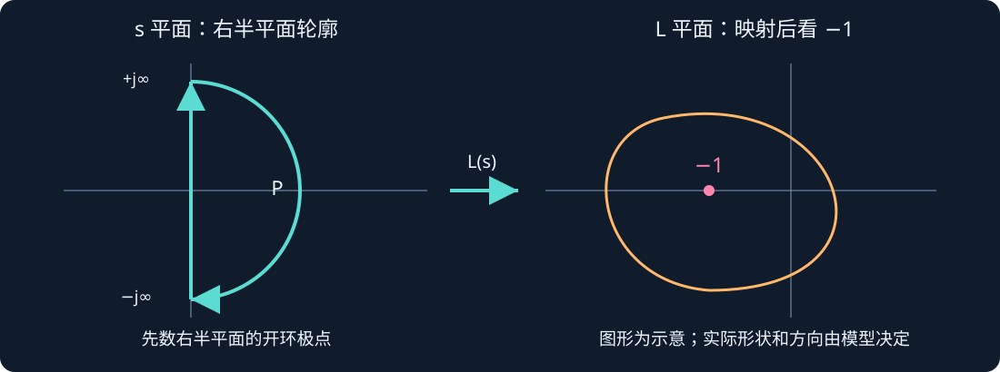
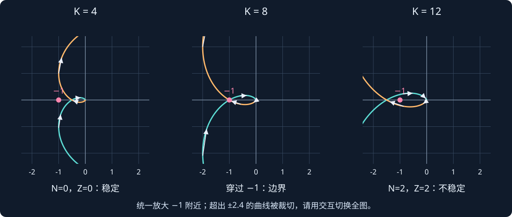
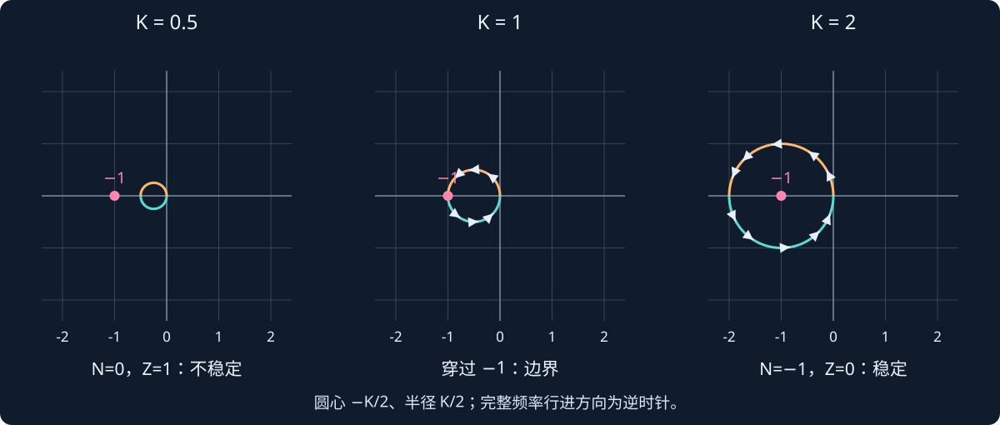
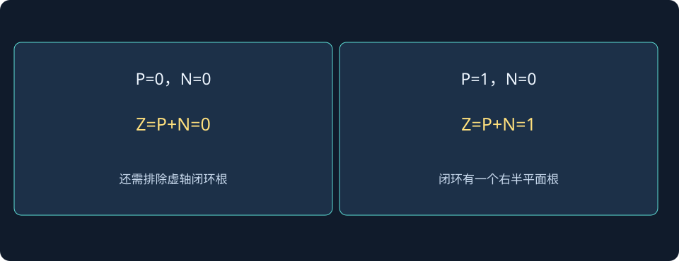

# 第 13 课：Nyquist 稳定判据——沿着曲线判断闭环稳定性

> 阶段 0 · 先看清复平面上的点、方向和包围，再用 P、N、Z 判断闭环根数。

本课接续 Bode 图。已经知道每个频率会得到一个幅值和相位，现在把这个复数画成平面上的点。先记住一个任务：**已知开环环路，判断接上负反馈以后，闭环有没有发散模态。** 不需要一开始就背复变函数证明。

## 1. 为什么盯着 −1，而不是原点？

单位负反馈中，控制器与对象的乘积记为 L。闭环输入输出关系是：

$$
T(s)=\frac{L(s)}{1+L(s)}.
$$

闭环特征方程来自分母：

$$
1+L(s)=0
\quad\Longleftrightarrow\quad
L(s)=-1.
$$

因此 −1 是关键点：环路映射到这里，闭环特征式就变成零。这里的 −1 是复数 −1+j0，既有幅值 1，又有 −180° 相位。

要分清两个平面：s 平面中的横坐标表示极点实部，单位通常为 s⁻¹；L 平面画的是环路复数值，横纵坐标是其实部与虚部。**Nyquist 曲线不是机器人位置轨迹，也不是闭环极点的轨迹。**

## 2. 一个频率怎样变成图上的一个点？

令 s=jω，计算 L(jω)，再画到坐标：

$$
\bigl(\operatorname{Re}L(j\omega),\;\operatorname{Im}L(j\omega)\bigr).
$$

以稍后使用的模型为例，在 ω=1 rad/s 时：

$$
\begin{aligned}
L(s)&=\frac{K}{(s+1)^3},\\
(1+j)^3&=-2+2j,\\
L(j)&=\frac{K}{-2+2j}
=-\frac K4-j\frac K4.
\end{aligned}
$$

若 K=4，图上就是 (−1,−1)，不是关键点 (−1,0)。横坐标都为 −1 不代表曲线穿过关键点。连续改变频率，就得到一条曲线。

实系数模型满足共轭关系：

$$
L(-j\omega)=\overline{L(j\omega)}.
$$

所以负频率分支是正频率分支关于实轴的镜像；但它沿完整轮廓的行进方向不能随意反过来。

## 3. 先统一轮廓和计数方向

本课采用包围右半平面的顺时针 Nyquist 轮廓：沿虚轴从 −j∞ 向 +j∞ 走，再沿右半平面的大半圆返回。这里两个例子的高频环路值都趋于零，因此大半圆映射收缩到 L 平面原点附近。



| 符号 | 数什么？ | 在哪里数？ |
|---|---|---|
| P | 环路的右半平面极点数，计重数 | 开环 s 平面 |
| N | 完整映射对 −1 的净环绕数，顺时针为正 | L 平面 |
| Z | 闭环特征式的右半平面零点数，计重数 | 闭环 s 平面 |

计数关系为：

$$
\boxed{N=Z-P}\qquad\Longleftrightarrow\qquad\boxed{Z=P+N}.
$$

为了严格稳定，需要 Z=0，并且没有虚轴闭环根，也没有被输入输出相消隐藏的不稳定内部模态。不同教材可能把逆时针规定为正，届时公式符号随之变化；务必把公式与方向一起使用。

“净”意味着顺、逆方向会抵消，不是看到两段弧线就数成两圈。曲线如果穿过 −1，环绕数在该参数处不能按普通情况定义，要单独处理稳定边界。

## 4. 例一：三个开环稳定极点，为什么增益过大反而失稳？

### 4.1 模型与 P 的数值

取 K>0，单位负反馈：

$$
L(s)=\frac{K}{(s+1)^3}.
$$

三个开环极点都在 s=−1，因此：


$$
P=0.
$$


这里没有虚轴开环极点，暂时不用处理小半圆绕行。高频映射也趋于零，适合先学习普通情况。

### 4.2 先算负实轴交点

每个 1+jω 的相位为 arctan ω，分母有三项，所以连续展开的相位为：

$$
\angle L(j\omega)=-3\arctan\omega.
$$

曲线落在负实轴时，这里相位为 −180°：

$$
\begin{aligned}
-3\arctan\omega_{pc}&=-180^\circ,\\
\arctan\omega_{pc}&=60^\circ,\\
\omega_{pc}&=\sqrt3\ \mathrm{rad/s}.
\end{aligned}
$$

再算该频率幅值：

$$
\begin{aligned}
|L(j\omega_{pc})|
&=\frac{K}{(1+\omega_{pc}^2)^{3/2}}\\
&=\frac{K}{(1+3)^{3/2}}
=\frac K8.
\end{aligned}
$$

相位 −180° 表明它指向负实轴，故坐标为：

$$
\boxed{L(j\sqrt3)=-\frac K8+j0}.
$$

K 变大时，曲线整体按比例放大；负实轴交点向左移动。**交点只是读图线索，最终仍要检查完整曲线及方向。**

### 4.3 对照三张图数环绕



| K | 负实轴交点 | 完整映射情况 | 结论 |
|---|---|---|---|
| 4 | −0.5 | N=0 | Z=0，闭环严格稳定 |
| 8 | −1 | 穿过关键点，单独分析 | 闭环到达虚轴边界 |
| 12 | −1.5 | 两个顺时针净环绕，N=2 | Z=2，闭环有两个右半平面根 |

K=12 时为什么会是两圈？正、负频率的完整映射各形成一段包围关键点的回路；沿频率方向追踪，会发现两段都贡献顺时针环绕。不要把它想成“只画一个椭圆，所以最多一圈”。交互会同时给出路径数值环绕与闭环根，便于核对。

### 4.4 用闭环根独立核对

特征方程为：

$$
\begin{aligned}
1+\frac K{(s+1)^3}&=0,\\
(s+1)^3+K&=0,\\
s^3+3s^2+3s+(1+K)&=0.
\end{aligned}
$$

Routh 首列为：

$$
1,\quad3,\quad\frac{8-K}{3},\quad1+K.
$$

在 K>0 的约定下，全正要求：


$$
0<K<8.
$$


若 K=8，可以直接分解：

$$
(s+3)(s^2+3)=0
\quad\Longrightarrow\quad
s=-3,\;\pm j\sqrt3.
$$

这同时解释了临界频率为什么也是 √3 rad/s。若不限制 K>0，完整严格稳定区间会是 −1<K<8；本课交互先限定正增益。

还可以直接求三根。令 ρ=K^(1/3)，有：

$$
s_1=-1-\rho,\qquad
s_{2,3}=-1+\frac\rho2\pm j\frac{\sqrt3\rho}{2}.
$$

ρ>2，也就是 K>8 时，一对共轭根的实部变正。K=12 时约为 0.145±1.983j，另一个根约 −3.289。数值与 Z=2 一致。

### 4.5 动手实验：频率点与闭环极点一起看

先选 K=4、8、12 预设，再拖动频率。左图是 L 平面，黄色点显示当前正频率对应的环路复数；右图是闭环极点。勾选“放大 −1 附近”只改变视野，不改变 N、P、Z。关闭放大可查看全部曲线。

:::demo nyquist-explorer model=cubic
:::

先自己预测，再操作：ω=0 时曲线从哪里出发？ω=1 时为什么 K=4 对应 (−1,−1)？K 接近 8 时，一对闭环极点怎样移动？

## 5. 例二：开环不稳定，为什么闭环仍然可能稳定？

### 5.1 先数 P，不沿用上例的结论

换成：

$$
L(s)=\frac K{s-1},\qquad K>0.
$$

开环在 +1 有一个极点，所以 P=1。要使闭环 Z=0，需要：

$$
N=Z-P=0-1=-1.
$$

负的顺时针计数，表示需要一个逆时针净环绕。因此此时“不包围 −1”反而不够：N=0 会导致 Z=1。

### 5.2 这条曲线为什么是圆？

把复数分母实数化：

$$
\begin{aligned}
L(j\omega)
&=\frac K{-1+j\omega}\\
&=-\frac K{1+\omega^2}
-j\frac{K\omega}{1+\omega^2}.
\end{aligned}
$$

令其坐标为 a、b，消去频率可得：

$$
\boxed{\left(a+\frac K2\right)^2+b^2=\left(\frac K2\right)^2}.
$$

因此圆心是 (−K/2,0)，半径 K/2；最左点是 −K，最右点趋近原点。正频率从 −K 沿下半圆走向原点；连同负频率分支，完整行进方向是逆时针。



### 5.3 三种增益，对照圆与闭环根

闭环特征方程可以直接算：

$$
1+\frac K{s-1}=0
\quad\Longrightarrow\quad
s=1-K.
$$

| K | −1 与圆的关系 | 环绕与根数 | 闭环极点 |
|---|---|---|---|
| 0.5 | 在圆外 | N=0，Z=1 | +0.5，不稳定 |
| 1 | 在圆上 | 穿过 −1，边界需单独分析 | 0，非渐近稳定 |
| 2 | 在圆内 | N=−1，Z=0 | −1，严格稳定 |

这里增加增益能把闭环极点向左推，与上例“增益过大失稳”不同。应根据模型与完整判据分析，不能把“增益越大越危险”当成普遍规律。

### 5.4 动手实验：跨过 K=1

观察左图圆是否包含 −1，再看右图极点处于虚轴哪侧。特别比较“曲线穿过 −1”和“极点穿过虚轴”：它们发生在同一增益 K=1。

:::demo nyquist-explorer model=unstable
:::

## 6. 为什么积分器需要额外处理？

若开环在原点有积分极点，例如：


$$
L(s)=\frac K{s(s+1)},
$$


普通 Nyquist 轮廓会穿过奇点，不能直接代入。要把轮廓在极点附近绕开，并计入小半圆的映射。只画正、负频率主分支可能遗漏重要部分。

本课两个完整例子都没有虚轴开环极点，目的是先把方向和 P、N、Z 学清。下一步遇到积分环路时，应先检查轮廓，而不是照搬图形。

## 7. 与 Bode 和稳定裕度的关系

曲线满足 |L|=1 时，对应 Bode 的增益交越频率；到达负实轴时，对应展开相位为 −180° 的交点。离 −1 多近，是理解增益裕度与相位裕度的入口。

使用流程：先数开环 P，检查虚轴极点；再看完整方向并求 N；计算 Z 并排除边界；确认稳定后，再讨论稳定裕度。多次交越或开环不稳定时，不能只挑一个正裕度就宣称闭环稳定。


## 不包围关键点，到底意味着什么？先固定 P 再回答

保持曲线计数 N=0，分别代入两种开环根数：

$$
\begin{aligned}
P=0:&\quad Z=P+N=0,\\
P=1:&\quad Z=P+N=1.
\end{aligned}
$$

这两种结果不矛盾：环绕数不是闭环不稳定根数本身，它还要补上开环已有的右半平面极点。下图固定同一个计数结论，直接比较两种 P 的推理路径。

对于 K/(s−1)，选K=0.5时圆不包围−1，P=1、N=0，所以闭环根+0.5；选K=2时，曲线提供一个逆时针环绕，N=−1，把计数抵消为Z=0，闭环根−1。看图之前先写P，可以避免把开环稳定对象的经验误搬到开环不稳定对象。



**读图与操作**：两个交互选同样“不包围”状态，对比P与Z；再用闭环极点图核对。

**使用条件**：沿本课约定的右半平面顺时针轮廓，N以顺时针为正；边界不套普通环绕数。

### 先预测，再展开核对

若 P=2，为使Z=0，需要什么方向、几次净环绕？

<details><summary>查看思路与答案</summary>

需要N=−2，也就是两个逆时针净环绕；还要排除映射穿过−1和闭环虚轴根。

</details>

## 8. MATLAB：两条独立路线核对

```matlab
% 需要 Control System Toolbox
s=tf('s');
figure; nyquist(4/(s+1)^3,8/(s+1)^3,12/(s+1)^3); grid on;
legend('K=4','K=8','K=12');
for K=[4 8 12]
    disp(K); disp(roots([1 3 3 1+K]));
end
figure; nyquist(0.5/(s-1),1/(s-1),2/(s-1)); grid on;
legend('K=0.5','K=1','K=2');
for K=[0.5 1 2]
    fprintf('K=%g, closed-loop pole=%g\n',K,1-K);
end
```

Nyquist 绘图核对曲线，直接求根核对右半平面根数。两种方法应一致。示例未由 MATLAB 实际执行；仅用基础 MATLAB 的 roots 也能独立核对第一模型的根。

## 9. 练习与提示

1. 对第一个模型，在 ω=0、1、√3、很大时，分别写出曲线位置或极限。
2. 不看图，用 Routh 判据求第一个模型的正增益严格稳定区间。
3. 对第二个模型，手算 K=3 时的圆心、半径、N、P、Z 和闭环极点。
4. 为什么 P=1、N=0 时，曲线没有包围 −1 也不能认为稳定？
5. K=8 与 K=1 两个边界分别对应什么闭环根？为何不能用普通整数环绕数直接判定边界？

<details><summary>展开自查提示（先自己做）</summary>

第一模型：L(0)=K，L(j)=−K/4−jK/4，L(j√3)=−K/8，高频趋于 0。正增益稳定区间 0<K<8。第二模型 K=3 时圆心 −1.5、半径 1.5，N=−1、P=1、Z=0，闭环根 −2。P=1、N=0 则 Z=1。

</details>
