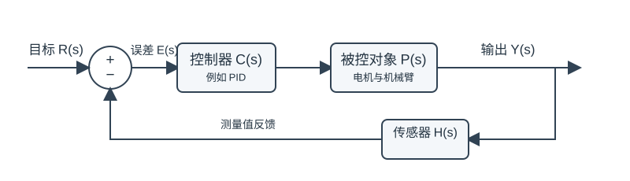
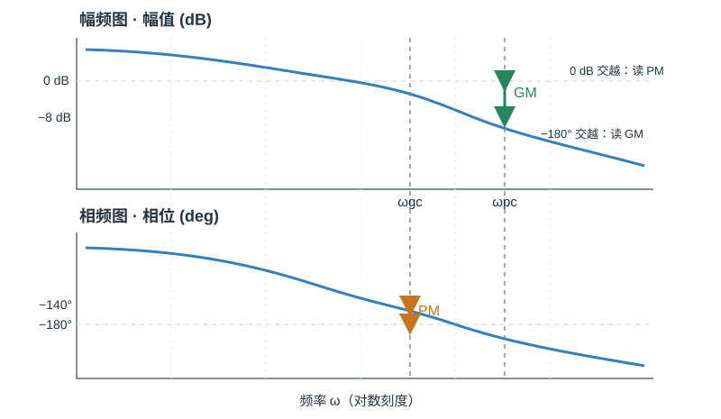
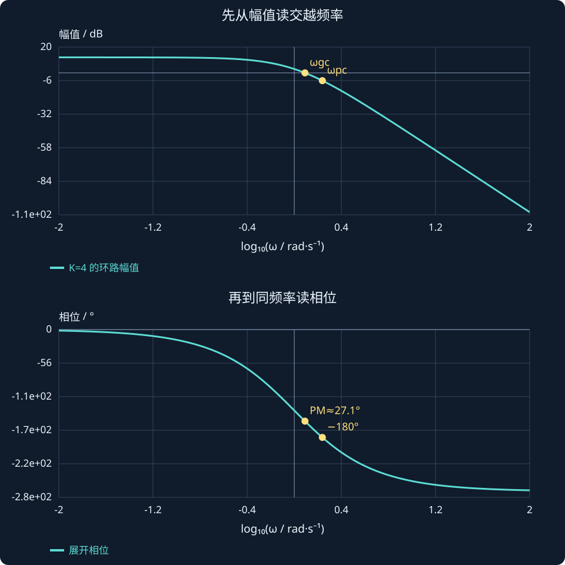

# 第 14 课：增益裕度与相位裕度

> 第 3 周｜第 2 节：系统离失稳还有多远？

上一课我们学会从 Bode 图读出“系统在不同频率下会放大多少、滞后多少”。这一课继续追问一个工程问题：**如果控制器增益继续增加，或者系统延迟再多一点，闭环会不会开始持续振荡？离这个边界还有多远？**

我们会先用“绕圈时多转了多少、速度又放大了多少”的直觉理解，再正式定义相位裕度和增益裕度。最后用一个可调模型、MATLAB 仿真和练习，把图上的读数与闭环稳定性连起来。

学完后，你应该能：

1. 说明为什么要看开环 Bode 图，却关心闭环稳定性。
2. 在 Bode 图上找出增益交越频率和相位交越频率。
3. 计算相位裕度 PM 和增益裕度 GM，并解释单位。
4. 理解裕度较小意味着什么，以及它为什么不是“安全保证书”。

## 一、从机器人关节的“越调越抖”说起

想象一个机械臂关节在跟踪目标角度。控制器发现位置误差后增加电机力矩，关节开始向目标运动；传感器测到运动后，控制器再修正力矩。

这是负反馈：希望“发现偏差后，施加能让偏差变小的作用”。

但真实系统有惯性和延迟。控制命令发出去后，关节不会立刻按命令变化；等反馈回来时，关节可能已经继续向前转了一段。若修正来得太晚、又太强，控制器可能反过来把关节推向另一边。于是出现来回摆动。

这时只问“增益是不是太大”还不够。我们需要两个角度：

- **相位裕度**：在系统相位已经接近“反馈方向反过来”的频率处，还能容忍多少额外相位滞后？
- **增益裕度**：在相位已经到达临界方向的频率处，环路增益还能放大多少倍才到临界？

可以先把它们想成两种“离边界的距离”：一个用角度量，一个用倍数或 dB 量。

## 二、为什么分析开环，最后却要判断闭环？

先定义开环环路传递函数：

$$
L(s)=C(s)P(s)
$$

这里 $C(s)$ 是控制器，$P(s)$ 是被控对象。对单位负反馈，闭环从目标 $R$ 到输出 $Y$ 的传递函数是：

$$
T(s)=\frac{Y(s)}{R(s)}=\frac{L(s)}{1+L(s)}
$$

闭环的分母是 $1+L(s)$。稳定性问题因此与方程 $1+L(s)=0$ 有关。

我们为何看开环 $L(j\omega)$？因为它更容易拆开理解：控制器和对象各自的增益、相位可以相乘、相加；而闭环性能可以借由开环曲线靠近临界点的程度来判断。对本课讨论的**连续时间、单位负反馈、线性时不变系统**，裕度是很有用的稳定余量指标。

一个直观的临界情况是：

$$
L(j\omega)=-1
$$

$-1$ 这个复数有两个特点：模长为 1，相位为 $-180^\circ$（也可写成 $180^\circ$）。此时 $1+L(j\omega)=0$，闭环特征分母在该频率处到达临界。因此我们接下来重点找：

图 1：裕度分析通常针对环路 $L(s)=C(s)P(s)$；如果传感器动态不可忽略，也要把 $H(s)$ 纳入分析。

- 开环幅值何时等于 1，也就是 0 dB？
- 开环相位何时等于 $-180^\circ$？
- 在其中一个条件满足时，另一个条件离临界还多远？

## 三、两个交越频率：先把图上的位置找对

### 3.1 增益交越频率 $\omega_{gc}$

增益交越频率（gain crossover frequency）是开环幅值等于 1 的频率：

$$
|L(j\omega_{gc})|=1
$$

用 dB 表示，等价于幅频曲线经过 $0\,\mathrm{dB}$ 的位置。

### 3.2 相位交越频率 $\omega_{pc}$

相位交越频率（phase crossover frequency）是开环相位达到 $-180^\circ$ 的频率：

$$
\arg L(j\omega_{pc})=-180^\circ
$$

找准这两个点很重要：**PM 在增益交越频率处读；GM 在相位交越频率处读。**不要把两个频率或两种裕度对调。

图 2：曲线只作读图示意。沿同一频率向另一张图对照，才能读到对应的裕度。

## 四、相位裕度 PM：还可以多滞后多少角度？

在 $\omega_{gc}$ 处，开环幅值正好是 1。此时查看相位离 $-180^\circ$ 还差多少：

$$
\boxed{\mathrm{PM}=180^\circ+\arg L(j\omega_{gc})}
$$

假设在增益交越频率处，相位是 $-150^\circ$，那么：

$$
\mathrm{PM}=180^\circ-150^\circ=30^\circ
$$

这表示：在这个交越点，环路相位还可以再往负方向移动约 $30^\circ$，才到达 $-180^\circ$ 的临界相位。

如果 PM 很小，额外延迟、滤波、采样和模型误差带来的相位滞后就更容易把系统推近临界。PM 较大通常意味着相对更充足的相位余量，但并不意味着响应一定又快又好。

### 一个常见的延迟直觉

纯延迟 $e^{-sT_d}$ 在频率 $\omega$ 处增加的相位是：

$$
\phi_d(\omega)=-\omega T_d
$$

当相位以弧度计算时，若某个交越频率处还剩 PM 弧度的裕度，粗略的延迟余量估算为：

$$
T_{d,\max}\approx\frac{\mathrm{PM}_{\mathrm{rad}}}{\omega_{gc}}
$$

这是基于交越附近的简化估算，不等于复杂数字控制系统的完整时延上限；实际还要考虑采样、计算、通信、滤波和其他交越点。

## 五、增益裕度 GM：环路增益还能放大多少倍？

到相位交越频率 $\omega_{pc}$ 时，相位已经是 $-180^\circ$。此时查看开环幅值离 1 还有多远：

$$
\boxed{\mathrm{GM}=\frac{1}{|L(j\omega_{pc})|}}
$$

以分贝表示：

$$
\boxed{\mathrm{GM}_{\mathrm{dB}}=20\log_{10}(\mathrm{GM})=-20\log_{10}|L(j\omega_{pc})|}
$$

例如相位交越频率处开环幅值为 $0.25$：

$$
\mathrm{GM}=\frac1{0.25}=4
$$

$$
\mathrm{GM}_{\mathrm{dB}}=20\log_{10}(4)\approx12.04\,\mathrm{dB}
$$

也就是说，按这个单一环路模型估算，增益变成原来的 4 倍时，曲线才会在该频率达到幅值 1、相位 $-180^\circ$ 的临界组合。

如果 GM 小于 1，GM 的 dB 值为负，说明当前增益已经超过这个临界参考值。若系统有多个相位交越点、开环本身不稳定，或使用了非单位反馈，判断要更谨慎；不能只抄一个裕度数字就断言闭环稳定。

### 为什么是 $20\log_{10}$？

GM 是幅值倍数。上一课我们学过，幅值比换算为 dB 使用 $20\log_{10}$。例如 2 倍约为 $6.02\,\mathrm{dB}$，10 倍为 $20\,\mathrm{dB}$。dB 可以让“很大的倍数范围”更容易在图上比较。

## 把 PM、GM 从图上的距离算成具体数字

用无虚轴开环极点的环路：

$$L(s)=\frac4{(s+1)^3}.$$

先找增益交越频率，再求相位裕度，不能任意挑一个相位好看的频率：

$$
\begin{aligned}
\frac4{(1+\omega_{gc}^2)^{3/2}}&=1,\\
\omega_{gc}&=\sqrt{4^{2/3}-1}\approx1.233\ \mathrm{rad/s},\\
PM&=180^\circ-3\arctan(\omega_{gc})\approx27.1^\circ.
\end{aligned}
$$

相位−180°的位置为√3 rad/s，此处幅值为4/8=0.5，因此：

$$GM=\frac1{0.5}=2,\qquad GM_{dB}=20\log_{10}2\approx6.02\ \mathrm{dB}.$$

2 是幅值倍率，不是2 dB。把增益从4乘以2到8，闭环到达临界，恰好与 Nyquist 的例子相连。PM 的度数和 GM 的 dB 也不能互相相加。

图中标出同一模型的两个交越位置：幅值图读0 dB处的频率去相位图读PM；相位图读−180°处的频率再去幅值图读GM。

**读图与操作**：调增益时同时记录新的交越频率与PM；不要只把幅值图竖直移动，而把PM固定不变。

**使用条件**：本例开环稳定且交越结构简单；多交越、开环不稳定或延迟系统要结合完整Nyquist分析。

### 先预测，再展开核对

把当前增益从4改成6，增益裕度倍率是多少？dB是多少？

查看思路与答案

仍以临界增益8为参照，倍率8/6≈1.333，约2.50 dB；不要直接写“剩余增益2”。

## 六、交互实验：亲手把系统推向临界

我们用一个可解析的教学模型：

$$
\boxed{L(s)=\frac{K}{(s+1)^3}}
$$

它表示三个相同的一阶滞后串联，再乘上可调环路增益 $K$。这是为了看清裕度定义而选的简化模型，不是某台真实机械臂的完整模型。

:::demo design mode=margins
:::

建议先把 $K$ 设为 4，观察两张 Bode 图上的交越位置和数值：

- 增益交越处幅值为 $0\,\mathrm{dB}$，读取其相位并计算 PM。
- 相位交越处相位为 $-180^\circ$，读取其幅值并计算 GM。
- 再逐渐增大 $K$：幅频曲线整体上移，增益交越频率向右移动，PM 通常减小。
- 当 $K$ 接近 8 时，模型的 GM 接近 1（0 dB），闭环接近稳定边界。

这个模型的相位交越频率可以直接求出。每个 $(s+1)$ 在 $j\omega$ 处贡献相位 $-\arctan\omega$，三个串联后总相位为 $-3\arctan\omega$。令它等于 $-180^\circ$：

$$
-3\arctan\omega_{pc}=-180^\circ
\quad\Longrightarrow\quad
\boxed{\omega_{pc}=\sqrt{3}\ \mathrm{rad/s}}
$$

在这个频率，每个因子的幅值为 $|1+j\sqrt3|=2$，三者乘起来是 8，所以：

$$
|L(j\omega_{pc})|=\frac K8,\qquad
\boxed{\mathrm{GM}=\frac8K}
$$

于是 $K=4$ 时，GM 是 2 倍，也就是约 $6.02\,\mathrm{dB}$；$K=8$ 时 GM 为 1，也就是 $0\,\mathrm{dB}$。

**再从闭环方程交叉验证**：单位负反馈的闭环特征方程为

$$
(s+1)^3+K=0
$$

展开后是 $s^3+3s^2+3s+(1+K)=0$。Routh–Hurwitz 条件给出 $0<K<8$ 时稳定，$K=8$ 到达临界边界。这与 GM 算出的 $K=8$ 相吻合。这个对应关系是本教学模型的特性，不要把 $K<8$ 当成所有控制系统都通用的规则。

## 七、把 Bode 图读法整理成固定步骤

拿到一张开环 Bode 图，可以按下面顺序操作：

1. **确认画的是开环环路 $L(s)=C(s)P(s)$。**确认反馈符号、单位、频率单位和相位范围。
2. **找 0 dB 交越点。**读取 $\omega_{gc}$，再到相频图读取该频率的相位。
3. **计算 PM。**用 $180^\circ+\arg L(j\omega_{gc})$。
4. **找 $-180^\circ$ 交越点。**读取 $\omega_{pc}$，再到幅频图读取该频率的 dB 值。
5. **计算 GM。**幅值 dB 若为 $A_{\mathrm{dB}}$，则 $\mathrm{GM}_{\mathrm{dB}}=-A_{\mathrm{dB}}$；线性 GM 为 $10^{\mathrm{GM}_{\mathrm{dB}}/20}$。
6. **看是否有多个交越点、系统是否开环稳定，以及裕度定义是否适用。**标注 MATLAB 或软件返回的每个交越点，不要只挑看起来好看的一个。

口算示例：若 $\omega_{gc}=5\,\mathrm{rad/s}$ 时相位为 $-140^\circ$，则 PM 为 $40^\circ$。若 $\omega_{pc}=12\,\mathrm{rad/s}$ 时幅值为 $-8\,\mathrm{dB}$，则 GM 为 $+8\,\mathrm{dB}$，线性倍数约为 $10^{8/20}=2.51$。

## 八、裕度大就一定更好吗？

裕度可以帮助比较设计方案，但不是越大越好，也不能单独替代其他分析。

- 提高 $K_p$ 常常会把开环幅值曲线向上推，可能提高交越频率、加快某些响应，同时让 PM 变小。
- 增加滤波或延迟可能增加相位滞后，降低 PM。
- 提高带宽通常有利于快速跟踪，但高频噪声、执行器限幅和未建模动态可能变得更重要。
- 很大的裕度可能对应较保守、较慢的设计；仍要看跟踪速度、超调、噪声和控制力矩。
- 裕度是基于指定模型和交越点的指标。非线性、饱和、时变、柔性结构、多个回路耦合等，都可能使实际结果不同。

所以设计时经常是权衡：在足够的稳定余量下，尽可能满足响应速度、误差、噪声和执行器能力要求。具体目标值要由系统、任务和规范决定，不存在对所有机器人都适用的单一“合格裕度”。

## 九、MATLAB：算裕度并观察 $K$ 怎么改变它

以下代码需要 Control System Toolbox。先比较 $K=4$ 和临界附近的 $K=7.8$：

~~~matlab
clc;
clear;
close all;

s = tf('s');
K = 4;
L = K/(s+1)^3;

figure;
margin(L);
grid on;
title('开环环路的增益裕度与相位裕度');

[GM, PM, Wcg, Wcp] = margin(L);
fprintf('GM = %.3f 倍, GM = %.2f dB\n', GM, 20*log10(GM));
fprintf('PM = %.2f deg\n', PM);
fprintf('增益交越频率 Wcg = %.3f rad/s\n', Wcg);
fprintf('相位交越频率 Wcp = %.3f rad/s\n', Wcp);

K = 7.8;
Lnear = K/(s+1)^3;
figure;
margin(Lnear);
grid on;
title('提高环路增益后，观察稳定裕度变化');
~~~

MATLAB 的 <code>margin</code> 常见返回顺序是 <code>GM, PM, Wcg, Wcp</code>：增益裕度、相位裕度、增益交越频率、相位交越频率。不同版本或多交越系统可能显示多个结果；请结合图确认交越点。若 GM 为 <code>Inf</code>，通常表示在显示频率范围内没有相位交越点，不能把它误读成“现实系统绝对安全”。

你也可以从闭环极点看本模型靠近临界时的变化：

~~~matlab
K_values = [4 7 7.8 8 9];
for K = K_values
    T = feedback(K/(s+1)^3, 1);
    fprintf('K = %.1f, poles =\n', K);
    disp(pole(T));
end
~~~

当 $K$ 靠近 8，闭环极点会接近虚轴；越过临界后，至少有极点进入右半平面。**Bode 裕度和闭环极点是两种互相核对的视角。**

## 十、本课公式卡

| 名称 | 公式 | 在哪里读 |
| --- | --- | --- |
| 开环环路 | $L(s)=C(s)P(s)$ | 控制器乘被控对象 |
| 单位负反馈闭环 | $T(s)=L(s)/(1+L(s))$ | 目标到输出 |
| 增益交越频率 | $|L(j\omega_{gc})|=1$ | 幅频图 0 dB |
| 相位交越频率 | $\arg L(j\omega_{pc})=-180^\circ$ | 相频图 $-180^\circ$ |
| 相位裕度 | $\mathrm{PM}=180^\circ+\arg L(j\omega_{gc})$ | 在增益交越频率读取 |
| 增益裕度 | $\mathrm{GM}=1/|L(j\omega_{pc})|$ | 在相位交越频率读取 |
| 增益裕度 dB | $\mathrm{GM}_{\mathrm{dB}}=-20\log_{10}|L(j\omega_{pc})|$ | 等于临界点处幅值 dB 的相反数 |

相位要使用一致的展开方式；如果相位跨过 $-180^\circ$ 后软件显示成 $+180^\circ$，读图时要理解相位展开（phase unwrap）。

## 十一、第 14 课课后练习

请先自己作答，我会逐题批改并解释。批改完后会等你明确说“下一课”，不会自动跳到第 16 课。

### 练习 1：从 Bode 图读 PM

在增益交越频率处，开环相位为 $-155^\circ$。请计算 PM，并用一句话解释这个角度代表什么。

### 练习 2：从 Bode 图读 GM

在相位交越频率处，开环幅值为 $-10\,\mathrm{dB}$。请计算：

1. 增益裕度是多少 dB？
2. 线性倍数大约是多少？

### 练习 3：检查教学模型

对于 $L(s)=K/(s+1)^3$，若 $K=2$：

1. 相位交越频率是多少？
2. GM 是多少倍、多少 dB？
3. $K$ 增大时，GM 如何变化？

### 练习 4：联系机器人

提高关节位置环的比例增益后，跟踪似乎变快，但机械臂开始更容易振荡。请用“增益交越频率”和“相位裕度”解释一种可能原因；再说出至少一个不能只靠 PM 判断的实际因素。

本课核心：**PM 看 0 dB 处还剩多少相位，GM 看 $-180^\circ$ 处还剩多少增益。**它们把“离临界还有多远”变成可以在开环 Bode 图上读出的量。

## 课程衔接与条件检查

### 先确认闭环稳定，再读裕度

PM 常在每个增益交越频率处按 $180^\circ+\angle L(j\omega_{gc})$ 计算；相位需要连续展开，不能因主值跳变误读。GM 来自相位交越处幅值的倒数。多次交越时，应逐个检查并结合 Nyquist，而不是挑一个好看的数。

没有有限的 −180° 相位交越可能使经典增益裕度无穷，但不意味着对任意延迟都鲁棒。纯延迟能增加相位滞后；相关延迟余量近似要用弧度相位裕度除以交越角频率，并核对适用前提。

**自查**：把当前增益从4改成6，增益裕度倍率是多少？dB是多少？
