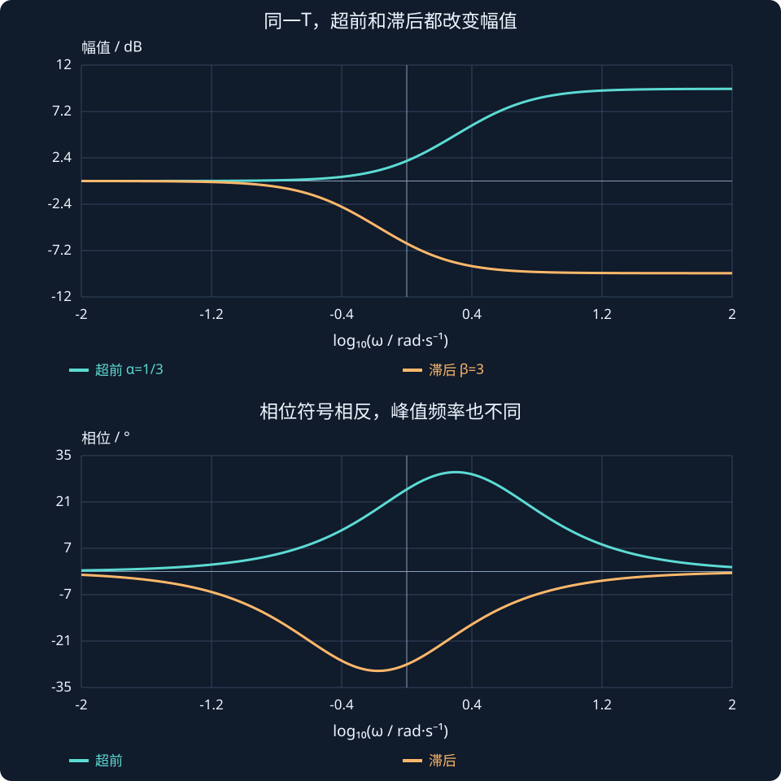

# 第 15 课：超前与滞后校正

> 阶段 0 · 从性能要求选择补偿器，并复查裕度、低频精度和输入代价。


## 1. 为什么改增益还不够？

比例增益主要把 Bode 幅值整体抬高，通常不直接改变相位；交越频率却会移动，因而实际相位裕度也可能变化。若希望同时调整低频精度和交越附近的相位，只改变一个增益往往不够，需要增加极点和零点。

本课用串联超前与滞后网络讲解“在哪段频率改变多少”。它们不是保证稳定的通用按钮；补偿器、对象和增益组成新环路后，要重新检查。

## 2. 超前网络：在一段频率提供正相位

取 $C_{lead}(s)=(1+Ts)/(1+\alpha Ts)$，T>0、0<α<1。零点 −1/T 比极点 −1/(αT) 更靠近原点。相位是 $\arctan(\omega T)-\arctan(\alpha\omega T)$，因此在正频率处为正。

最大相位超前与对应频率为：


$$
\phi_{max}=\sin^{-1}\frac{1-\alpha}{1+\alpha},\qquad \omega_m=\frac1{T\sqrt\alpha}.
$$


在该频率幅值为 $1/\sqrt\alpha$，说明增加相位的同时会提高幅值、移动交越点。若只把原相位裕度加上峰值相位，而不重新找交越频率，会高估或误估设计效果。

## 3. 完整数值设计：把相位峰值放在 2 rad/s

取对象与设计目标：

$$G(s)=\frac1{s(s+1)},\qquad \omega_{gc}\approx2\ \mathrm{rad/s},\qquad \phi_{max}=30^\circ.$$

第一步，反解 α，使相位峰值达到 30°：

$$
\alpha=\frac{1-\sin30^\circ}{1+\sin30^\circ}=\frac13.
$$

第二步，让峰值频率等于设计交越频率：

$$
T=\frac1{\omega_{gc}\sqrt\alpha}=\frac1{2\sqrt{1/3}}\approx0.866\ \mathrm{s}.
$$

第三步，求此频率的对象与网络幅值：

$$
\begin{aligned}
|G(j2)|&=\frac1{2\sqrt5}\approx0.2236,\\
|C_{lead}(j2)|&=\frac1{\sqrt\alpha}=\sqrt3.
\end{aligned}
$$

第四步，调总增益 K，使完整环路在该处幅值为 1：

$$K=\frac1{|G(j2)|\,|C_{lead}(j2)|}\approx2.582.$$

第五步，算新环路相位和相位裕度：

$$
\begin{aligned}
\angle G(j2)&=-90^\circ-\arctan2\approx-153.435^\circ,\\
\angle L(j2)&\approx-153.435^\circ+30^\circ=-123.435^\circ,\\
PM&\approx180^\circ-123.435^\circ=56.565^\circ.
\end{aligned}
$$

得到的是该模型下的候选设计，还要核对全部交越和闭环极点。超前网络高频增益趋于 1/α=3，加上 K 后会影响噪声和控制输入；不能只因为相位裕度变大就宣布所有性能都改善。


## 4. 滞后网络：相对提高低频增益

取 $C_{lag}(s)=(1+Ts)/(1+\beta Ts)$，β>1。它的低频增益为 1，高频增益为 1/β，相位为负。若采用 $\beta C_{lag}$，低频增益变为 β，高频约保持 1，因此可相对提高低频精度。

例如 β=10、T=10 s，对应零点 −0.1、极点 −0.01。采用 $10C_{lag}$ 可把低频增益提高十倍，而在远高于 0.1 rad/s 处近似不变。但仍会带来负相位和慢动态。把转折频率放在交越频率之下，只能减轻影响，不能说完全没有影响。

## 5. 把设计步骤串起来

先给出目标：稳态误差、交越频率或响应速度、期望稳定裕度。再画未校正对象的频率响应，判断需要补的是低频增益还是交越附近的相位。选择网络参数后，用幅值条件调整总增益，重新求全部交越、裕度、闭环极点、阶跃响应和控制输入。

超前常用于增加交越附近相位与调整带宽；滞后常用于改善低频相对增益。若两者都需要，可组合超前—滞后，但参数应根据完整环路迭代。

## 6. 与 PID、延迟和状态反馈的联系

带滤波的微分环节可在某段频率表现出超前作用，PI 可提高低频增益并引入积分。它们与本课网络有相似目的，但不是所有频率上完全相同的传递函数。

加入纯延迟 $e^{-s\tau}$ 后，幅值不变，相位额外减少 $\omega\tau$ rad。提高交越频率会增加延迟损失，因此校正完成后要回到“带宽与延迟鲁棒性”一课复查。后续状态反馈也面对相似性能取舍，只是设计表达换成状态空间。


## 超前网络在哪一段帮忙，在哪一段付出代价？

固定α=1/3、T=√3/2 s：

$$C_{lead}(s)=\frac{1+Ts}{1+\alpha Ts}.$$

零点在约−1.155，极点在约−3.464。先遇到零点，幅值先抬升、相位先向正方向变化；随后极点抵消部分相位，最终相位回到0°。最大超前并不在零点或极点位置，而在它们频率的几何平均处：

$$
\omega_m=\sqrt{\frac1T\frac1{\alpha T}}=2\ \mathrm{rad/s},\qquad
\phi_{max}=30^\circ.
$$

峰值处网络幅值√3，即约4.77 dB；高频最终幅值3，即约9.54 dB。因此“只增加30°、其他都不动”不是这个补偿器的行为。图中用同一α与T比较超前网络和相应β=3的滞后网络，分别标注幅值与相位轴。

设计时把对象一起乘进去，重新找0 dB交越，才能知道实际增加了多少PM。若目标交越变了，还需重新检查延迟损失。



**读图与操作**：固定α只调T，先观察峰值水平移动；固定T再改α，观察相位高度和幅值一起变化。

**使用条件**：一阶超前/滞后网络的连续频率响应，不代表整个闭环的稳定性与性能。

### 先预测，再展开核对

若T加倍、α不变，最大相位与峰值频率分别怎样变？

<details><summary>查看思路与答案</summary>

最大相位仍为30°，峰值频率减半到1 rad/s；零极点频率同时减半。

</details>

## 交互实验

选择超前或滞后，调节 α、T。只画补偿器本身：蓝色为幅值 dB（左轴），橙色为相位 °（右轴）。先判断相位正负，再看峰值位置随 T 移动；还需结合被控对象检查最终环路。

:::demo bridge-lab mode=compensator
:::

## MATLAB 验证

```matlab
s=tf('s'); G=1/(s*(s+1));
a=1/3; T=1/(2*sqrt(a)); K=2.582;
C=K*(1+T*s)/(1+a*T*s); L=C*G;
figure; margin(L); grid on;
figure; step(feedback(L,1)); grid on;
figure; step(feedback(C,G)); grid on; title('单位参考到控制输入');
disp(pole(feedback(L,1)));
```

本例使用 Control System Toolbox。请先预测趋势，再运行程序核对；这里给出可运行示例，不代表已在 MATLAB 中执行。

## 公式、条件与符号


$$
C_{lead}=\frac{1+Ts}{1+\alpha Ts},\quad 0<\alpha<1,\quad \omega_m=\frac1{T\sqrt\alpha},\quad \phi_{max}=\sin^{-1}\frac{1-\alpha}{1+\alpha}.
$$


T 为时间常数，α 为无量纲比值，ω 单位 rad/s。反正弦结果按 rad 或 °统一换算。峰值处幅值为 $1/\sqrt\alpha$。


$$
C_{lag}=\frac{1+Ts}{1+\beta Ts},\qquad \beta>1.
$$


β 是无量纲参数；该形式低频为 1、高频为 1/β。若希望提高低频而近似保持高频，使用 β 倍该网络并重新核对整个环路。


## 练习与理解检查

1. 求 α=0.25 时最大超前角和峰值幅值。
2. 若峰值希望放在 4 rad/s，T 应取多少？
3. 为什么加了超前网络必须重新找交越频率？
4. 为 β=5、T=20 s 的滞后网络求零极点，解释低频与高频增益。
5. 本课数值超前设计加入 0.1 s 延迟后，在 2 rad/s 额外损失多少相位？


完成练习后逐题解释依据，问题澄清后再进入下一课。
