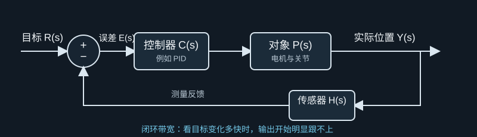
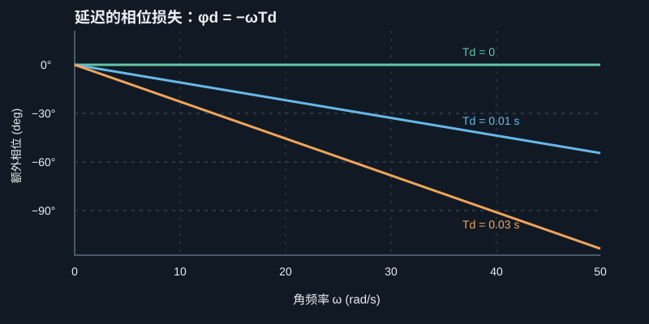
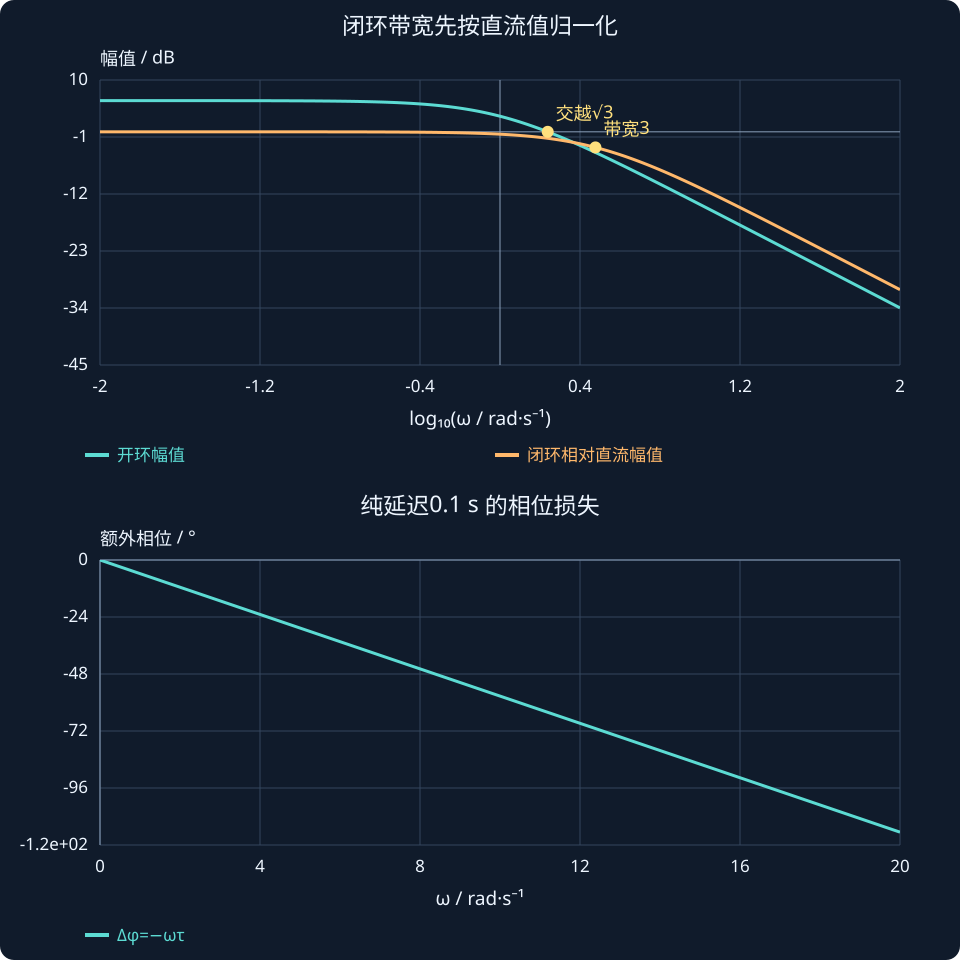

# 第 16 课：闭环带宽、延迟与鲁棒性

> 第 3 周｜第 3 节：既要跟得快，也要留有余量

第 12 课我们学了：频率越高，系统可能跟得越小、越晚。第 14 课又学了：增益裕度和相位裕度能表示开环系统离临界状态还有多少余量。

这一课把两条线索合在一起，回答一个实际设计问题：

**怎样让机器人跟踪得更快，同时又不因为计算、通信或传感器延迟而变得容易振荡？**

我们会先从闭环的输入输出关系理解“带宽”，再用一个简单的电机位置环算出提高增益的效果，最后观察延迟如何随频率增长、消耗相位裕度，并讨论这和鲁棒性的关系。

学完后，你应该能：

1. 用自己的话解释闭环带宽表示什么。
2. 区分闭环带宽与开环增益交越频率。
3. 说明纯延迟为何不改变幅值，却会增加相位滞后。
4. 用相位裕度估算一个简单系统还能容忍多少额外延迟。
5. 解释“更快”与“更稳健”为什么常常需要权衡。

## 一、从“目标变化时，机械臂能跟多快”开始

想象机械臂跟踪一个逐渐变快的正弦目标：

$$
q_d(t)=A\sin(\omega t)
$$

目标变化很慢时，控制器有时间让关节跟上；目标变化得很快时，机械臂可能逐渐跟不上。实际角度可能比目标小，也可能晚一些才到达相同位置。

第 12 课用频率响应描述这种现象。但本课更关心**闭环**：从目标位置 $r$ 到实际位置 $y$ 的整条反馈系统，最终能跟踪多快？

单位负反馈下：

$$
L(s)=C(s)P(s),\qquad
T(s)=\frac{Y(s)}{R(s)}=\frac{L(s)}{1+L(s)}
$$

$L(s)$ 是开环环路，$T(s)$ 是闭环目标到输出的传递函数。带宽通常讨论的是闭环 $T(s)$，因为它直接描述“给目标后，实际输出跟得如何”。

图 1：闭环带宽关心从目标到输出的整体响应速度；开环裕度则用来检查反馈环路的稳定余量。

## 二、带宽是什么：从低频能跟，到高频跟不上

先看一个低通型的闭环系统。目标变化很慢时，输出幅值接近目标；频率逐渐升高后，输出幅值开始衰减。

为了给“开始明显跟不上”一个统一读数，常用 **−3 dB 带宽**。相对于低频稳态增益，当闭环幅值降到低频值的 $1/\sqrt2\approx0.707$ 时，对应的频率叫带宽：

$$
\boxed{|T(j\omega_{BW})|=\frac{|T(0)|}{\sqrt2}}
$$

如果低频增益约等于 1，也就是 0 dB，那么 −3 dB 点对应闭环幅值约为 0.707。

带宽较大，通常意味着系统能跟踪更快变化的目标；带宽较小，系统会更早开始衰减。但带宽并不直接告诉你所有动态表现：超调、振铃、时延、噪声放大和执行器饱和还需要分别检查。

### 一个一阶系统的直觉

一阶低通闭环可写成：

$$
T(s)=\frac{1}{\tau_{cl}s+1}
$$

它的带宽为：

$$
\omega_{BW}=\frac1{\tau_{cl}}
$$

时间常数越小，带宽越大，系统响应越快。对这种一阶系统，上升时间常用近似：

$$
T_r\approx\frac{2.2}{\omega_{BW}}
$$

这个关系帮助我们建立直觉，不应该直接套到有明显振荡、多个时间尺度或时延的复杂机器人系统。

## 三、用比例控制器看见“增益提高，响应变快”

假设一个简化电机位置系统为：

$$
P(s)=\frac{1}{\tau s+1}
$$

控制器只使用比例增益 $K$：

$$
C(s)=K
$$

于是：

$$
L(s)=\frac{K}{\tau s+1}
$$

单位负反馈闭环为：

$$
T(s)=\frac{K}{\tau s+1+K}
=\frac{K}{1+K}\cdot
\frac{1}{\frac{\tau}{1+K}s+1}
$$

这个结果告诉我们两件事：

- 低频闭环增益为 $K/(1+K)$。$K$ 越大，最终位置越接近目标。
- 闭环时间常数为 $\tau/(1+K)$，所以闭环 −3 dB 带宽为：

$$
\boxed{\omega_{BW}=\frac{1+K}{\tau}}
$$

这里用的是**闭环幅值相对自身低频值下降 3 dB**的定义。因为这个简单比例控制系统有稳态跟踪误差，不能误把其直流增益 $K/(1+K)$ 当成 1。

例如取 $\tau=0.2\,\mathrm{s}$：

| 比例增益 $K$ | 低频闭环增益 $K/(1+K)$ | 闭环带宽 $\omega_{BW}$ | 直观表现 |
| ---: | ---: | ---: | --- |
| 1 | 0.50 | 10 rad/s | 跟踪偏慢，稳态误差较大 |
| 2 | 0.67 | 15 rad/s | 更快，稳态误差减小 |
| 10 | 0.91 | 55 rad/s | 更快，低频跟踪更接近目标 |

这看起来像是“把 $K$ 调大就好”。但还没考虑延迟。高增益会把开环增益交越频率推高，而高频处的延迟相位损失更严重。

## 四、闭环带宽不等于开环交越频率

第 14 课里我们找过增益交越频率 $\omega_{gc}$：

$$
|L(j\omega_{gc})|=1
$$

这是一种**开环读数**。本课的 $\omega_{BW}$ 来自闭环传递函数 $T(s)$，是一种**闭环读数**。两者常常有关联，但定义不同，数值也不保证相等。

对刚才的比例控制例子，若 $K>1$，开环增益交越频率为：

$$
\omega_{gc}=\frac{\sqrt{K^2-1}}{\tau}
$$

闭环带宽则为：

$$
\omega_{BW}=\frac{1+K}{\tau}
$$

以 $K=2,\tau=0.2\,\mathrm{s}$ 为例：

$$
\omega_{gc}=\frac{\sqrt3}{0.2}\approx8.66\,\mathrm{rad/s},
\qquad
\omega_{BW}=\frac3{0.2}=15\,\mathrm{rad/s}
$$

二者不是同一个数字。不同系统结构和控制器下，它们之间的关系也会改变。读图或看软件输出时，先确认自己要的是开环交越频率还是闭环带宽。

## 五、延迟为何危险：幅值不变，滞后持续增加

控制程序读传感器、计算控制量、等待通信和执行器响应，都可能产生延迟。纯延迟可以写成：

$$
D(s)=e^{-sT_d}
$$

令 $s=j\omega$：

$$
D(j\omega)=e^{-j\omega T_d}
$$

它的幅值为：

$$
|D(j\omega)|=1
$$

它的相位为：

$$
\boxed{\phi_d(\omega)=-\omega T_d\quad\text{（弧度）}}
$$

所以，纯延迟本身不改变正弦信号的幅值，却让信号落后。频率越高，同样的延迟对应越大的相位滞后。

图 2：曲线使用深色底和高对比标注。它只显示纯延迟带来的相位变化，不代表某台机器人的完整 Bode 曲线。

如果用角度表示：

$$
\phi_d(\omega)=-\omega T_d\frac{180^\circ}{\pi}
$$

例如 $T_d=0.02\,\mathrm{s}$：

- $\omega=5\,\mathrm{rad/s}$ 时，延迟约带来 $-5.7^\circ$ 相位。
- $\omega=50\,\mathrm{rad/s}$ 时，延迟约带来 $-57.3^\circ$ 相位。

同样 20 ms，对慢变化影响较小，对快变化可能非常关键。

图 2：纵轴是延迟额外带来的相位，横轴是角频率。延迟不改幅值，却会在高频处显著消耗相位余量。

## 六、用相位裕度估算延迟余量

考虑无额外延迟时的开环：

$$
L_0(s)=\frac{K}{\tau s+1}
$$

若增益交越频率处原来的相位裕度为 $\mathrm{PM}_0$，加入纯延迟后，该频率的相位额外减少 $\omega_{gc}T_d$ 弧度。因为纯延迟的幅值为 1，增益交越频率保持不变。因此在这个简化模型下：

$$
\mathrm{PM}(T_d)
=\mathrm{PM}_0-\omega_{gc}T_d\frac{180^\circ}{\pi}
$$

令新的相位裕度刚好降到 $0^\circ$，可得到延迟余量估算：

$$
\boxed{T_{d,\max}\approx\frac{\mathrm{PM}_{0,\mathrm{rad}}}{\omega_{gc}}}
$$

注意公式里的 PM 要用**弧度**。如果 PM 用角度，先乘 $\pi/180$ 再代入。

### 数字例子：高增益换来更小的延迟容忍度

仍取 $\tau=0.2\,\mathrm{s}$。对 $K>1$：

$$
\mathrm{PM}_0=180^\circ-\arctan\!\left(\sqrt{K^2-1}\right)\frac{180^\circ}{\pi}
$$

- $K=2$：$\omega_{gc}\approx8.66\,\mathrm{rad/s}$，$\mathrm{PM}_0=120^\circ=2.094\,\mathrm{rad}$，所以 $T_{d,\max}\approx0.242\,\mathrm{s}$。
- $K=10$：$\omega_{gc}\approx49.75\,\mathrm{rad/s}$，

$$
\mathrm{PM}_0\approx95.7^\circ=1.67\,\mathrm{rad}
$$

所以 $T_{d,\max}\approx0.0336\,\mathrm{s}$。

增益从 2 增加到 10 后，这个简化系统的闭环带宽从 15 提高到 55 rad/s；但估算的延迟余量从约 242 ms 降到约 34 ms。

这就是本课的重要权衡：**响应可能更快，但对延迟和模型误差更敏感。**

## 同一个闭环中，交越频率、带宽与延迟分别是多少？

选对象1/(s+1)、比例增益2，环路与闭环为：

$$L(s)=\frac2{s+1},\qquad T(s)=\frac2{s+3}.$$

开环幅值为1的位置是：

$$\omega_{gc}=\sqrt{2^2-1}=\sqrt3\approx1.732\ \mathrm{rad/s}.$$

闭环直流增益为2/3；按相对直流−3 dB定义带宽，得到：

$$\frac{|T(j\omega_{bw})|}{|T(0)|}=\frac1{\sqrt2}\quad\Longrightarrow\quad\omega_{bw}=3\ \mathrm{rad/s}.$$

它们相关，却不是同一个数。未加延迟时PM为120°；纯延迟0.1 s不改变开环幅值，却在交越处增加约9.92°滞后：

$$\Delta\phi=-\omega_{gc}\tau=-0.1732\ \mathrm{rad}\approx-9.92^\circ.$$

此例的稳定延迟边界可由首个虚轴交点精确算得约1.209 s；在一般复杂系统中，PM/交越频率只是有条件的延迟余量估计。图中比较相对直流归一的闭环幅值和未延迟开环幅值，再单独画延迟损失。

**读图与操作**：先设延迟为0确认基准，再增加延迟；保持增益不变以区分幅值和相位各发生什么变化。

**使用条件**：相对直流带宽需要有限非零直流值；本例简单环路只有一个正增益交越。

### 先预测，再展开核对

为什么计算−3 dB带宽时不能直接把闭环幅值与0.707比较？

查看思路与答案

因为本例直流增益不是1；阈值应为($2/3)/√2≈0.4714$。先归一化后才可比较0.707。

## 七、交互实验：改变增益、系统快慢和延迟

下面的模型仍是 $P(s)=1/(\tau s+1)$、$C(s)=K$。滑块会同时更新开环 Bode 曲线、增益交越处相位裕度、闭环带宽和估算的延迟余量。

:::demo design mode=bandwidth
:::

建议按这个顺序观察：

1. 固定 $\tau=0.2\,\mathrm{s}$、$T_d=0$，把 $K$ 从 2 增大到 10。
2. 看闭环带宽如何增加，也看开环交越频率如何向右移动。
3. 保持 $K=10$，把延迟慢慢增加到约 $0.03\,\mathrm{s}$ 以上，观察相位裕度如何接近或越过 $0^\circ$。
4. 再降低 $K$ 或增大 $\tau$，观察系统如何用较低带宽换取更多延迟余量。

演示中的闭环带宽公式对应**无额外延迟时的一阶模型**；延迟滑块显示的是开环相位裕度如何变化及延迟余量估算。延迟后的真实闭环时域响应可能出现振铃或不稳定，需用完整时延模型再仿真。

## 八、鲁棒性：模型不完全准确时还能不能工作？

设计控制器时，模型参数不可能永远精确。真实机械臂可能存在：

- 惯量变化：换了负载，$J$ 就变了。
- 摩擦变化：低速时的摩擦与高速时不同。
- 通信和计算延迟变化：任务负载、网络状态会改变周期。
- 柔性、间隙和高频振动：简化刚体模型里没有这些动态。
- 执行器饱和：控制器要求的力矩超过电机能力。
- 传感器噪声、量化和滤波：测到的速度或位置并不完美。

**鲁棒性**关心的是：这些不确定性存在时，系统是否仍能保持稳定，并达到可接受的跟踪、噪声和控制量表现。

PM、GM 是分析鲁棒性的有用线索：较小的裕度通常意味着可容忍的相位变化或增益变化较少。但裕度只根据特定线性模型和环路定义计算，不能自动覆盖饱和、死区、时变延迟、多个回路耦合等全部问题。

因此工程验证通常要把几种方法结合起来：

- 用开环 Bode 图看交越与稳定裕度。
- 用闭环阶跃、正弦轨迹看跟踪速度、误差和振铃。
- 在合理范围内改变惯量、延迟、摩擦等参数，检查性能是否明显变坏。
- 检查力矩、速度和加速度是否超出执行器能力。
- 用真实采样周期、滤波和通信链路进行仿真或硬件测试。

## 九、MATLAB：手工绘制含延迟的开环曲线

下面不需要 Control System Toolbox。我们直接使用幅值与相位公式，比较“无额外延迟”和“有延迟”的开环 Bode 曲线。

~~~matlab
clc;
clear;
close all;

K = 10;          % 比例增益
tau = 0.2;       % 被控对象时间常数 (s)
Td = 0.02;       % 额外纯延迟 (s)

% 对 K > 1，此一阶开环存在 0 dB 交越
omega_gc = sqrt(K^2 - 1) / tau;

% 生成对数分布角频率
omega = logspace(-1, 3, 600);

% 开环幅值：纯延迟的幅值为 1，因此不改变此曲线
mag = K ./ sqrt(1 + (omega*tau).^2);
mag_dB = 20*log10(mag);

% 一阶对象相位；额外延迟另加 -omega*Td
phase_plant = -atan(omega*tau) * 180/pi;
phase_delay = -omega*Td * 180/pi;
phase_no_delay = phase_plant;
phase_with_delay = phase_plant + phase_delay;

% 在增益交越频率计算相位裕度
PM0 = 180 - atan(omega_gc*tau)*180/pi;
PM = PM0 - omega_gc*Td*180/pi;
delay_margin = (PM0*pi/180) / omega_gc;

% 这个闭环带宽公式是无额外延迟的一阶闭环结果
bandwidth_no_delay = (1 + K) / tau;

fprintf('增益交越频率 = %.2f rad/s\n', omega_gc);
fprintf('无额外延迟时 PM = %.2f deg\n', PM0);
fprintf('当前延迟下估算 PM = %.2f deg\n', PM);
fprintf('估算延迟余量 = %.4f s\n', delay_margin);
fprintf('无额外延迟闭环带宽 = %.2f rad/s\n', bandwidth_no_delay);

figure;

subplot(2,1,1);
semilogx(omega, mag_dB, 'LineWidth', 1.6);
hold on;
yline(0, 'k--', '0 dB');
xline(omega_gc, 'Color', [0.2 0.5 0.8], 'LineStyle', '--');
grid on;
ylabel('Magnitude (dB)');
title('Open-loop Bode plot: P(s)=1/(tau*s+1), C(s)=K');
legend('Magnitude', 'Gain crossover level', 'omega_{gc}', 'Location', 'best');

subplot(2,1,2);
semilogx(omega, phase_no_delay, 'LineWidth', 1.6);
hold on;
semilogx(omega, phase_with_delay, 'LineWidth', 1.6);
yline(-180, 'k--', '-180 deg');
xline(omega_gc, 'Color', [0.2 0.5 0.8], 'LineStyle', '--');
grid on;
xlabel('Angular frequency (rad/s)');
ylabel('Phase (deg)');
legend('No extra delay', 'With delay', '-180 deg', 'omega_{gc}', ...
       'Location', 'best');
~~~

运行后重点观察：

- 上图的幅值曲线没有因纯延迟而变化，0 dB 交越仍在同一位置。
- 下图的延迟曲线会比无延迟曲线更低；越到高频，两条曲线差距越大。
- 在 $\omega_{gc}$ 的竖线上读取延迟后的相位，再计算当前 PM。
- 若 PM 接近 $0^\circ$ 或变成负值，说明系统已经接近或越过这个简化模型预测的稳定边界。

## 十、本课知识连接

$$
\boxed{
\text{比例增益 }K\uparrow
\ \Longrightarrow\
\text{闭环带宽通常增大}
\ \Longrightarrow\
\text{开环交越频率上升}
\ \Longrightarrow\
\text{同样的延迟造成更大相位损失}
}
$$

设计目标不是无限提高带宽，而是在响应速度、稳定余量、传感器噪声和执行器能力之间找到合适折中。

## 十一、本课公式卡

| 概念 | 公式 | 说明 |
| --- | --- | --- |
| 单位负反馈闭环 | $T(s)=L(s)/(1+L(s))$ | 目标到输出 |
| −3 dB 闭环带宽 | $|T(j\omega_{BW})|=|T(0)|/\sqrt2$ | 相对低频闭环增益定义 |
| 一阶低通带宽 | $\omega_{BW}=1/\tau_{cl}$ | 适用于标准一阶低通 |
| 一阶上升时间近似 | $T_r\approx2.2/\omega_{BW}$ | 一阶系统近似 |
| 纯延迟幅值 | $|e^{-j\omega T_d}|=1$ | 不改变幅值 |
| 纯延迟相位 | $\phi_d=-\omega T_d$ | 弧度 |
| 延迟余量近似 | $T_{d,\max}\approx\mathrm{PM}_{0,\mathrm{rad}}/\omega_{gc}$ | 交越附近的简化估算 |
| 本课闭环带宽 | $\omega_{BW}=(1+K)/\tau$ | $P=1/(\tau s+1)$、比例 $C=K$，相对直流增益的 −3 dB |

## 十二、第 16 课课后练习

先自己完成，我会逐题批改，讲清楚计算和物理含义。批改后会等你说“下一课”，不会自动跳到第 20 课。

### 练习 1：计算闭环带宽

对象为 $P(s)=1/(0.25s+1)$，比例增益 $K=4$。请计算：

1. 闭环低频增益 $K/(1+K)$。
2. 按相对低频值定义的闭环带宽 $\omega_{BW}$。
3. 增大 $K$ 后，带宽与稳态跟踪误差分别怎样变化？

### 练习 2：延迟带来的相位损失

控制系统在 $\omega_{gc}=20\,\mathrm{rad/s}$ 处有 $60^\circ$ 的无延迟相位裕度。现在增加 $T_d=0.02\,\mathrm{s}$ 的纯延迟。

1. 额外相位滞后是多少度？
2. 近似的新 PM 是多少度？

### 练习 3：估算延迟余量

若 $\mathrm{PM}_0=45^\circ$，$\omega_{gc}=15\,\mathrm{rad/s}$，请估算 $T_{d,\max}$。记得先把角度换成弧度。

### 练习 4：联系机器人调参

提高位置环 $K_p$ 后，机器人动作变快，但对通信延迟、负载变化更敏感。请用“带宽、交越频率、延迟相位损失、鲁棒性”把这个现象串起来，并举出一个裕度指标没有覆盖到的非线性因素。

本课核心：**带宽描述闭环跟踪能有多快；延迟会按频率增加相位滞后；鲁棒设计要为真实系统的不确定性留余量。**

## 课程衔接与条件检查

### 区分开环交越和闭环带宽

闭环 $T=L/(1+L)$。通常以 $|T(j\omega_{bw})|=|T(0)|/\sqrt2$ 定义相对直流 −3 dB 带宽，要求直流值有限且非零，并说明有峰值或多交点时如何选取。开环增益交越满足 |L|=1，两者常相关，却并非恒等。

例：$L=K/(s+a)$，a、$K>0$，闭环带宽为 a+K；只有 $K>a$ 时才有正的增益交越频率 $\sqrt{K^2-a^2}$。这个简单例子表明闭环有带宽，不一定存在有限正频率的开环增益交越。

**自查**：为什么计算−3 dB带宽时不能直接把闭环幅值与0.707比较？
