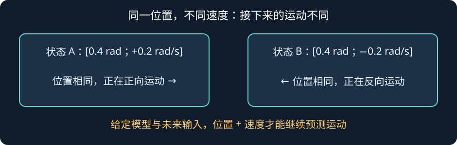
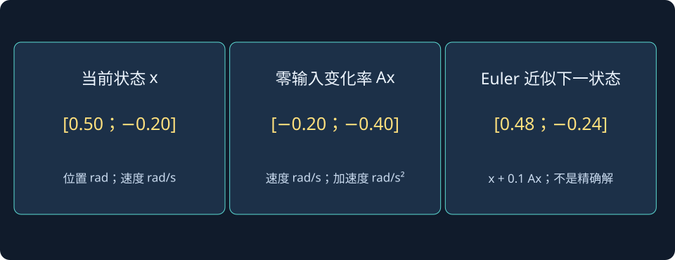

# 第 17 课：矩阵与状态向量——现代控制的数学语言

> 阶段 1 · 数学与模型衔接 · 本课目标：看懂向量、矩阵和状态变量怎样把一个真实运动系统写成可计算的形式。

先别急着把矩阵当成一堵数学墙。现代控制用矩阵，主要是因为真实系统往往同时有好几个会变化的量。一个机器人关节至少有位置和速度；一辆车可能同时有横向位置、横摆角、侧向速度和横摆角速度。把它们逐个写成许多互相连接的方程，会很快变得难读。向量和矩阵只是把这些关系整齐地收纳起来。

## 一、为什么“当前角度”不足以描述运动？

想象两台机械臂的关节此刻都在 $q=0.4\ \mathrm{rad}$。第一台正向前转，第二台正向后转。它们的位置相同，但接下来很可能往不同方向运动。只知道位置，无法描述系统“正在发生什么”。

对于一个转动关节，常用两个量描述此刻状态：

$$
x_1=q,\qquad x_2=\dot q
$$

把它们装进一个列向量：

$$
x=\begin{bmatrix}x_1\\x_2\end{bmatrix}
=\begin{bmatrix}q\\\dot q\end{bmatrix}
$$

这个 $x$ 就叫**状态向量**。它不是额外的物理东西，而是把系统当前所需的信息打包起来。若系统的运动规律已知，知道当前状态和之后的输入，就可以继续计算系统未来如何变化。

这也解释了“状态”两个字：它描述系统此刻处在什么情况。它不一定只包括传感器直接测出来的量。比如速度可能没有速度传感器直接测量，但它仍然是描述机械运动所需要的状态，之后可以通过观测器估计。

### 用一个熟悉的例子判断状态够不够

一个质量块在弹簧上运动，位置记作 $q$。当它经过平衡位置 $q=0$ 时：

- 若速度为 $+1\ \mathrm{m/s}$，它正在向右穿过平衡位置；
- 若速度为 $-1\ \mathrm{m/s}$，它正在向左穿过平衡位置；
- 若速度为 $0$，无外力时，它处于静止平衡；若有外力，还需由方程计算接下来的加速度。

所以，位置相同不代表运动状态相同。对二阶机械系统，位置和速度通常需要一起作为状态。

## 二、向量：把多个状态量放进一个“盒子”

若系统有 $n$ 个状态，可以写成：

$$
x=\begin{bmatrix}x_1&x_2&\cdots&x_n\end{bmatrix}^{\mathsf T}
$$

上标 $\mathsf T$ 表示转置：把横着写的一行变成竖着写的一列。

例如一辆简化车辆的状态可以选为：

$$
x=\begin{bmatrix}y&\psi&v_y&r\end{bmatrix}^{\mathsf T}
$$

其中 $y$ 是横向位置，$\psi$ 是车身朝向误差，$v_y$ 是侧向速度，$r$ 是横摆角速度。这里先不用背这组变量；重点是：一个向量可以同时代表许多个相互关联的物理量。

### 单位要一起检查

向量里的量不一定具有相同单位。上面的 $q$ 以 rad 为单位，$\dot q$ 以 rad/s 为单位。数学上可以把它们放在一个向量里，但检查方程时必须留心单位是否匹配。

例如：

- $\dot x_1=x_2$：左边是位置变化率 rad/s，右边也是速度 rad/s，单位一致。
- 若把一个位置量和一个力矩直接相加，单位不一致，模型一定写错或缺少比例系数。

## 三、矩阵：一次表达许多“谁影响谁”

矩阵可以看作一个规则表。每一行说明某个输出或状态变化率如何由各个状态组合而来。

先看一个简单计算：

$$
A=\begin{bmatrix}1&2\\-1&0\end{bmatrix},\qquad
x=\begin{bmatrix}3\\4\end{bmatrix}
$$

矩阵乘法按“每行乘向量，再相加”计算：

$$
Ax=
\begin{bmatrix}
1(3)+2(4)\\
-1(3)+0(4)
\end{bmatrix}
=
\begin{bmatrix}11\\-3\end{bmatrix}
$$

所以，$A$ 把原来的向量 $[3,4]^{\mathsf T}$ 映射成了 $[11,-3]^{\mathsf T}$。可以把它想成一个“变换器”：输入一个向量，输出另一个向量。

矩阵的每个元素有明确位置。以 $A_{21}=-1$ 为例，它表示第 2 个输出分量中，$x_1$ 的系数是 $-1$。换句话说，第一状态增大时，对第二个状态变化率有负向影响。

## 矩阵的一行，到底是怎样影响一个物理量的？

选一个能直接手算的状态：

$$
A=\begin{bmatrix}0&1\\-2&-3\end{bmatrix},\quad
x=\begin{bmatrix}0.5\\-0.2\end{bmatrix},\quad
B=\begin{bmatrix}0\\1\end{bmatrix},\quad u=0.4.
$$

每行与列向量做乘积相加：

$$
\begin{aligned}
\dot x_1&=0(0.5)+1(-0.2)=-0.2,\\
\dot x_2&=-2(0.5)-3(-0.2)+0.4=0.
\end{aligned}
$$

这时加速度为零，却正在以负速度运动，位置不会停在0.5。无输入时第二项则为−0.4，说明恢复力与阻尼的合力还会改变速度。矩阵计算能回答瞬间趋势，不会单凭加速度为零就认定整段运动平衡。

图中分开列出状态、变化率与0.1 s 的Euler近似，避免把Ax误当成下一状态。两者单位不同，画在一起只能作分量示意，不能比较“谁的物理长度更大”。

**读图与操作**：把x设成[0.5,−0.2]，A第二行设成[−2,−3]；现有矩阵交互采用u=0，再改变时间步长观察Euler端点。

**使用条件**：两状态顺序为位置、速度；例题输入不为零时要显式加Bu，矩阵交互本身采用零输入。

### 先预测，再展开核对

同一状态下令u=0，0.1 s Euler近似的下一状态是什么？

查看思路与答案

xdot=[−0.2,−0.4]ᵀ，下一状态近似[0.48,−0.24]ᵀ；这是一步近似，不是精确解。

### 交互实验：矩阵怎样改变向量？

拖动状态分量，观察当前状态向量 $x$ 和它的变化率 $Ax$。箭头方向表示方向，长度表示相对大小。请先固定矩阵，只改 $x$；再固定 $x$，思考不同系数如何改变系统当下的运动趋势。

:::demo matrix-vector
:::

## 四、从二阶微分方程到一阶向量方程

控制理论常把高阶微分方程改写成一组一阶方程。计算机做数值积分时，这种形式尤其方便。

考虑一个带阻尼的弹簧质量块：

$$
J\ddot q+b\dot q+kq=\tau
$$

这里把转动关节当作转动版弹簧质量块：$J$ 是转动惯量，$b$ 是阻尼系数，$k$ 是等效刚度，$\tau$ 是外加力矩。移项得到：

$$
\ddot q=-\frac{k}{J}q-\frac{b}{J}\dot q+\frac{1}{J}\tau
$$

现在选状态：

$$
x_1=q,\qquad x_2=\dot q
$$

由定义立即有：

$$
\dot x_1=x_2
$$

而第二个状态的变化率是：

$$
\dot x_2=-\frac{k}{J}x_1-\frac{b}{J}x_2+\frac{1}{J}\tau
$$

把两条方程合起来：

$$
\begin{bmatrix}\dot x_1\\\dot x_2\end{bmatrix}
=
\begin{bmatrix}
0&1\\
-k/J&-b/J
\end{bmatrix}
\begin{bmatrix}x_1\\x_2\end{bmatrix}
+
\begin{bmatrix}0\\1/J\end{bmatrix}\tau
$$

于是得到现代控制最常见的形式：

$$
\boxed{\dot x=Ax+Bu}
$$

对于本例，输入 $u=\tau$；矩阵 $A$ 说明没有外部输入时，系统内部状态怎样相互影响；矩阵 $B$ 说明外加力矩怎样影响状态变化。

若传感器只测角度，输出为：

$$
y=q=\begin{bmatrix}1&0\end{bmatrix}x
$$

一般写作：

$$
\boxed{y=Cx+Du}
$$

这里 $C$ 负责从状态中“挑出”传感器能看到的量。$D$ 表示输入是否会不经过状态变化，直接影响输出。本例中角度不会在力矩刚施加的同一瞬间跳变，因此通常 $D=0$。

## 五、一个带数字的完整小例子

令 $J=2\ \mathrm{kg\,m^2}$、$b=4\ \mathrm{N\,m\,s/rad}$、$k=10\ \mathrm{N\,m/rad}$。此时：

$$
A=\begin{bmatrix}0&1\\-5&-2\end{bmatrix},\qquad
B=\begin{bmatrix}0\\0.5\end{bmatrix}
$$

如果此刻 $q=0.1\ \mathrm{rad}$、$\dot q=0.2\ \mathrm{rad/s}$，且输入力矩 $\tau=1\ \mathrm{N\,m}$，那么：

$$
\dot x_1=0.2
$$

$$
\dot x_2=-5(0.1)-2(0.2)+0.5(1)=0
$$

这表示此刻角加速度恰好为零，但角速度并不为零。关节不会停住，它仍以约 $0.2\ \mathrm{rad/s}$ 继续转动。这个例子也提醒我们：**状态的数值**和**状态变化率**是两回事。

## 进入特征值之前：单位矩阵、行列式与逆矩阵

单位矩阵相当于不改变向量的变换。二维情况下：

$$
I_2=\begin{bmatrix}1&0\\0&1\end{bmatrix},\qquad I_2x=x.
$$

对一个二维方阵，行列式按两条对角线的乘积相减：

$$
M=\begin{bmatrix}a&b\\c&d\end{bmatrix},\qquad \det M=ad-bc.
$$

行列式不为零时存在逆矩阵，可以把变换后的向量还原：

$$
M^{-1}=\frac{1}{ad-bc}\begin{bmatrix}d&-b\\-c&a\end{bmatrix},\qquad M^{-1}M=I_2.
$$

例子：

$$
M=\begin{bmatrix}2&1\\1&1\end{bmatrix},\quad
M^{-1}=\begin{bmatrix}1&-1\\-1&2\end{bmatrix}.
$$

输入 [1,2]ᵀ 后输出 [4,3]ᵀ，再乘逆矩阵就回到 [1,2]ᵀ。若两行成比例，例如 [1,2] 与 [2,4]，行列式为零：多个输入可能压缩到同一输出，无法唯一还原，因此不能随意“除以矩阵”。

下一课用行列式求特征值；模型转换课用逆矩阵消去状态。先掌握二维手算足够，不要求在这里学完全部线性代数。

### 状态、变化率与下一时刻要分开

若此刻 x=[1,0]ᵀ，A=[0,1;−2,−3]，无输入，则：

$$
\dot x=Ax=\begin{bmatrix}0\\-2\end{bmatrix}.
$$

这表示位置此刻不变、速度正朝负方向改变，不表示“下一时刻位置就是 0、速度就是 −2”。若只取 0.1 s 的前向 Euler 近似：

$$
x(t+0.1)\approx x(t)+0.1\dot x(t)=\begin{bmatrix}1\\-0.2\end{bmatrix}.
$$

交互增加了时间步长，可以同时观察状态、变化率与单步近似。Euler 只是近似，步长变大时误差和数值稳定问题也会增大。

## 六、MATLAB 验证：逐项核对矩阵方程

下面不用 Control System Toolbox，只用普通矩阵乘法核对状态变化率：

~~~matlab
clc; clear;

J = 2;
b = 4;
k = 10;
tau = 1;

A = [0 1; -k/J -b/J];
B = [0; 1/J];
x = [0.1; 0.2];

xdot_matrix = A*x + B*tau;

% 用原始物理公式单独计算一次，作为交叉检查
q = x(1);
dq = x(2);
ddq = (tau - b*dq - k*q)/J;
xdot_physics = [dq; ddq];

disp('矩阵形式得到的 xdot =');
disp(xdot_matrix);
disp('直接从物理方程得到的 xdot =');
disp(xdot_physics);
~~~

两种算法都应得到 $[0.2,\ 0]^{\mathsf T}$。如果结果不同，优先检查状态顺序、矩阵 $A$ 的第二行，以及输入矩阵 $B$ 中的 $1/J$。

## 七、本课小结：这几种对象不要混淆

| 对象 | 在本例中的内容 | 它回答的问题 |
|---|---|---|
| 状态 $x$ | 角度与角速度 | 系统此刻是什么状态？ |
| 状态变化率 $\dot x$ | 角速度与角加速度 | 状态此刻如何变化？ |
| 输入 $u$ | 外加力矩 | 我能对系统施加什么作用？ |
| 输出 $y$ | 传感器测得的角度 | 我能直接看到什么？ |
| 矩阵 $A,B,C,D$ | 状态演化和输入输出关系 | 状态、输入、输出怎样连接？ |

下一课会继续回答：为什么矩阵 $A$ 的特征值能告诉我们运动会衰减、振荡还是发散？

## 八、课后练习

1. 选取 $x_1=q,\ x_2=\dot q$，把 $J\ddot q+b\dot q+kq=\tau$ 写成 $\dot x=Ax+Bu$。请标出 $A$ 和 $B$ 的每个元素来自哪一项物理关系。
2. 设 

$$
J=1,\ b=3,\ k=2,\ q=0.5,\ \dot q=-0.2,\ \tau=0.4
$$

。计算 $\dot q$ 与 $\ddot q$，并解释关节此刻向哪边转、角加速度又指向哪边。
3. 如果传感器同时测量角度和角速度，$C$ 应该怎样写？如果只测角速度呢？
4. 用你自己的话解释：状态向量为什么不等于“传感器读数的列表”？
