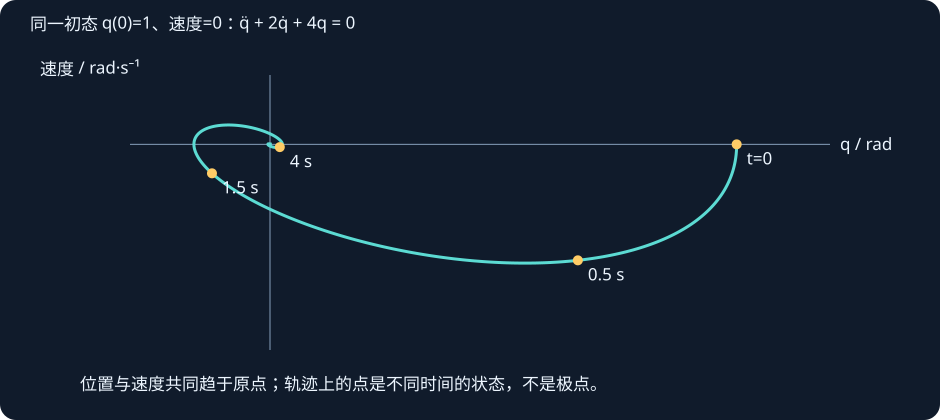
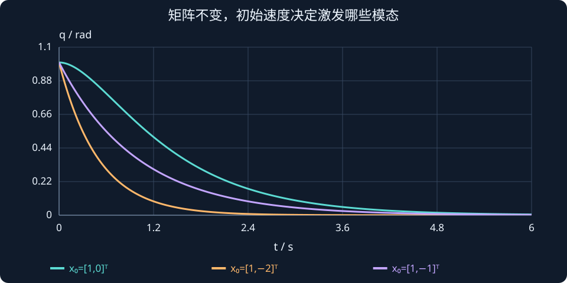

# 第 18 课：特征值与系统动态

> 阶段 1 · 从指数运动到矩阵模态，连接特征值、极点和时间响应。


## 1. 为什么先看一维指数运动？

若 $\dot v=-2v$，每时每刻速度的变化率都与当前速度成比例，解为 $v(t)=v(0)e^{-2t}$。初速度为 3 时，1 秒后约为 0.406。系数 −2 决定衰减规律，初值 3 决定幅度。改成 $\dot v=2v$，速度就指数增长。

在 $\dot x=Ax$ 中，每个状态还会受其他状态影响，不能只读矩阵对角线。我们要找一些特殊方向，矩阵沿这些方向的作用可以归结为一个标量。

## 2. 特征值、特征向量和模态

若非零向量 $v$ 满足 $Av=\lambda v$，沿这个方向取初态 $x(0)=cv$，那么 $x(t)=ce^{\lambda t}v$。把解求导再代回方程，两边都是 $c\lambda e^{\lambda t}v$。这个方向上的指数运动称为一个模态。

$\lambda$ 决定随时间变化的规律，$v$ 决定不同状态分量以怎样的比例共同运动。注意 $Ax$ 是变化率，并非下一时刻的状态；小时间步长下才有 $x(t+h)\approx x(t)+hAx(t)$。

## 3. 从行列式开始，把一个例子算到底

无输入模型为：

$$
\ddot q+3\dot q+2q=0,\qquad
x=\begin{bmatrix}q\\\dot q\end{bmatrix},\qquad
A=\begin{bmatrix}0&1\\-2&-3\end{bmatrix}.
$$

用上一课的单位矩阵和行列式，逐步展开：

$$
\begin{aligned}
\lambda I-A&=\begin{bmatrix}\lambda&-1\\2&\lambda+3\end{bmatrix},\\
\det(\lambda I-A)&=\lambda(\lambda+3)-(-1)(2)\\
&=\lambda^2+3\lambda+2\\
&=(\lambda+1)(\lambda+2).
\end{aligned}
$$

令行列式为零，得到 λ₁=−1、λ₂=−2。为什么要令它为零？因为特征向量需要满足非零解：

$$
(A-\lambda I)v=0,\qquad v\ne0.
$$

若 A−λI 可逆，两边乘逆矩阵只能得到 v=0。因此出现非零特征向量时，该矩阵必须不可逆，行列式为零。

### 找出每个特征方向

λ=−1 时，第一行给出 v₂=−v₁；取 v₁=1，得到 [1,−1]ᵀ。λ=−2 时同理得到 [1,−2]ᵀ。可以直接乘回去核对：

$$
A\begin{bmatrix}1\\-1\end{bmatrix}=-\begin{bmatrix}1\\-1\end{bmatrix},\qquad
A\begin{bmatrix}1\\-2\end{bmatrix}=-2\begin{bmatrix}1\\-2\end{bmatrix}.
$$

### 把真实初态拆成两种模态

若初始位置 1、初始速度 0，先解两个系数：

$$
\begin{aligned}
\begin{bmatrix}1\\0\end{bmatrix}
&=c_1\begin{bmatrix}1\\-1\end{bmatrix}
+c_2\begin{bmatrix}1\\-2\end{bmatrix},\\
c_1+c_2&=1,\\
-c_1-2c_2&=0.
\end{aligned}
$$

得到 c₁=2、c₂=−1。再让每个模态按自己的指数变化：

$$
\begin{aligned}
x(t)&=2e^{-t}\begin{bmatrix}1\\-1\end{bmatrix}
-e^{-2t}\begin{bmatrix}1\\-2\end{bmatrix},\\
q(t)&=2e^{-t}-e^{-2t},\\
\dot q(t)&=-2e^{-t}+2e^{-2t}.
\end{aligned}
$$

代入 t=0，位置为 1、速度为 0；两项随时间都趋于零。后期 e⁻ᵗ 衰减更慢，通常主导尾部；如果初态只激发另一个方向，慢模态也可能不出现。


## 4. 复特征值为什么对应振荡？

对 $\ddot q+b\dot q+kq=0$，当 $b=2,k=4$ 时，特征值为 $-1\pm j\sqrt3$。由欧拉公式可得实数解是 $e^{-t}\cos(\sqrt3t)$ 与 $e^{-t}\sin(\sqrt3t)$ 的组合。实部 −1 控制包络衰减，虚部 $\sqrt3$ 控制振荡角频率。

在状态平面上，位置与速度一起变化，常呈螺旋形趋近原点。实部相同、虚部不同，衰减包络可以相同而振荡快慢不同；虚部相同、实部不同，振荡周期可以相同而衰减快慢不同。



## 5. 稳定判据与边界例外

连续线性自治系统对所有初态渐近稳定，当且仅当全部特征值实部严格为负。有正实部模态时不稳定。特征值在虚轴上时，需要进一步检查，不能仅凭“没有正实部”就说稳定。

反例 $A=[0,1;0,0]$ 的两个特征值都是零，却有 $q(t)=q(0)+t\dot q(0)$，可随时间线性增长。这与重复根的 Jordan 结构有关，后续再深入。

离散系统 $x_{k+1}=A_dx_k$ 要求全部特征值模长严格小于 1。连续标量系统 $\dot x=-2x$ 的精确离散特征值为 $e^{-2T_s}$，说明连续负实部对应离散单位圆内。不要把两种判据混用。


## 初态改变，为什么慢模态有时会完全消失？

沿用A=[0,1;−2,−3]，两个特征方向为v₁=[1,−1]ᵀ、v₂=[1,−2]ᵀ。先用模态系数表示初态：

$$x(0)=c_1v_1+c_2v_2.$$

若初态是[1,0]ᵀ，系数为2、−1，位置响应含两种指数；若初态直接选v₂，只剩快模态：

$$
\begin{aligned}
x_a(0)&=\begin{bmatrix}1\\0\end{bmatrix},&q_a(t)&=2e^{-t}-e^{-2t},\\
x_b(0)&=\begin{bmatrix}1\\-2\end{bmatrix},&q_b(t)&=e^{-2t}.
\end{aligned}
$$

两次系统矩阵没变，特征值仍为−1、−2，但第二次的e⁻ᵗ系数为零，尾部就不再由它主导。图中两条曲线起点都为1，斜率却不同；状态除了位置，还包含初始速度。

这说明“最慢特征值主导响应”需要条件：该模态被激发，且能在输出中观察到。只看极点位置，不看初态和输入输出，可能解释不完整。



**读图与操作**：将阻尼b=3、刚度k=2，固定初始位置1，只把初始速度依次设为0、−1、−2；比较曲线尾部。

**使用条件**：连续自治线性系统；所选A可对角化，初态方向直接决定模态系数。

### 先预测，再展开核对

若初态为[1,−1]ᵀ，位置响应是什么？

<details><summary>查看思路与答案</summary>

只激发λ=−1模态，q(t)=exp(−t)，速度为−exp(−t)。

</details>

## 交互实验

固定 k=4，依次把 b 调为 0、2、4、6、−1。先预测极点与位置响应，再观察图像。改变初始位置和速度，理解“同一个系统也有不同响应”。蓝色为位置随时间的曲线；极点数值显示在下方。

:::demo bridge-lab mode=eigen
:::

## MATLAB 验证

```matlab
A=[0 1;-2 -3]; x0=[1;0]; t=linspace(0,6,601);
disp(eig(A)); X=zeros(2,numel(t));
for i=1:numel(t), X(:,i)=expm(A*t(i))*x0; end
plot(t,X(1,:),t,2*exp(-t)-exp(-2*t),'--'); grid on;
legend('矩阵指数','手算解'); xlabel('t / s');
```

本例不需要控制工具箱。`expm` 是矩阵指数，不能用逐元素取指数的 `exp(A)` 替代。手算解应与矩阵指数结果重合。

## 公式、条件与符号


$$
Av=\lambda v,\quad v\ne0;\qquad \det(\lambda I-A)=0.
$$


$A$ 为状态矩阵，$I$ 为单位矩阵，$\lambda$ 为特征值，$v$ 为特征向量。连续特征值的量纲为时间的倒数。


$$
x(t)=ce^{\lambda t}v\quad\text{当 }x(0)=cv.
$$


若矩阵有足够独立特征向量，可叠加各模态；矩阵指数表达对一般方阵也成立。连续渐近稳定要求全部实部严格负，离散渐近稳定要求全部模长严格小于 1。边界根要另行分析。


## 练习与理解检查

1. 为 $A=[0,1;-6,-5]$ 求特征值和特征方向。
2. −0.1±3j 与 −2±3j 哪组衰减更慢？振荡角频率相同吗？
3. 给出“所有特征值实部非正，但状态仍可能发散”的例子。
4. 解释为什么初态不同不改变特征值，却会改变响应。


完成练习后逐题解释依据，问题澄清后再进入下一课。
