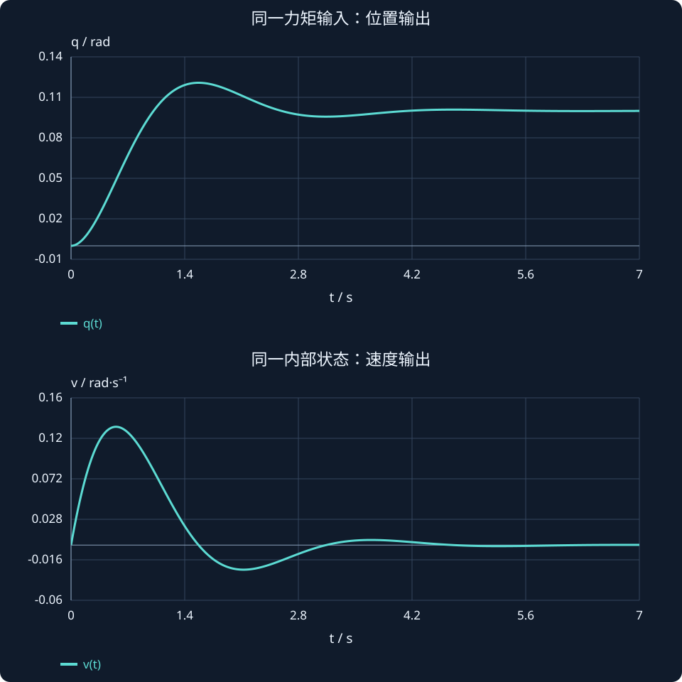

# 第 19 课：传递函数到状态空间

> 阶段 1 · 用同一物理系统对照两种表达，明确初态、输出与内部状态。


## 1. 从同一个物理模型出发

带阻尼和恢复力的关节满足 $J\ddot q+b\dot q+kq=\tau$。$J$ 为惯量，$b$ 为黏性阻尼，$k$ 为等效扭转刚度，$\tau$ 为输入力矩。质量—弹簧—阻尼也有相同数学结构，只是单位不同。

传递函数描述零初始条件下的输入输出关系；状态空间显式记录位置、速度等内部信息。后者尤其适合非零初态、多输入多输出和状态反馈。

## 2. 导数变换中不能漏掉初始条件

拉普拉斯变换给出：

$$
\begin{aligned}
\mathcal L\{\dot q\}&=sQ(s)-q(0),\\
\mathcal L\{\ddot q\}&=s^2Q(s)-sq(0)-\dot q(0).
\end{aligned}
$$

代入机械系统方程，得到完整关系：


$$
(Js^2+bs+k)Q(s)=\mathcal{T}(s)+J[sq(0)+\dot q(0)]+bq(0).
$$


只有初态为零时，才由输出变换除以输入变换得到传递函数 $G(s)=1/(Js^2+bs+k)$。若系统一开始已被拉开或已在运动，即使输入为零，也会出现自由响应。

## 3. 把二阶方程拆成两个一阶方程

令 $x_1=q,x_2=\dot q,u=\tau$。第一行只是速度定义 $\dot x_1=x_2$；第二行把加速度单独留在左边：$\dot x_2=-(k/J)x_1-(b/J)x_2+u/J$。


$$
\dot x=\begin{bmatrix}0&1\\-k/J&-b/J\end{bmatrix}x+\begin{bmatrix}0\\1/J\end{bmatrix}u,\qquad y=\begin{bmatrix}1&0\end{bmatrix}x.
$$


位置输出对应 $C=[1,0],D=0$；测速度时改成 $C=[0,1]$；同时测位置和速度时改成 $C=I_2$。输出选择改变 C，却不改变物理动力学 A、B。

## 4. 反向推导：矩阵怎样变回传递函数？

零初态下 $sX=AX+BU$，移项得 $(sI-A)X=BU$，所以：


$$
G(s)=C(sI-A)^{-1}B+D.
$$


本例 $sI-A=[s,-1;k/J,s+b/J]$，行列式为 $s^2+(b/J)s+k/J$。逆矩阵乘 B 后，第一分量为 $(1/J)/[s^2+(b/J)s+k/J]$。再乘 C，恰好得到 $1/(Js^2+bs+k)$。

## 5. 数值例子与物理含义

取 $J=2,b=4,k=10$，有 $A=[0,1;-5,-2],B=[0;0.5]$，位置传递函数为 $1/(2s^2+4s+10)$。初态 $[0.1,0.2]^{\mathsf T}$ 在零输入下仍会运动，因为有初始动能与势能。

再令 $k=0$，模型变为 $1/[s(Js+b)]$。阻尼可使速度衰减，却没有恢复力把位置带回零。恒定非零力矩下，若 $b>0$，速度趋于 $u/b$，位置继续增长。这不是数值仿真错误，而是模型包含位置积分。

## 6. 一种传递函数不只对应一种状态表达

取可逆坐标变换 $z=Tx$，则 $\dot z=TAT^{-1}z+TBu$，$y=CT^{-1}z+Du$。例如把位置从 rad 换成度，T 的相应对角元素取 $180/\pi$。矩阵元素变化，输入输出关系和特征值不变。

还可能出现不可控或不可观的内部模态，约简后的传递函数不显示它们。只有在最小实现等条件满足时，才能把全部状态特征值与传递函数极点一一对应。后续可控性与可观测性会解释这一点。


## 更换输出不必更换动力学，但传递函数会变

取 $J=2$、$b=4$、$k=10$，状态仍是位置与速度。动力学为：

$$
\dot x=\begin{bmatrix}0&1\\-5&-2\end{bmatrix}x+\begin{bmatrix}0\\0.5\end{bmatrix}u.
$$

若输出位置，Cq=[1,0]；若输出速度，Cv=[0,1]。A、B不变，但零初态的输入输出关系变成：

$$
\begin{aligned}
G_q(s)&=\frac1{2s^2+4s+10},\\
G_v(s)&=\frac{s}{2s^2+4s+10}.
\end{aligned}
$$

同样施加1 N·m恒定输入，最终位置为$1/10=0.1$ rad、速度为0。图中位置轴和速度轴分别标注单位，不能把二者当作同一个量。若选同时输出，$C=I₂$，输出就是二维向量。

反向从状态模型到传递函数时，可把逆矩阵乘法完整写出：

$$
\begin{aligned}
(sI-A)^{-1}B&=\frac1{s^2+2s+5}\begin{bmatrix}s+2&1\\-5&s\end{bmatrix}\begin{bmatrix}0\\0.5\end{bmatrix}\\
&=\frac1{s^2+2s+5}\begin{bmatrix}0.5\\0.5s\end{bmatrix}.
\end{aligned}
$$

分别用Cq和Cv选取第一、第二分量，就得到上面两个传递函数。这一步解释“输出矩阵”到底做了什么，而不只给出总公式。



**读图与操作**：调J、b、k并观察位置；再根据模型手算平衡位置u/k。动态变了不一定改变平衡值：只改b不会改变静态位置。

**使用条件**：线性关节模型、零初态传递关系、常值输入；位置平衡公式要求k>0。

### 先预测，再展开核对

同时测位置与速度时，C、D的维度与数值是什么？

<details><summary>查看思路与答案</summary>

C为2×2单位矩阵，D为2×1零向量；一个输入对应两个输出。

</details>

## 交互实验

调节 J、b、k，核对 A 的第二行与单位阶跃力矩下的位置曲线。令 $k=0$，观察没有恢复力时位置能否收敛。位置单位按转动模型取 rad，时间为 s。

:::demo bridge-lab mode=state
:::

## MATLAB 验证

```matlab
J=2; b=4; k=10;
A=[0 1;-k/J -b/J]; B=[0;1/J]; C=[1 0]; D=0;
sys=ss(A,B,C,D); G=tf(1,[J b k]);
figure; step(sys,G); grid on; legend('状态空间','传递函数');
figure; initial(sys,[0.1;0.2]); grid on;
disp(tf(sys));
```

本例使用 Control System Toolbox。请先预测趋势，再运行程序核对；这里给出可运行示例，不代表已在 MATLAB 中执行。

## 公式、条件与符号


$$
\dot x=Ax+Bu,\quad y=Cx+Du,\quad G(s)=C(sI-A)^{-1}B+D.
$$


n 个状态、m 个输入、p 个输出对应 A 为 n×n、B 为 n×m、C 为 p×n、D 为 p×m；s 为拉普拉斯变量。传递函数按零初始条件定义，模型需为线性时不变系统。


$$
z=Tx,\quad A_z=TAT^{-1},\quad B_z=TB,\quad C_z=CT^{-1}.
$$


T 必须可逆，D 不变。坐标变换不改变物理输入输出关系。


## 练习与理解检查

1. 为 $3\ddot q+6\dot q+12q=u$ 写位置输出的状态模型与传递函数。
2. 输出改成速度，C 怎么变？传递函数分子怎么变？
3. 为什么零输入不等于零响应？
4. 若存在隐藏内部模态，仅检查约简传递函数有何不足？


完成练习后逐题解释依据，问题澄清后再进入下一课。
