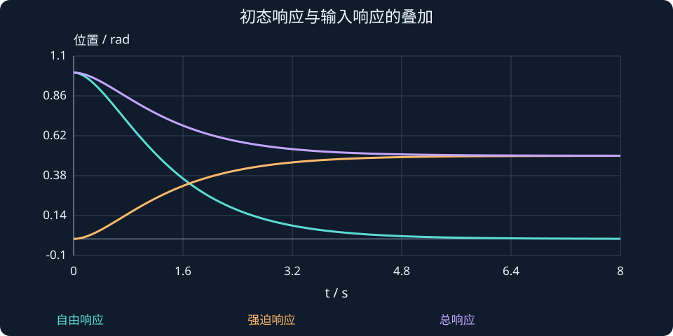

# 第 20 课：状态空间基础

> 阶段 2 · 衔接已有建模知识，重点学习状态响应、矩阵指数和初态与输入的叠加。

## 1. 从“此刻怎样变化”走到“一段时间后在哪里”

第17–19课已经建立了状态、特征值和模型转换。本课只简要回顾标准式，然后推进到解的计算：

$$
\dot x(t)=Ax(t)+Bu(t),\qquad y(t)=Cx(t)+Du(t).
$$

$x$ 是 $n$ 维状态，$u$ 是 $m$ 维输入，$y$ 是 $p$ 维输出；$A$ 为 $n\times n$、$B$ 为 $n\times m$、$C$ 为 $p\times n$、$D$ 为 $p\times m$。先核对维度，再做乘法。此处 $A,B$ 为常矩阵，暂不讨论时变和非线性模型。

### 一次状态变化率计算

对 $J=1$、$b=2$、$k=5$ 的关节，当前 $q=0.1\,\mathrm{rad}$、$\dot q=0.2\,\mathrm{rad/s}$、力矩 $\tau=1\,\mathrm{N\cdot m}$，有：

$$
\begin{aligned}
\dot q&=0.2\ \mathrm{rad/s},\\
\ddot q&=-5(0.1)-2(0.2)+1=0.1\ \mathrm{rad/s^2}.
\end{aligned}
$$

即使某一瞬间加速度真的为零，也不能断言之后速度一直不变，因为位置变化会继续改变恢复力。

## 2. 先从标量指数推广到矩阵指数

标量方程的解为：

$$
\dot x=ax,\quad x(0)=x_0\quad\Longrightarrow\quad x(t)=e^{at}x_0.
$$

对矩阵A，用幂级数定义：

$$
e^{At}=I+At+\frac{A^2t^2}{2!}+\frac{A^3t^3}{3!}+\cdots.
$$

$A^2$ 是矩阵乘法，不是逐元素平方。由级数逐项求导，可以验证：

$$
\frac{d}{dt}e^{At}=Ae^{At},\qquad e^{A\cdot0}=I.
$$

因此无输入解为 $x(t)=e^{At}x_0$。状态转移矩阵记为 $\Phi(t)=e^{At}$，它将初始状态映射到时刻 $t$。

若 $A$ 可对角化，可写 $A=V\Lambda V^{-1}$，再分别对 $\Lambda$ 的对角元素取指数。即使 $A$ 不可对角化，矩阵指数仍存在，不要求先找到 $n$ 个独立特征向量。

## 3. 有输入时，为什么要做积分？

每个时刻施加的输入都会改变状态；这次改变还会经过系统自身动态，继续传播到终点。线性叠加得到：

$$
\boxed{x(t)=e^{At}x_0+\int_0^t e^{A(t-\sigma)}Bu(\sigma)\,d\sigma}.
$$

第一项是初态产生的自由响应，第二项是输入产生的强迫响应。σ只是积分里的时间变量，避免与力矩τ混淆。零输入不等于零响应，零初态也不等于无输入。

若输入为常数 $u_0$，只有 $A$ 可逆时才可进一步简化：

$$
x(t)=e^{At}x_0+A^{-1}(e^{At}-I)Bu_0.
$$

$A$ 不可逆时应保留积分或使用增广矩阵法，不能硬写 $A^{-1}$。双积分器恰好是后续的重要反例。

## 4. 一个能手算到底的二阶例子

取位置、速度状态：

$$
A=\begin{bmatrix}0&1\\-2&-3\end{bmatrix},\quad B=\begin{bmatrix}0\\1\end{bmatrix},\quad
x_0=\begin{bmatrix}1\\0\end{bmatrix},\quad u(t)=1.
$$

无输入位置响应由上一阶段的模态分解得到 $2e^{-t}-e^{-2t}$。零初态常值输入的位置响应为：

$$
q_u(t)=\frac12(1-2e^{-t}+e^{-2t}).
$$

将两者相加：

$$
\begin{aligned}
q(t)&=\frac12+e^{-t}-\frac12e^{-2t},\\
\dot q(t)&=-e^{-t}+e^{-2t}.
\end{aligned}
$$

初始位置为 $1$、速度为 $0$，最终位置为 $0.5$、速度为 $0$。最终位置来自静态平衡 $2q=u$，而不是简单等于输入。图中分开画出自由、强迫与总响应，先检查起点，再检查终值。

## 5. 把状态解与输入输出表达联系起来

非零初态时，对状态方程做拉普拉斯变换：

$$
X(s)=(sI-A)^{-1}x_0+(sI-A)^{-1}BU(s).
$$

因此输出也分成两部分：

$$
Y(s)=C(sI-A)^{-1}x_0+[C(sI-A)^{-1}B+D]U(s).
$$

方括号内是零初态输入输出传递函数，第一项则保留初态信息。这样，状态解与之前学过的传递函数就接上了，而不是两套互不相关的方法。

力矩τ的拉普拉斯变换记作𝒯(s)，位置变换记作Q(s)。本例机械系统在零初态下有：

$$G(s)=\frac{Q(s)}{\mathcal{T}(s)}=\frac1{Js^2+bs+k}.$$

不要把初态项遗漏后，再用输入输出传递函数解释全部运动。第19课学的是表示转换，本课学的是如何把初态与输入合起来计算一段时间的响应。

### 再核对一次：总解真的满足原方程吗？

本例

$$
q(t)=\frac12+e^{-t}-\frac12e^{-2t}.
$$

对时间求导两次并代回：

$$
\begin{aligned}
\dot q&=-e^{-t}+e^{-2t},\\
\ddot q&=e^{-t}-2e^{-2t},\\
\ddot q+3\dot q+2q&=1.
\end{aligned}
$$

这一步分别核对了初值、微分方程和终值，比只看到“曲线像是收敛”更可靠。计算机求出的状态响应也应满足同样关系；MATLAB用expm而不是逐元素exp，原因就在这里。



## 动手实验：先预测，再改变参数

改变初始位置与常值输入，分别检查自由响应、强迫响应和总响应；输入为零时是否仍有运动？

:::demo modern-lab mode=response
:::

## MATLAB：独立核对

```matlab
A=[0 1;-2 -3]; B=[0;1]; x0=[1;0];
t=linspace(0,8,801); X=zeros(2,numel(t));
% 常输入用增广指数；不要求A可逆
M=[A B;zeros(1,3)];
for i=1:numel(t)
 E=expm(M*t(i)); X(:,i)=E(1:2,1:2)*x0+E(1:2,3);
end
plot(t,X(1,:),t,0.5+exp(-t)-0.5*exp(-2*t),'--');grid on;
legend('增广矩阵指数','手算总响应');xlabel('t / s');
```

示例使用基础MATLAB，涉及工具箱的替代函数已注明；本轮未实际运行MATLAB。请对照手算值与单位，不只看图形外观。

## 本课练习

1. 对A=diag(−1,−2)、x₀=[1,2]ᵀ、$u=0$写出精确解。
2. 为什么A含零特征值时不能直接使用含A⁻¹的常值输入公式？
3. 手算例中，$t=0$的两种响应各是多少？最终总位置是多少？
4. 重算本课修正的瞬间加速度，并说明它和当前速度的区别。

<details><summary>展开自查要点（先写出过程）</summary>

1. x=[e⁻ᵗ,2e⁻²ᵗ]ᵀ。2. A不可逆，但积分表达仍有效。3. 自由响应起点1，强迫起点0，总位置最终0.5。4. 加速度0.1 rad/s²，当前速度0.2 rad/s。

</details>

学习时先完成本课练习并澄清疑问，再进入下一课；网页制作进度不代表学习进度。
