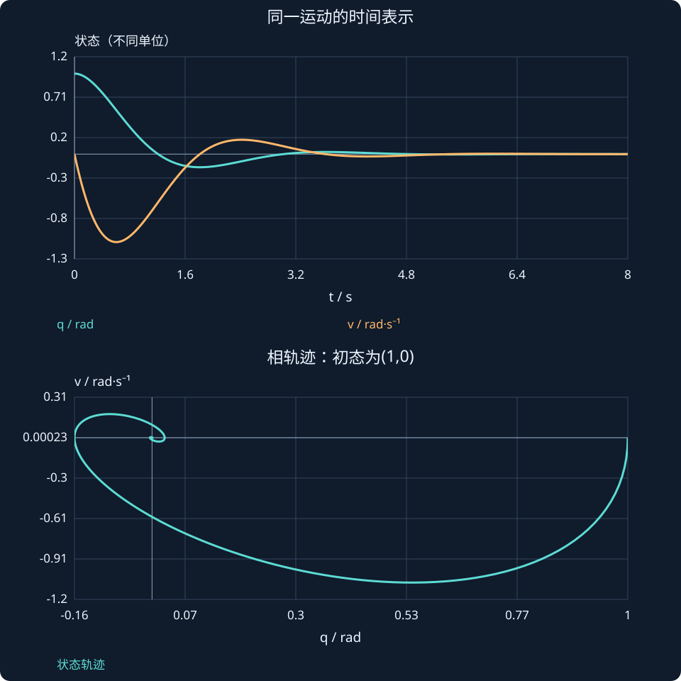

# 第 21 课：相平面与状态轨迹

> 阶段 2 · 将时间响应与位置—速度平面对应起来，区分轨迹、向量场和极点。

## 1. 同一运动可以用两种坐标观察

时间图以t为横轴，每条线表示一个变量；相平面以位置q为横轴、速度v为纵轴，一个点就对应一个完整状态。点沿曲线移动表示时间前进，曲线不是障碍物路径，也不是根轨迹。

先看无输入阻尼弹簧：

$$
\dot q=v,\qquad\dot v=-kq-bv.
$$

为了简化数值，这里惯量取1。向量场在每个位置画出(q̇,v̇)的方向，轨迹沿着这个场前进。横纵量纲不同，箭头只表达模型坐标里的趋势。

## 2. 在画图之前先判断方向

取k=2、$b=3$。状态(1,0)处，速度变化率为−2，所以接下来向下走；状态(0,1)处，位置增加、速度下降，所以向右下走：

$$
f(1,0)=\begin{bmatrix}0\\-2\end{bmatrix},\qquad
f(0,1)=\begin{bmatrix}1\\-3\end{bmatrix}.
$$

先用四个象限的几个点判断方向，再画整条曲线，能避免把旋转方向画反。轨迹与速度为零的横轴相交时，位置曲线达到极值。

## 3. 平衡点不只是“当前位置不变”

平衡点必须同时满足全部状态变化率为零：

$$
v_e=0,\qquad kq_e=0.
$$

$k>0$时只有原点。若恒定输入u不为零，则平衡点变成qₑ=u/k、vₑ=0。稳定性应围绕这个平衡点分析，不能还把原点当终点。

## 4. 节点、螺旋、中心与不稳定情况

对于k>0：b足够大时两个负实根，轨迹通常沿模态方向收敛；阻尼较小时出现共轭负实部根，轨迹螺旋收敛。$b=0$时没有耗散，轨迹是闭合能量曲线，不能叫渐近稳定。$b<0$相当于负阻尼，轨迹能量增长。

$$
\lambda_{1,2}=\frac{-b\pm\sqrt{b^2-4k}}2.
$$

若将k改为负值，会出现一正一负实根的鞍点；并不是所有状态都收敛。交互先限定k>0，避免把太多分类同时混入。

## 5. 用能量解释闭合与收缩

$$
V(q,v)=\frac12kq^2+\frac12v^2,\qquad\dot V=-bv^2.
$$

$b=0$时能量不变，因此没有理由收敛到原点；$b>0$时非增。注意导数为零可能发生在v=0而q≠0的位置，此时加速度会把轨迹带离该轴。后续Lyapunov与LaSalle会更严格地区分这些情况。

例：$k=4$、$b=2$、初态(1,0)，相轨迹向下起步、顺时针螺旋趋零；位置第一次到极值的时刻，正好对应相轨迹穿过v=0。

### 读图练习：同一位置的两种速度

固定 $q=0.5$、$k=4$、$b=2$。状态方程为 $\dot q=v$、$\dot v=-kq-bv$。

若 $v=1$，则

$$
\dot q=1,\qquad \dot v=-4(0.5)-2(1)=-4.
$$

若 $v=-1$，则

$$
\dot q=-1,\qquad \dot v=-4(0.5)-2(-1)=0.
$$

同样的位置，前者向右运动并减速，后者此刻向左运动且速度瞬时变化率为零。

“$v̇=0$”只描述这一瞬间。下一瞬间q变化，恢复力也变化，不能沿着该点把速度永远画成常数。相平面图的每个点都有自己的局部箭头，一条轨迹是持续沿局部箭头更新的结果。



## 动手实验：先预测，再改变参数

固定初态，依次试正阻尼、零阻尼、负阻尼；把时间图与相平面上同一状态点对应起来。

:::demo modern-lab mode=phase
:::

## MATLAB：独立核对

```matlab
k=4;b=2;A=[0 1;-k -b];
[t,X]=ode45(@(t,x)A*x,[0 8],[1;0]);
subplot(1,2,1);plot(t,X);grid on;legend('q','v');
subplot(1,2,2);plot(X(:,1),X(:,2));grid on;
xlabel('q');ylabel('v');
```

示例使用基础MATLAB，涉及工具箱的替代函数已注明；本轮未实际运行MATLAB。请对照手算值与单位，不只看图形外观。

## 本课练习

1. 画出k=2、$b=3$时(1,0)、(0,1)、(−1,0)、(0,−1)处的向量。
2. 为什么位置相同而速度不同不能算同一个状态？
3. $b=0$时轨迹闭合意味着渐近稳定吗？
4. 输入u=2、$k=4$时平衡点在哪里？

<details><summary>展开自查要点（先写出过程）</summary>

1. 分别为[0,−2]、[1,−3]、[0,2]、[−1,3]。3. 不是，能量保持且通常持续振荡。4. (0.5,0)。

</details>

学习时先完成本课练习并澄清疑问，再进入下一课；网页制作进度不代表学习进度。
