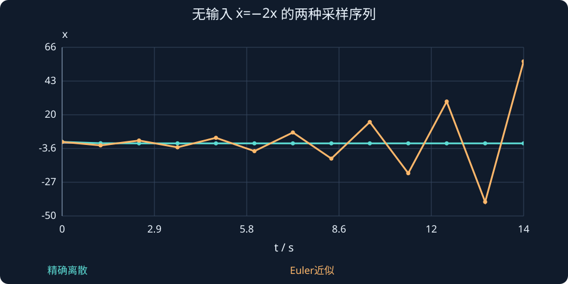

# 第 22 课：连续系统离散化

> 阶段 2 · 理解零阶保持、精确离散模型与Euler近似，并把采样周期带入计算。

## 1. 数字控制器不能连续改输入

在kTₛ采样后计算uₖ，随后保持该输入到下次采样，这叫零阶保持。保持的是执行器命令，不是物理状态；两个采样点之间位置和速度仍在变化。

将上一课的状态解在一个采样区间使用：

$$x_{k+1}=A_dx_k+B_du_k,\qquad
A_d=e^{AT_s},\qquad B_d=\int_0^{T_s}e^{A\sigma}B\,d\sigma.$$

输出若在采样时刻直接测量，则yₖ=Cxₖ+Duₖ。上式假设输入在整个区间不变，没有额外计算延迟。

## 2. 标量模型先手算一次

$$
\dot x=-2x+u,\qquad T_s=0.1\ \mathrm{s}.
$$

$$
A_d=e^{-0.2}\approx0.81873,\qquad B_d=\frac{1-e^{-0.2}}2\approx0.09063.
$$

当前xₖ=1、uₖ=1时，下次状态约0.90937。输入会抬高状态，但原先的衰减仍在，因此不是简单“加0.1”。

## 3. Euler何时会造出假的不稳定？

前向Euler把导数近似成差分：

$$
A_E=I+AT_s,\qquad B_E=BT_s.
$$

对标量无输入模型，Tₛ=1.2 s时，精确因子e⁻²·⁴≈0.0907，仍衰减；Euler因子1−2Tₛ=−1.4，却会交替放大。连续对象没变，是数值近似失去稳定性。

连续负实部特征值λ，精确离散后变为e^(λTₛ)。数字模型的稳定判据是全部离散特征值模长小于1，不能继续只看负实部。

## 4. A不可逆时，积分仍然能算

双积分器的位置—速度模型为：

$$
A=\begin{bmatrix}0&1\\0&0\end{bmatrix},\quad B=\begin{bmatrix}0\\1\end{bmatrix}.
$$

因为A²=0，矩阵指数直接截断为I+Aσ，积分得到：

$$
A_d=\begin{bmatrix}1&T_s\\0&1\end{bmatrix},\qquad B_d=\begin{bmatrix}T_s^2/2\\T_s\end{bmatrix}.
$$

第一分量Tₛ²/2体现区间内持续加速引起的位置改变，不能漏掉。

## 5. 工程上还要说明时序

若uₖ其实到下一拍才执行，就需要延迟状态，当前Ad、Bd不足以描述该实现。采样周期、仿真积分步长和滤波时间常数各有含义。选择更快采样也会增加计算负担，不能用“越小越好”替代时序分析。

### 图中为什么特意选择1.2 s？

下方静态对照图使用Tₛ=1.2 s，放大Euler近似与精确离散的区别；正文0.1 s例子则用于展示正常的小步长手算。两图和两组数字不能混用。

对于无输入模型，初态1时，精确采样依次约1、0.0907、0.00823；Euler依次为1、−1.4、1.96。前者衰减，后者交替放大。每拍都有数学上自洽的更新，并不意味着近似忠实于原连续模型。



## 动手实验：先预测，再改变参数

调大采样周期，比较同一无输入稳定标量模型的精确采样值与Euler近似；看清楚负因子何时越出单位圆。

:::demo modern-lab mode=discrete
:::

## MATLAB：独立核对

```matlab
A=[0 1;0 0];B=[0;1];Ts=0.1;
E=expm([A B;zeros(1,3)]*Ts);
Ad=E(1:2,1:2);Bd=E(1:2,3);disp(Ad);disp(Bd);
% 不需要Control System Toolbox；如有工具箱，也可用c2d交叉核对。
```

示例使用基础MATLAB，涉及工具箱的替代函数已注明；本轮未实际运行MATLAB。请对照手算值与单位，不只看图形外观。

## 本课练习

1. 将ẋ=−x+2u以Ts=0.2精确离散。
2. 双积分器Ts=0.1时写Ad、Bd。
3. 为什么原点特征值使含A⁻¹公式失效，却不妨碍精确离散？
4. Euler模拟发散是否证明连续对象不稳定？

<details><summary>展开自查要点（先写出过程）</summary>

1. Ad=e⁻⁰·²≈0.81873，Bd=2(1−e⁻⁰·²)≈0.36254。2. Ad=[1,.1;0,1]，Bd=[.005;.1]。4. 不能，要区分对象与数值算法。

</details>

学习时先完成本课练习并澄清疑问，再进入下一课；网页制作进度不代表学习进度。
