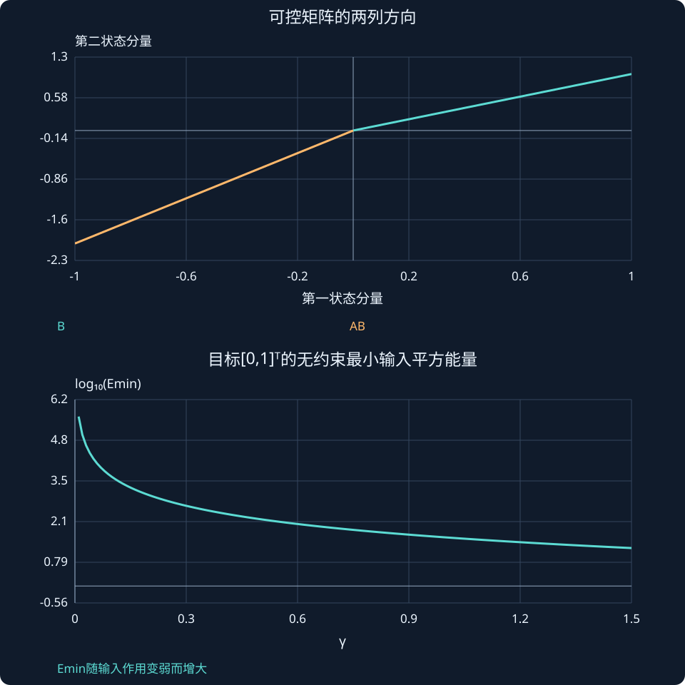

# 第 23 课：可控性与可达状态

> 阶段 2 · 判断输入能否独立改变全部状态，而不仅是让某个输出动起来。

## 1. 两个状态都变化，未必能分别控制

若输入同样推动两个状态，且它们自身动态也完全相同，可能始终只能保持某个固定比例。可控性问的是：在理想线性模型、无输入约束条件下，能否把任意初态在有限时间带到任意目标状态。

这比“输出会对输入响应”更强，也不等同于现实中能否在有限力矩内完成任务。

## 2. 先理解列向量的方向与秩

可控性矩阵收集输入及其经系统传播后能产生的方向：

$$
\mathcal C=[B,AB,A^2B,\ldots,A^{n-1}B].
$$

rank表示独立列方向的个数，满秩n时可控。二维单输入时，矩阵有两列；行列式不为零就表示两个方向独立。

$$A=\begin{bmatrix}0&1\\0&0\end{bmatrix},\quad B=\begin{bmatrix}0\\1\end{bmatrix},\quad
\mathcal C=\begin{bmatrix}0&1\\1&0\end{bmatrix}.$$

输入先改速度，速度再改位置，所以只有一个输入也可以控制两个状态。“输入数少于状态数”不自动意味着不可控。

## 3. 一个带失效参数的例子

$$
A=\begin{bmatrix}-1&0\\0&-2\end{bmatrix},\quad B=\begin{bmatrix}1\\\gamma\end{bmatrix}.
$$

$$
\mathcal C=\begin{bmatrix}1&-1\\\gamma&-2\gamma\end{bmatrix},\qquad\det\mathcal C=-\gamma.
$$

γ=0时第二状态完全不受输入影响；γ≠0时可控。但γ很小时，用同一输入推动第二状态会变得困难，代数满秩不代表所需输入很小。

## 4. 可控Gramian把“困难程度”带进来

从零初态到目标x_f，时间窗T内的可控Gramian为：

$$
W_c(T)=\int_0^T e^{A\sigma}BB^{\mathsf T}e^{A^{\mathsf T}\sigma}\,d\sigma.
$$

可控时它正定；无约束最小输入平方能量为x_fᵀWc⁻¹x_f。若时间很短或执行器对某状态作用很弱，Gramian某些方向会很小，所需能量可能很大。

对上例T=2、x_f=[0,1]ᵀ，第二状态输入系数缩小10倍时，最小能量增大约100倍。交互给出该例的精确Gramian；这里的能量是∫u²dt，不直接等同于电池耗电。

## 5. 不可控并不总意味着无法稳定

若不可控模态本来就稳定，仍可能用输入稳定其余模态，这叫可稳定性。极点配置任意指定全部闭环极点需要可控；只要求存在稳定反馈时，条件可放宽为可稳定。不可控的不稳定模态则无法靠该输入修正。

### 两列方向为什么能解释“独立控制”？

上例γ=0时，B=[1,0]ᵀ、AB=[−1,0]ᵀ，两个箭头都在第一坐标轴上。无论怎样组合，第二分量始终为零。γ=1时，B=[1,1]ᵀ、AB=[−1,−2]ᵀ不共线，线性组合能覆盖整个二维平面。

Gramian从“方向是否存在”进一步衡量输入在有限时间内沿各方向积累的作用。T=2时：

$$
W_c=\begin{bmatrix}(1-e^{-4})/2&\gamma(1-e^{-6})/3\\\gamma(1-e^{-6})/3&\gamma^2(1-e^{-8})/4\end{bmatrix}.
$$

终点固定为[0,1]ᵀ时，W的逆在第二方向上按1/γ²放大。γ缩小十倍导致100倍能量代价，是可从公式精确推出的比例关系，而不只是图上看起来陡峭。



## 动手实验：先预测，再改变参数

将γ从1减到0.1，再设为0；同时看可控方向、秩和无约束最小能量，不把数值大误读成程序错误。

:::demo modern-lab mode=controllable
:::

## MATLAB：独立核对

```matlab
A=diag([-1 -2]);
for g=[0 0.1 1]
 B=[1;g];Cc=[B A*B];fprintf('gamma=%g, rank=%d\n',g,rank(Cc));
end
% rank默认有数值容差，接近失效时还应看奇异值而非只看整数秩。
```

示例使用基础MATLAB，涉及工具箱的替代函数已注明；本轮未实际运行MATLAB。请对照手算值与单位，不只看图形外观。

## 本课练习

1. 对双积分器手算B和AB，解释两个方向的物理意义。
2. γ=0与0.1时分别判断上例的可控性。
3. 为什么满秩仍可能需要很大力矩？
4. 不可控模态在−2与+2时，可稳定性的结论有何不同？

<details><summary>展开自查要点（先写出过程）</summary>

1. B=[0,1]ᵀ，AB=[1,0]ᵀ。2. 不可控、可控。3. 秩不包含输入幅值和时间约束。4. 稳定不可控模态可保留；+2的不可控模态阻止稳定化。

</details>

学习时先完成本课练习并澄清疑问，再进入下一课；网页制作进度不代表学习进度。
