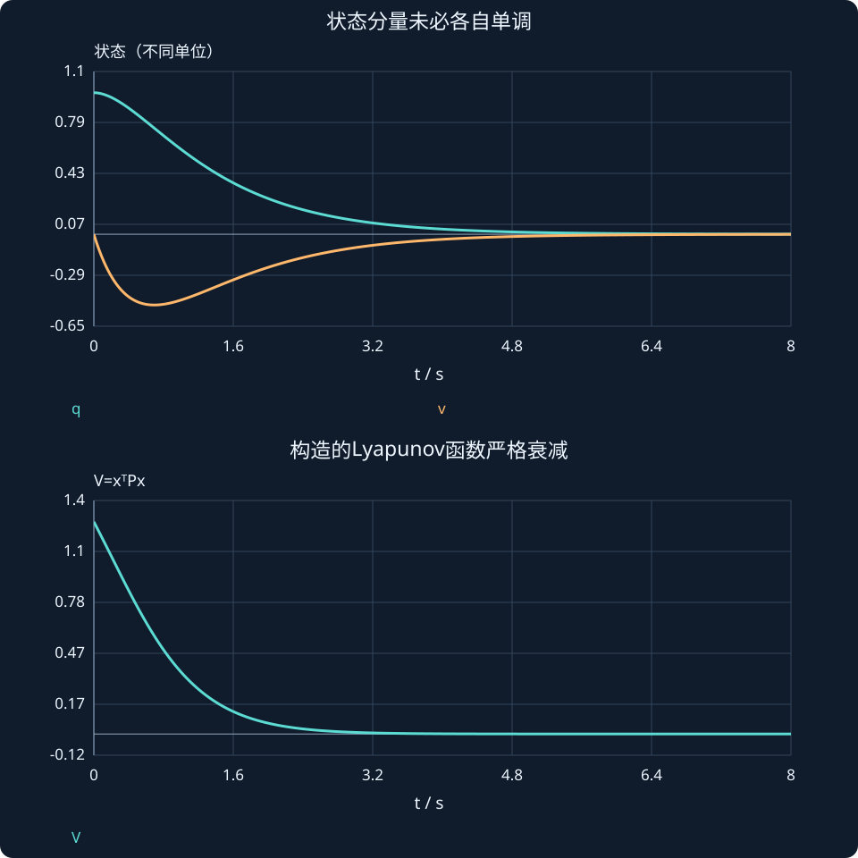

# 第 24 课：线性系统的Lyapunov稳定性

> 阶段 2 · 从能量直觉走到正定矩阵与严格衰减，学习线性稳定性的另一种证明。

## 1. 极点之外，还能怎样证明收敛？

对无输入系统ẋ=Ax，寻找一个始终非负、只在原点为零、沿轨迹下降的标量函数。它像能量，但不一定等于真实机械能。本课先处理线性系统，非线性直接法留在阶段3。

候选二次型：

$$
V(x)=x^{\mathsf T}Px,\qquad P=P^{\mathsf T}>0.
$$

正定意味着对任何非零x都严格大于零，不是“矩阵每个元素都为正”。二维对称矩阵可用第一主子式和行列式均正来判断。

## 2. 把导数逐步展开

$$
\begin{aligned}
\dot V&=\dot x^{\mathsf T}Px+x^{\mathsf T}P\dot x\\
&=x^{\mathsf T}(A^{\mathsf T}P+PA)x.
\end{aligned}
$$

若能找到正定Q使下式成立，则导数对全部非零状态严格为负：

$$
A^{\mathsf T}P+PA=-Q,\qquad Q>0.
$$

A为Hurwitz矩阵，即所有特征值实部严格负，当且仅当对任意给定正定Q，存在唯一正定P满足该方程。

## 3. 手算一个真实矩阵

取A=[0,1;−2,−3]，Q=I，设P为对称矩阵。由矩阵相乘得到：

$$
\begin{bmatrix}
-4p_{12}&p_{11}-3p_{12}-2p_{22}\\
p_{11}-3p_{12}-2p_{22}&2p_{12}-6p_{22}
\end{bmatrix}=-I.
$$

因此p₁₂=1/4、p₂₂=1/4、p₁₁=5/4：

$$
P=\begin{bmatrix}5/4&1/4\\1/4&1/4\end{bmatrix}.
$$

P的第一主子式5/4>0，行列式1/4>0，因此正定，且：

$$
\dot V=-(q^2+v^2)<0\qquad(x\ne0).
$$

对x₀=[1,0]ᵀ，V(0)=1.25。交互显示状态虽可能某个分量短时上升，这个构造出的V仍持续下降；不要把“每个状态都单调”当成稳定性的必要条件。

## 4. 半负定导数为什么要谨慎？

真实机械能可取Vₑ=q²+v²/2，其导数为−3v²；当v=0、q≠0时导数为零。这并不自动证明不收敛，但仅靠“导数不正”还差一步；需要分析零导数集合中的轨迹，后续LaSalle会处理。

本课构造的P使导数严格负，直接避免了该缺口。请区分稳定、渐近稳定、指数稳定，线性Hurwitz系统具有指数衰减性质。

## 5. 一个可核对的衰减界

由正定矩阵特征值可得：

$$
\lambda_{min}(P)\|x\|^2\le V\le\lambda_{max}(P)\|x\|^2,
$$

所以V̇≤−λmin(Q)V/λmax(P)。这给出保守指数界，不是说真实每条曲线都恰好按这一个速率变化。

### 为什么一个状态变大，V仍可能变小？

取x=[0.1,1]ᵀ，则位置变化率为1，位置正在增加；但：

$$
V=1.25(0.1)^2+0.5(0.1)(1)+0.25(1)^2=0.3125,
$$

$$
\dot V=-[(0.1)^2+1^2]=-1.01.
$$

因此某个坐标短暂远离零不违背稳定。V同时综合全部状态及交叉项，稳定性要求整段运动最终回到平衡，而不是每个坐标都朝零单调移动。



## 动手实验：先预测，再改变参数

交互将A整体乘以a，采用模型坐标x₁、x₂；a不为1时，不将x₂直接解释为同一物理时间下的速度。改变a与初态，观察V是否仍下降。

:::demo modern-lab mode=lyapunov
:::

## MATLAB：独立核对

```matlab
A=[0 1;-2 -3];P=[1.25 .25;.25 .25];
disp(A'*P+P*A);disp(eig(P));
[t,X]=ode45(@(t,x)A*x,[0 8],[1;0]);
V=sum((X*P).*X,2);plot(t,V);grid on;xlabel('t / s');ylabel('V');
% Control System Toolbox中也可 P2=lyap(A',eye(2))；注意转置方向。
```

示例使用基础MATLAB，涉及工具箱的替代函数已注明；本轮未实际运行MATLAB。请对照手算值与单位，不只看图形外观。

## 本课练习

1. 用矩阵乘法核对本课P确实满足Q=I。
2. 为什么P所有元素为正不能作为正定判据？举一个2×2反例。
3. 能量导数在v=0处为零，为什么不能立刻说状态不再变化？
4. 若A换成aA且a>0，原P对应的Q怎样变化？

<details><summary>展开自查要点（先写出过程）</summary>

1. 得−I。2. [1,2;2,1]所有元素正但有负特征值。3. q≠0会产生加速度，状态会离开该轴。4. Q变成aI。

</details>

学习时先完成本课练习并澄清疑问，再进入下一课；网页制作进度不代表学习进度。
