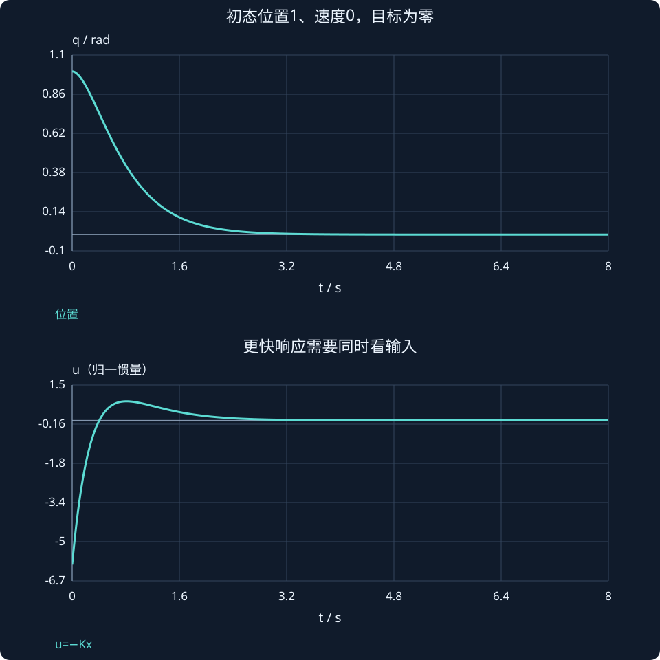

# 第 25 课：状态反馈与极点配置

> 阶段 2 · 在可控性基础上用u=−Kx改变动态，并核对输入代价。

## 1. 反馈改变的是哪个矩阵？

状态全部可用时，采用负反馈：

$$
u=-Kx,\qquad\dot x=(A-BK)x.
$$

单输入时K为1×n行向量。闭环特征值由A−BK决定；不要把符号写成A+BK，也不要把反馈矩阵K与标量比例增益混为一谈。

## 2. 双积分器的极点可以手算

对位置—速度模型

$$
A=\begin{bmatrix}0&1\\0&0\end{bmatrix},\qquad B=\begin{bmatrix}0\\1\end{bmatrix},\qquad K=[k_1,k_2].
$$

$$
A-BK=\begin{bmatrix}0&1\\-k_1&-k_2\end{bmatrix},\qquad p_{cl}(s)=s^2+k_2s+k_1.
$$

希望两根为−2、−3，期望多项式为：

$$
(s+2)(s+3)=s^2+5s+6,
$$

对比系数即得 $K=[6,5]$。若初态 $q=1$、$v=0$，第一瞬间控制输入 $u=-Kx=-6$。状态反馈不是只有抽象矩阵，仍可解释为位置恢复项与速度阻尼项。

## 3. 为什么可控性在前？

若某个状态方向根本不受输入影响，反馈也无法任意移动那个模态。完全可控的单输入线性系统可任意配置其特征多项式；不可控但可稳定时，只能稳定可控部分并保留稳定不可控模态。

软件place不会创造额外执行能力。数值病态、不可控系统或某些重极点配置限制，都需要回到矩阵和模型检查。

## 4. 极点放得更左有什么代价？

将目标极点改成 $-4$、$-6$，得到 $K=[24,10]$。初态相同，初始输入从 $-6$ 增至 $-24$。理想响应快了，但需要更大输入，也可能更敏感于噪声、延迟和未建模动态。

图中同时画位置与输入，避免只看一条更快的位置曲线。加入限幅后，实际系统不再严格等于 $A-BK$，原极点不能完整描述全程响应。

## 5. 先做调节，再做跟踪

$u=-Kx$ 使系统趋近零状态。想稳定在 $q=1$ 不能直接把“零”口头改成“1”，需要定义误差状态或增加参考前馈。第 27 课会从平衡方程推导。

### 把配好的极点变回一条可检查的解

$K=[6,5]$、初态 $x_0=[1,0]^{\mathsf T}$ 时，由初值确定模态系数：

$$
q(t)=3e^{-2t}-2e^{-3t},\qquad v(t)=-6e^{-2t}+6e^{-3t}.
$$

再代入反馈，可得：

$$
u(t)=12e^{-2t}-18e^{-3t}.
$$

$t=0$ 时 $q=1$、$v=0$、$u=-6$，和直接矩阵乘法一致；三个量最终都趋零。负输入只是开始往原点加速，后期输入会改变符号来制动，不应要求 $u$ 在全程同号。



## 动手实验：先预测，再改变参数

调位置增益k₁和速度增益k₂，同时观察极点、位置与输入；找一个快但输入明显变大的配置。

:::demo modern-lab mode=feedback
:::

## MATLAB：独立核对

```matlab
A=[0 1;0 0];B=[0;1];K=[6 5];
disp(eig(A-B*K));
[t,X]=ode45(@(t,x)(A-B*K)*x,[0 6],[1;0]);U=-X*K';
subplot(2,1,1);plot(t,X(:,1));grid on;
subplot(2,1,2);plot(t,U);grid on;ylabel('u');xlabel('t / s');
```

示例使用基础MATLAB，涉及工具箱的替代函数已注明；本轮未实际运行MATLAB。请对照手算值与单位，不只看图形外观。

## 本课练习

1. 为双积分器配置−1、−4，求K。
2. x₀=[0.5,−0.2]ᵀ时，K=[6,5]的初始输入是多少？
3. 为什么更左极点不等于工程上总更好？
4. 直接u=−Kx能否自动跟踪任意非零常值参考？

<details><summary>展开自查要点（先写出过程）</summary>

1. K=[4,5]。2. $u=−(3−1)=−2$。3. 输入、噪声、延迟和模型误差代价。4. 不能，需要参考设计。

</details>

学习时先完成本课练习并澄清疑问，再进入下一课；网页制作进度不代表学习进度。
