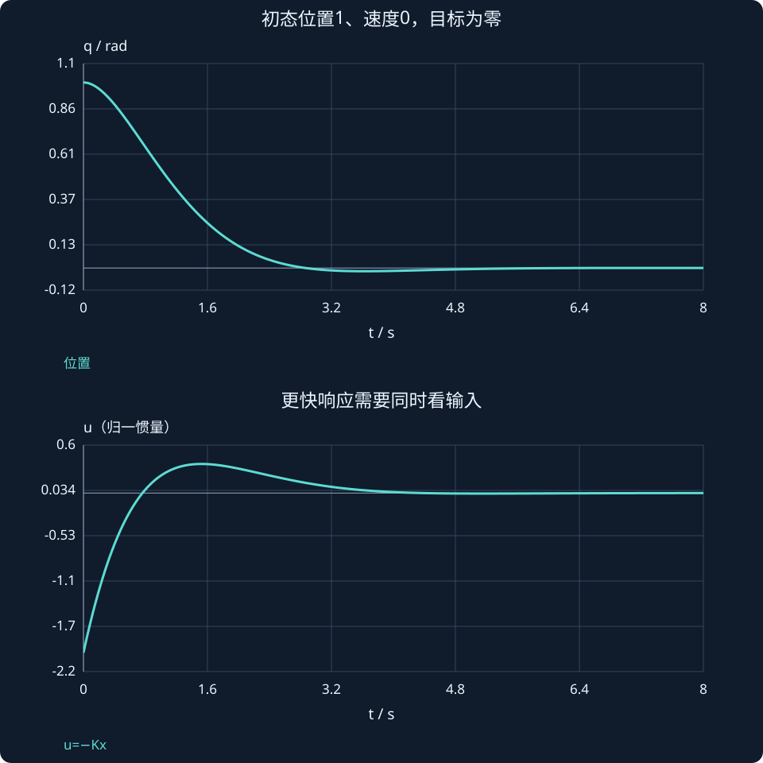

# 第 26 课：LQR最优状态反馈

> 阶段 2 · 用代价函数明确状态偏差与控制输入的权衡，学习Q、R与Riccati方程。

## 1. “最优”必须先定义代价

连续无限时域LQR选择使下式最小的控制输入：

$$
J=\int_0^{\infty}(x^{\mathsf T}Qx+u^{\mathsf T}Ru)\,dt.
$$

Q≥0惩罚状态偏差，R>0惩罚输入；它们不是“越大越好”的超参数。改变权重改变优化问题本身，不能用不同权重的代价值直接比较哪个控制器普遍更好。

状态单位不同，权重也要补偿量纲或先归一化。例如希望位置误差不超过0.1 rad，可将位置项按(q/0.1)²计，而不是把位置与速度数值不加区分地相加。

## 2. 解怎样变成一个反馈矩阵？

在可稳定、相应可检测等标准条件下，稳定化Riccati解满足：

$$
A^{\mathsf T}P+PA-PBR^{-1}B^{\mathsf T}P+Q=0,
$$

反馈为：

$$
u=-Kx,\qquad K=R^{-1}B^{\mathsf T}P.
$$

这里P是最优值函数矩阵，与上一课Lyapunov方程中的P概念相关但方程不同。不是先随便选P，再把式子套进去。

## 3. 双积分器存在简洁的解析增益

取Q=diag(q₁,q₂)、R=r>0。对双积分器且q₁>0、q₂≥0，稳定化解给出：

$$
k_1=\sqrt{q_1/r},\qquad k_2=\sqrt{q_2/r+2\sqrt{q_1/r}}.
$$

例如q₁=4、q₂=1、r=1，得到K=[2,√5]，闭环根约−1.118±0.866j。

将R增至4而Q不变，K约为[1,1.5]，对x₀=[1,0]ᵀ的初始输入绝对值从2减至1。响应通常更温和，但“输入更贵”不意味着每一个时刻的输入都严格小于另一设计，仍要看完整曲线。

## 4. 它和极点配置怎样比较？

极点配置直接选目标根；LQR通过Q、R决定权衡，根是求解结果。LQR最优性建立在线性模型、无限时域、二次代价、无硬输入约束等假设上。加入力矩上限后，直接饱和LQR不再是原问题的无约束最优解，约束优化留给后续MPC。

## 5. 仿真记录什么？

在同一初态、同一模型下比较q、v、u以及用同一评价权重计算的性能。若需要比较不同Q、R的控制器，可另外定义固定的评估代价，避免把不同标准的数值混在一起。

### 本例Riccati解也能手算核对

设P为对称矩阵。双积分器的Riccati方程逐项给出：

$$
p_{12}^2=rq_1,\qquad p_{22}^2=r(2p_{12}+q_2),\qquad p_{11}=p_{12}p_{22}/r.
$$

取稳定化分支，q₁=4、q₂=1、r=1时：

$$
P=\begin{bmatrix}2\sqrt5&2\\2&\sqrt5\end{bmatrix},\qquad K=[2,\sqrt5].
$$

对初态[1,0]ᵀ，最优无限时域代价为J*=x₀ᵀPx₀=2√5≈4.472。这里P既决定反馈，也决定最优值函数；它不是任意调出来的正定矩阵。



## 动手实验：先预测，再改变参数

固定Q只调R，观察增益、极点和输入；再固定R增大位置权重，说明权衡发生在哪里。

:::demo modern-lab mode=lqr
:::

## MATLAB：独立核对

```matlab
A=[0 1;0 0];B=[0;1];Q=diag([4 1]);R=1;
% 下式解析解不需要工具箱
K=[sqrt(Q(1,1)/R),sqrt(Q(2,2)/R+2*sqrt(Q(1,1)/R))];
disp(K);disp(eig(A-B*K));
% 如有Control System Toolbox: [K2,P,E]=lqr(A,B,Q,R)
[t,X]=ode45(@(t,x)(A-B*K)*x,[0 8],[1;0]);
plot(t,X(:,1),t,-X*K');legend('q','u');grid on;
```

示例使用基础MATLAB，涉及工具箱的替代函数已注明；本轮未实际运行MATLAB。请对照手算值与单位，不只看图形外观。

## 本课练习

1. q₁=1、q₂=2、r=1时求双积分器LQR增益。
2. 为什么Q、R同时乘相同正常数时控制器不变？
3. 两个权重不同的J数值能否直接用来比较优劣？
4. 有力矩限制时，直接截断输入是否仍是无约束LQR原解？

<details><summary>展开自查要点（先写出过程）</summary>

1. K=[1,2]。2. 最小化目标整体缩放，不改变最优输入。3. 不能，评价标准变了。4. 不是。

</details>

学习时先完成本课练习并澄清疑问，再进入下一课；网页制作进度不代表学习进度。
