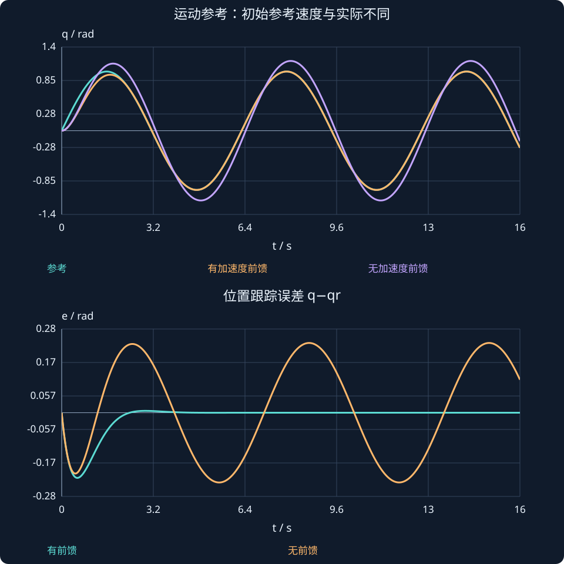

# 第 27 课：状态反馈的参考跟踪

> 阶段 2 · 从零点调节推广到常值参考和时变轨迹，区分前馈、反馈与积分。

## 1. 把平衡点先算对

对常值目标r，先寻找xᵣ、uᵣ满足：

$$
Ax_r+Bu_r=0,\qquad Cx_r+Du_r=r.
$$

再采用：

$$
u=u_r-K(x-x_r).
$$

误差状态e=x−xᵣ满足ė=(A−BK)e，因此能否收敛仍由同一个闭环矩阵判断。输入中uᵣ用于维持平衡，−Ke负责纠正偏差。

例：J=1、b=2、k=5，目标位置r=0.3 rad、速度零，需要uᵣ=kr=1.5 N·m。若忽略恢复刚度，直接令uᵣ=0，即使有状态反馈也可能留下偏差。

## 2. SISO静态前置增益的表达

当D=0且A−BK可逆，若采用u=−Kx+N̄r，则：

$$
\overline N=-[C(A-BK)^{-1}B]^{-1}.
$$

这需要括号中的直流通道非零、参考与输入维度匹配。多输入多输出时不能随便用“倒数”，应解平衡方程或线性方程组。

## 3. 跟踪运动目标，还需要速度和加速度

对双积分器q̈=u，希望跟踪可二次求导的qᵣ(t)，取：

$$
u=\ddot q_r-k_p(q-q_r)-k_d(\dot q-\dot q_r).
$$

则跟踪误差e=q−qᵣ满足ë+kdė+kpe=0。这里速度参考不是零，加速度前馈也不是可随意省略的常数。

若qᵣ=sin t，需q̇ᵣ=cos t、q̈ᵣ=−sin t。交互比较是否加入加速度前馈；在理想精确模型、相同初态下，前馈能消除参考加速度作为外部强迫项的影响。

## 4. 模型不准和恒定扰动怎么办？

平衡前馈依赖模型。外界多出恒定负载时，可增加积分状态ξ̇=r−y，使控制器逐渐补偿持续误差，但必须对增广系统重新检查可控性与稳定性。

$$
\frac{d}{dt}\begin{bmatrix}x\\\xi\end{bmatrix}=\begin{bmatrix}A&0\\-C&0\end{bmatrix}\begin{bmatrix}x\\\xi\end{bmatrix}+\begin{bmatrix}B\\0\end{bmatrix}u+\begin{bmatrix}0\\1\end{bmatrix}r.
$$

上式限定D=0的单输出结构；若D不为零，增广输入块也要改变。积分仍要结合抗饱和，不能把“有积分”当成所有跟踪问题的保证。

### 在平衡附近手算一次跟踪命令

本课弹簧模型目标qᵣ=0.3、uᵣ=1.5，设反馈K=[6,5]。当前q=0.2、v=0.1时：

$$
u=1.5-6(0.2-0.3)-5(0.1-0)=1.6\ \mathrm{N\,m}.
$$

输出1.6分为维持平衡的1.5和纠偏贡献0.1。若只把原点调节律的目标改成0.3却漏掉平衡输入，恢复力仍需由非零偏差来补偿。

此处被控对象带弹簧、阻尼，与第25课的双积分器不同；即使K数值相同，闭环极点也必须使用当前A−BK重新计算。



## 动手实验：先预测，再改变参数

改变参考频率，分别打开和关闭加速度前馈；看稳态周期误差而不只看起始时刻。

:::demo modern-lab mode=tracking
:::

## MATLAB：独立核对

```matlab
kp=4;kd=3;
f=@(t,x)[x(2); -sin(t)-kp*(x(1)-sin(t))-kd*(x(2)-cos(t))];
[t,X]=ode45(f,[0 12],[0;0]);
plot(t,sin(t),t,X(:,1));legend('参考','实际');grid on;
% 初始参考速度为1而实际为0，因此即使精确前馈，也有起始误差瞬态。
```

示例使用基础MATLAB，涉及工具箱的替代函数已注明；本轮未实际运行MATLAB。请对照手算值与单位，不只看图形外观。

## 本课练习

1. J=2、b=4、k=10时，保持q=0.2需要多少力矩？
2. qᵣ=0.5sin(2t)时，速度、加速度参考是什么？
3. 为什么固定目标的−Kd q̇与使用速度误差在运动目标时不同？
4. 前馈能否自动补偿所有未知外扰？

<details><summary>展开自查要点（先写出过程）</summary>

1. 2 N·m。2. q̇ᵣ=cos(2t)，q̈ᵣ=−2sin(2t)。3. 后者含参考速度项。4. 不能，未知量需要反馈、积分或估计等处理。

</details>

学习时先完成本课练习并澄清疑问，再进入下一课；网页制作进度不代表学习进度。
