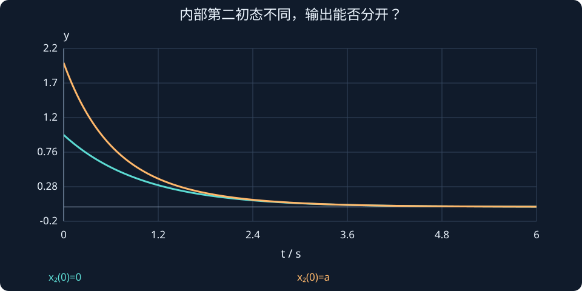

# 第 28 课：可观测性与输出信息

> 阶段 2 · 判断时间连续的测量能否区分不同内部初态，为观测器设计建立前提。

## 1. 测不到速度，不代表速度无法推知

若位置随时间变化，变化速度也包含信息。可观测性问的是：已知模型和输入，能否用一段时间的输出唯一确定初始状态。它不是“传感器数量是否等于状态数量”。

对D=0、输入已知的模型，先扣除输入引起的响应。剩余部分满足：

$$
y=Cx,\quad\dot y=CAx,\quad\ddot y=CA^2x,\ldots
$$

这些式子用于推导信息结构，不意味着工程上要直接对带噪声测量连续求高阶导数。

## 2. 可观测矩阵的秩

$$
\mathcal O=\begin{bmatrix}C\\CA\\\vdots\\CA^{n-1}\end{bmatrix},\qquad\operatorname{rank}\mathcal O=n.
$$

双积分器只测位置时，C=[1,0]，可观测矩阵就是I₂：位置及其随时间的变化能区分位置和速度。若只测速度，C=[0,1]，第二行CA为零，原始位置偏移无法从速度记录恢复。

## 3. 两个初态能否被测量分开？

$$A=\operatorname{diag}(-1,-2),\quad C=[1,\gamma],\quad
\mathcal O=\begin{bmatrix}1&\gamma\\-1&-2\gamma\end{bmatrix}.$$

行列式为−γ。若γ=0，输出只含x₁，无论x₂初值是多少，测量都一样。若γ很小但不为零，理论可观，却可能难以在噪声中区分第二状态。

取x₀=[1,a]ᵀ：

$$
y(t)=e^{-t}+\gamma a e^{-2t}.
$$

交互同时显示a=0与当前a的两条输出。γ=0时两条曲线完全重合，体现的是信息消失，而不是某种估计算法不够聪明。

## 4. 输入已知为什么重要？

若一个未知扰动和未测状态对输出造成完全相同的影响，单靠该测量可能无法区分二者。可观测性是给定模型结构的性质；传感器偏差、模型参数未知和未知输入估计是进一步的问题。

## 5. 可检测性比可观测性弱

不可观模态若自身稳定，状态误差可能自然衰减，仍可构造渐近估计器；这种条件称为可检测。不可观且不稳定的模态无法由输出纠正。后续观测器的稳定设计条件是可检测，任意配置所有误差极点则需要可观。

### 只测速度为什么恢复不了初始位置？

双积分器在u=0时，初态[0,1]ᵀ和[10,1]ᵀ都会产生恒定速度测量y(t)=1。积分测量能得到“位置变化了多少”，却不知道最初的位置偏移是0还是10。

若改成位置测量，两条记录分别为t和10+t，立刻可区分。可观测性关心不同内部状态是否可能产生完全一样的输出历史；先找这样的反例，比机械排矩阵更容易建立直觉。



## 动手实验：先预测，再改变参数

将γ降到0，改变第二初态a；看不同内部状态是否仍产生完全相同的测量。

:::demo modern-lab mode=observable
:::

## MATLAB：独立核对

```matlab
A=[0 1;0 0];
for C={[1 0],[0 1]}
 O=[C{1};C{1}*A];disp(O);disp(rank(O));
end
% 使用基础矩阵运算；有工具箱时可用obsv进行交叉核对。
```

示例使用基础MATLAB，涉及工具箱的替代函数已注明；本轮未实际运行MATLAB。请对照手算值与单位，不只看图形外观。

## 本课练习

1. 双积分器只测位置与只测速度时，分别排出O。
2. 对角例子γ=0时，哪一个初态分量无法区分？
3. 数值秩为满秩是否意味着抗噪估计一定容易？
4. “求输出导数”在结构推导与实际代码中的用途有何不同？

<details><summary>展开自查要点（先写出过程）</summary>

1. 位置时O=I；速度时O=[0,1;0,0]。2. x₂。3. 不是，病态和噪声影响仍需分析。4. 用于证明信息关系，工程估计不必直接求噪声导数。

</details>

学习时先完成本课练习并澄清疑问，再进入下一课；网页制作进度不代表学习进度。
