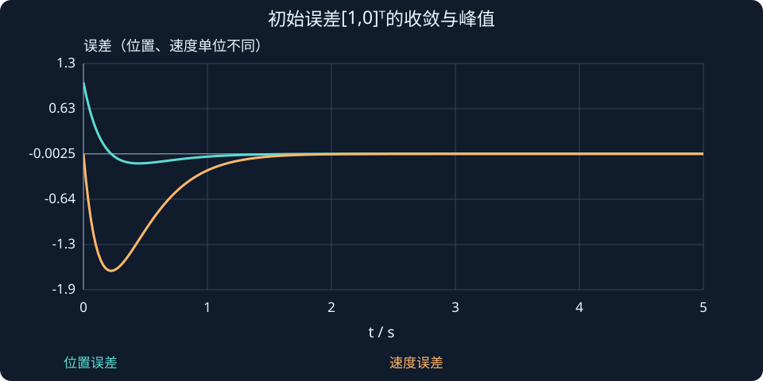

# 第 29 课：Luenberger状态观测器

> 阶段 2 · 用模型预测和测量残差估计不可直接测量的状态，并分析误差动态。

## 1. 观测器每次怎样修正自己？

对位置传感器无法直接测速度的问题，先用模型预测，再用测量与预测的差纠正：

$$
\dot{\hat x}=A\hat x+Bu+L(y-C\hat x).
$$

帽号表示估计状态，残差是测量输出减去由估计状态预测的输出，C作用于估计状态，不是估计状态的导数。D=0；若D不为零，残差应写y−C x̂−Du。

L是n×p观测器增益。残差小不自动意味着所有状态估计误差小，还要看模型的可观测结构。

## 2. 误差方程为什么不含已知输入？

定义e=x−x̂，真实与估计方程相减：

$$
\begin{aligned}
\dot e&=Ax+Bu-[A\hat x+Bu+L(Cx-C\hat x)]\\
&=(A-LC)e.
\end{aligned}
$$

输入消掉是因为观测器知道实际输入，且模型一致。若输入被执行器截断，观测器仍使用未截断命令，则抵消不再成立，会引入估计偏差。

## 3. 只测位置的双积分器

$$
A=\begin{bmatrix}0&1\\0&0\end{bmatrix},\quad C=[1,0],\quad L=\begin{bmatrix}l_1\\l_2\end{bmatrix}.
$$

误差矩阵和特征式为：

$$
A-LC=\begin{bmatrix}-l_1&1\\-l_2&0\end{bmatrix},\qquad s^2+l_1s+l_2=0.
$$

希望误差根为−4、−5，则L=[9,20]ᵀ。若初始真实与估计状态差为[1,0]ᵀ，则位置误差为−4e⁻⁴ᵗ+5e⁻⁵ᵗ，速度误差为20(e⁻⁵ᵗ−e⁻⁴ᵗ)。速度误差可能先增大再下降，这称为峰化现象的一种表现，不能因为中间误差暂时变大就否定最终稳定。

## 4. 观测器更快不总更好

若测量y=Cx+n，则误差多出−Ln。提高L可加快理想初态误差的收敛，也会增强噪声注入及潜在峰化。滤波、模型精度、采样与带宽都要权衡。

“观测器比控制器快几倍”只是常见起点，不是无条件设计定理。后续卡尔曼滤波会用统计噪声模型给出另一种权衡，本阶段先学确定性结构。

### 先增大的速度误差是否代表观测器失稳？

本例初始误差[1,0]ᵀ，有：

$$
\dot e(0)=\begin{bmatrix}-9\\-20\end{bmatrix}.
$$

速度误差从0向负方向变化，显然不可能在一开始就“绝对值单调减少”。t=0.2 s时，位置误差约0.042、速度误差约−1.629；随后两者仍都趋零。

这提醒我们同时检查误差极点和最大瞬态峰值。快观测器需要足够的数值范围与输入余量，不能只记录一个很小的最终误差。



## 动手实验：先预测，再改变参数

把两项增益同时设计成较快与较慢误差极点，观察收敛和中间峰值；本交互不含噪声，不能据此推断抗噪性能。

:::demo modern-lab mode=observer
:::

## MATLAB：独立核对

```matlab
A=[0 1;0 0];C=[1 0];L=[9;20];
[t,E]=ode45(@(t,e)(A-L*C)*e,[0 3],[1;0]);
plot(t,E);legend('位置误差','速度误差');grid on;
disp(eig(A-L*C));
```

示例使用基础MATLAB，涉及工具箱的替代函数已注明；本轮未实际运行MATLAB。请对照手算值与单位，不只看图形外观。

## 本课练习

1. 为误差极点−2、−3求L。
2. 为什么L=[9,20]ᵀ的第二项不是9？
3. 实际力矩饱和时，观测器应使用实际输入还是原始命令？
4. 加大L可能带来哪两类代价？

<details><summary>展开自查要点（先写出过程）</summary>

1. [5,6]ᵀ。2. 对比s系数与常数项，l₁=9、l₂=20。3. 应尽量使用实际输入。4. 噪声注入和估计峰化等。

</details>

学习时先完成本课练习并澄清疑问，再进入下一课；网页制作进度不代表学习进度。
