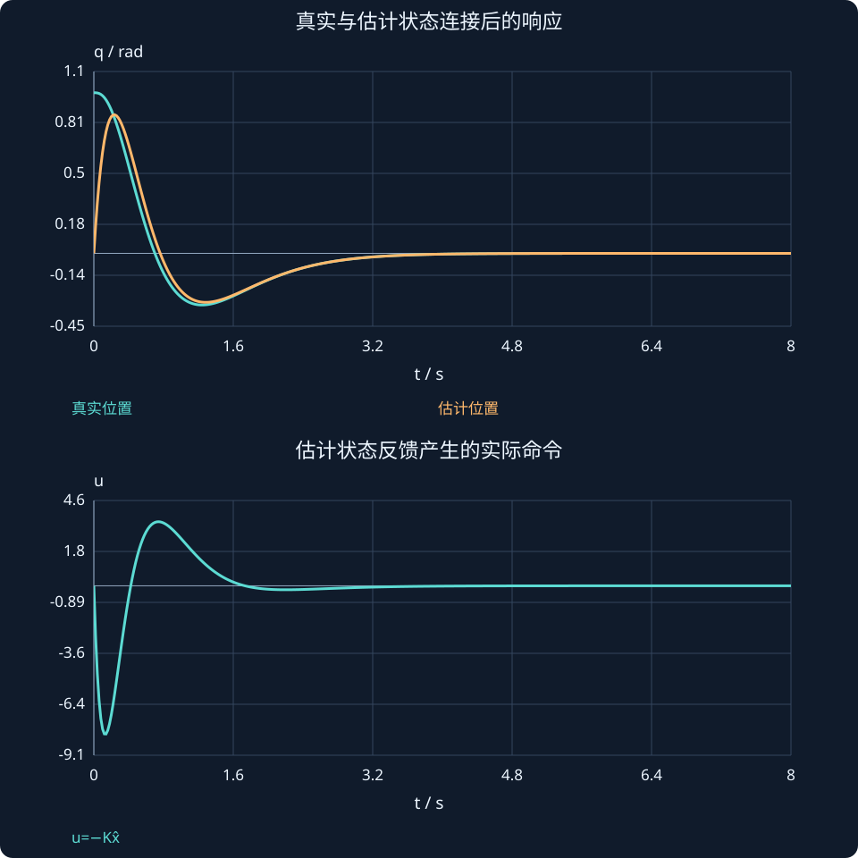

# 第 30 课：观测器反馈与分离原理

> 阶段 2 · 将估计状态接入控制器，理解两组极点怎样共同决定闭环。

## 1. 测不到全部状态，反馈怎样实现？

使用估计状态而非真实状态：

$$
u=-K\hat x,\qquad\dot{\hat x}=A\hat x+Bu+L(y-C\hat x).
$$

控制器K先依据可控性设计，观测器L依据可观测性设计。它们连接后仍要检查完整闭环，不能只看两张独立响应图。

## 2. 用误差坐标把连接关系写出来

令e=x−x̂，则x̂=x−e，代入真实方程：

$$
\begin{bmatrix}\dot x\\\dot e\end{bmatrix}
=\begin{bmatrix}A-BK&BK\\0&A-LC\end{bmatrix}
\begin{bmatrix}x\\e\end{bmatrix}.
$$

这是块上三角矩阵，特征多项式等于两个对角块特征多项式之积，因此闭环极点是两组极点的并集。估计误差通过BK影响真实系统，但不改变这组联合极点的代数结论。

## 3. 一套可手算的配置

双积分器取K=[6,5]，控制根−2、−3；L=[9,20]ᵀ，估计误差根−4、−5。连接后的四个极点就是−2、−3、−4、−5。

若真实初态[1,0]ᵀ而估计初态为零，控制器一开始认为没有偏差，所以初始输入为零；测量残差随后修正估计，控制才逐渐响应。这与使用真实状态时一开始输出−6不同。看两条位置曲线不同，并不与“极点并集”矛盾。

## 4. 稳定性结论与工程鲁棒性分开看

分离原理适用于精确线性模型及相应结构条件：控制闭环和估计误差闭环都Hurwitz，则连接系统也Hurwitz。它没有保证任意噪声、输入限幅、计算延迟和模型失配下仍有相同性能。

观测器极点放得非常快可能带来峰化和噪声放大；即使四个理想极点都在左半平面，也要检查控制输入是否可实现。

## 5. 参考跟踪怎样加入？

可在u=−Kx̂上加平衡前馈或参考轨迹项。先把参考与误差状态定义清楚，再构造估计器。不要同时更换坐标、误差符号与输入定义，否则容易把BK项的符号写反。

### 把联合矩阵展开，直接看耦合项

按坐标[q,v,e_q,e_v]排列，本课配置的联合矩阵是：

$$
M=\begin{bmatrix}0&1&0&0\\-6&-5&6&5\\0&0&-9&1\\0&0&-20&0\end{bmatrix}.
$$

取

$$
[q(0),v(0),e_q(0),e_v(0)]^{\mathsf T}=[1,0,1,0]^{\mathsf T}.
$$

此时真实加速度与误差变化率分别为

$$
\dot v(0)=-6q+6e_q=0,\qquad[\dot e_q(0),\dot e_v(0)]^{\mathsf T}=[-9,-20]^{\mathsf T}.
$$

随后误差不再维持原值，估计反馈开始驱动真实系统。不能因为第一瞬间 $u=0$，就误以为控制器之后也不会动作。



## 动手实验：先预测，再改变参数

分别调控制器与观测器的目标速率；看真实位置、估计位置和控制输入。检查初始估计不准时输入与理想全状态反馈的区别。

:::demo modern-lab mode=separation
:::

## MATLAB：独立核对

```matlab
A=[0 1;0 0];B=[0;1];C=[1 0];K=[6 5];L=[9;20];
M=[A-B*K B*K;zeros(2) A-L*C];disp(eig(M));
[t,Z]=ode45(@(t,z)M*z,[0 6],[1;0;1;0]);
X=Z(:,1:2);E=Z(:,3:4);Xhat=X-E;U=-Xhat*K';
plot(t,X(:,1),t,Xhat(:,1),t,U);grid on;
legend('真实位置','估计位置','输入');
```

示例使用基础MATLAB，涉及工具箱的替代函数已注明；本轮未实际运行MATLAB。请对照手算值与单位，不只看图形外观。

## 本课练习

1. 写出双积分器K=[6,5]、L=[9,20]时的两个对角块。
2. 为什么联合矩阵右上块是+BK？
3. 真实初态非零而估计初态为零时，初始输入是多少？
4. 极点都稳定是否保证饱和后的真实响应仍满足原分析？

<details><summary>展开自查要点（先写出过程）</summary>

1. A−BK=[0,1;−6,−5]，A−LC=[−9,1;−20,0]。2. $u=−K(x−e)$，因此误差以+BK作用于x。3. 零。4. 不保证。

</details>

学习时先完成本课练习并澄清疑问，再进入下一课；网页制作进度不代表学习进度。
