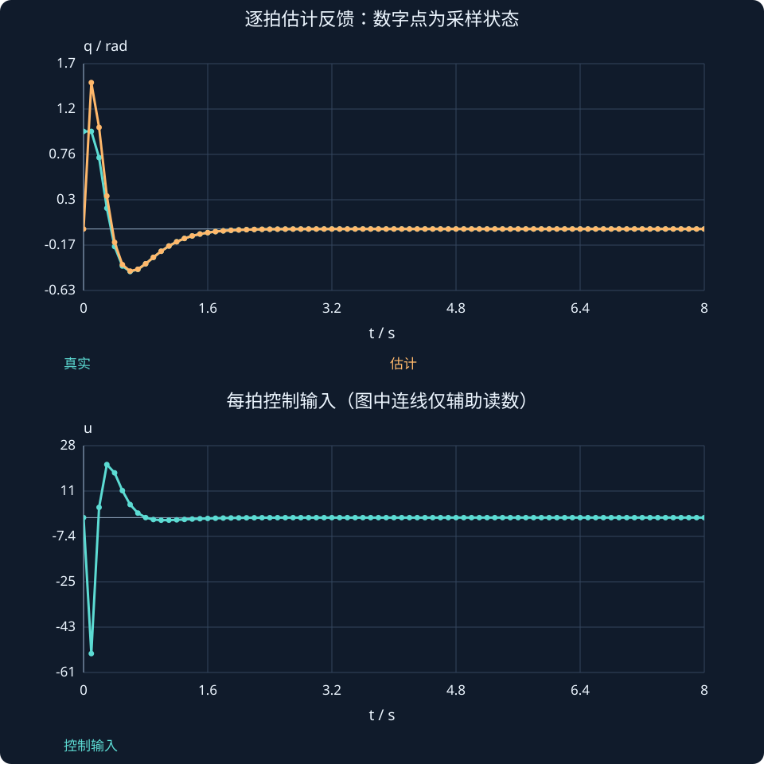

# 第 31 课：离散状态反馈与综合设计

> 阶段 2 · 用精确离散模型、数字反馈与观测器串起一套可执行的设计流程。

## 1. 连续增益不能不加说明地直接移植

双积分器的精确零阶保持模型为：

$$
A_d=\begin{bmatrix}1&T_s\\0&1\end{bmatrix},\qquad B_d=\begin{bmatrix}T_s^2/2\\T_s\end{bmatrix}.
$$

若使用数字反馈uₖ=−Kdxₖ，应分析Ad−BdKd的特征值是否在单位圆内，而不是只看连续A−BK。采样越慢，直接复用连续增益的差别越明显。

## 2. 配置两个离散极点，完整推导增益

令Kd=[k₁,k₂]，希望极点p₁、p₂。由迹和行列式匹配得到：

$$
\begin{aligned}
k_1&=\frac{(1-p_1)(1-p_2)}{T_s^2},\\
k_2&=\frac{1-p_1p_2}{T_s}+\frac{T_s k_1}{2}.
\end{aligned}
$$

取Tₛ=0.1 s、p₁=0.6、p₂=0.7，得Kd=[12,6.4]。注意第二式后项是加号。闭环矩阵为：

$$
A_d-B_dK_d=\begin{bmatrix}0.94&0.068\\-1.2&0.36\end{bmatrix}.
$$

迹1.3、行列式0.42，正好对应0.6+0.7与0.6×0.7。若某个离散极点超过1，状态会增长；负极点可能产生采样间交替符号。

## 3. 离散观测器要明确校正时序

本课采用预测器形式：

$$
\hat x_{k+1}=A_d\hat x_k+B_du_k+L_d(y_k-C\hat x_k).
$$

误差动态为eₖ₊₁=(Ad−LdC)eₖ；这不是先更新到x̂ₖ再反馈的另一种时序。对位置测量C=[1,0]，希望误差极点0.2、0.3：

$$
l_1=2-(0.2+0.3)=1.5,\qquad l_2=\frac{0.2(0.3)-1+l_1}{T_s}=5.6.
$$

## 4. 一拍控制循环按什么顺序？

在第k拍，先读取yₖ并取出旧估计x̂ₖ；由旧估计计算uₖ；用同一yₖ、x̂ₖ、uₖ计算下一估计；最后保存x̂ₖ₊₁等待下一拍。仿真中的真实x也按Ad、Bd推进，真实工程则由物理对象自行演化。

不能先覆盖位置估计再拿新位置更新旧速度，也不能让观测器使用与对象不同的实际输入。若存在限幅，记录实际u再进入估计更新。

## 5. 用一张设计清单串起阶段2

1. 给出A、B、C、D、单位、状态顺序和采样时序。
2. 检查可控性与可观测性；若只要求稳定，也检查可稳定/可检测。
3. 选择极点配置或LQR，记录目标与输入代价。
4. 若状态测不全，设计估计器并分析误差。
5. 选择精确离散模型，按数字实现重新核对闭环极点。
6. 用初态、参考变化、噪声、扰动和限幅分别检查；本课交互只覆盖理想初态调节，不冒充全部验证。

下方实验可调反馈极点和采样周期。观测器误差极点固定0.2、0.3；控制参数变化不应误改观测器的误差极点。完成本课后，再使用后面的机器人综合实践材料。

### 只算两拍，就能发现估计峰化带来的大输入

真实初态[1,0]ᵀ、估计初态零。第0拍y₀=1、u₀=0，下一真实状态仍为[1,0]ᵀ，但估计更新为：

$$
\hat x_1=L_dy_0=\begin{bmatrix}1.5\\5.6\end{bmatrix}.
$$

第1拍因此产生：

$$
u_1=-12(1.5)-6.4(5.6)=-53.84.
$$

这是理想线性仿真中的大命令，体现激进估计器的峰化，并不是代码自动保证的可执行输入。若实际执行器限幅，观测器应使用实际执行的u，再重新分析限幅后的恢复。极点都在单位圆内，仍不能省略输入峰值检查。



## 动手实验：先预测，再改变参数

比较p₁、p₂在单位圆内与超过1的情况；保持极点数值不变而改变Ts时，区分“每拍快慢”与“每秒快慢”。

:::demo modern-lab mode=digital
:::

## MATLAB：独立核对

```matlab
Ts=.1;Ad=[1 Ts;0 1];Bd=[Ts^2/2;Ts];C=[1 0];
Kd=[12 6.4];Ld=[1.5;5.6];x=[1;0];xh=[0;0];
N=100;Q=zeros(N,3);
for k=1:N
 y=C*x;u=-Kd*xh;Q(k,:)=[(k-1)*Ts,x(1),xh(1)];
 xn=Ad*x+Bd*u; xhn=Ad*xh+Bd*u+Ld*(y-C*xh);
 x=xn;xh=xhn;
end
plot(Q(:,1),Q(:,2:3),'.-');grid on;legend('真实位置','估计位置');
disp(eig(Ad-Bd*Kd));disp(eig(Ad-Ld*C));
```

示例使用基础MATLAB，涉及工具箱的替代函数已注明；本轮未实际运行MATLAB。请对照手算值与单位，不只看图形外观。

## 本课练习

1. 手算本课闭环矩阵的迹与行列式。
2. Ts=0.2、仍取p₁=0.6、p₂=0.7时，Kd是多少？
3. 为什么单位圆内两个负极点也可渐近稳定？
4. 按本课时序写出一拍伪代码，并指出何时才能覆盖旧状态。

<details><summary>展开自查要点（先写出过程）</summary>

1. 迹1.3、行列式0.42。2. Kd=[3,3.2]。3. 模长小于1可交替衰减。4. 先保留旧估计，使用同一拍数据计算所有分量，再整体更新。

</details>

学习时先完成本课练习并澄清疑问，再进入下一课；网页制作进度不代表学习进度。
