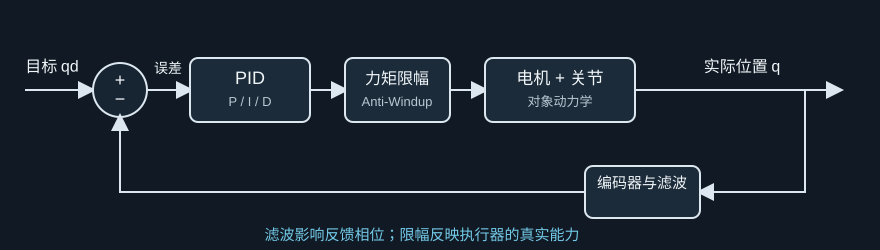

# 第 32 课：机器人控制器综合设计

> 第 4 阶段｜把 PID、滤波、限幅和采样放进同一个控制方案

前面我们分开学过 PD/PID、积分饱和、数字采样、Bode 图、稳定裕度、带宽和延迟。本课把它们放回同一个机器人关节里，按工程设计流程组合起来。

重点不是找一组“万能 PID 数字”，而是学会问对问题：要控制什么量？对象模型是什么？电机能不能执行计算出的命令？采样和滤波是否合适？换了负载之后还稳定吗？

## 一、先把控制任务说清楚

以单关节机械臂为例，目标角度为 $q_d(t)$，编码器测得角度 $q(t)$，电机接受力矩命令 $\tau(t)$。误差是：

$$
e(t)=q_d(t)-q(t)
$$

先用一个简化刚体模型：

$$
J\ddot q+b\dot q=\tau-d
$$

$d$ 汇总重力、摩擦和外部负载等扰动。这个模型忽略柔性、间隙、复杂摩擦和电机电气动态，适合帮助我们搭建第一版控制器。

设计前先确定指标：

- 控制目标是位置、速度还是力矩？
- 角度用 rad 还是 deg？增益单位是否匹配？
- 允许多大跟踪误差、超调和稳定时间？
- 电机连续和峰值力矩分别是多少？
- 控制周期、测量噪声和通信延迟大概多大？

图 1：限幅处在控制器与执行器之间；测量滤波属于反馈环的一部分，会影响动态和相位。

## 二、把全部部件放进闭环

一个可运行的位置控制方案通常包含：

目标轨迹 → 误差计算 → PID → 输出限幅 → 电机与关节 → 编码器测量 → 必要的滤波 → 回到误差计算。

PID 输出可写成：

$$
\tau_{raw}=K_pe+K_i z-K_d\dot q_f
$$

$z$ 是误差积分，$\dot q_f$ 是滤波后的测量速度。微分作用写在测量速度上，可以避免目标角度阶跃直接造成微分尖峰。

电机输出有限，实际命令为：

$$
\tau=\operatorname{sat}(\tau_{raw},-\tau_{max},+\tau_{max})
$$

控制器算出 12 N·m，不代表电机能输出 12 N·m。如果上限是 5 N·m，实际送入对象的只有 5 N·m。

## 三、各个部分分别负责什么？

| 组成 | 主要作用 | 过强或设计不当的后果 |
| --- | --- | --- |
| P：$K_pe$ | 误差越大，立即产生越强纠正力矩 | 振荡、噪声放大、力矩冲击 |
| I：$K_i z$ | 累积长期误差，补偿恒定负载 | 饱和期间积分堆积，造成大超调 |
| D：$-K_d\dot q_f$ | 根据速度提供阻尼 | 速度噪声被放大 |
| 低通滤波 | 抑制部分高频测量噪声 | 太强会让反馈变慢，消耗相位裕度 |
| 输出限幅 | 遵守电机能力 | 饱和时控制器无法继续增加力矩 |
| Anti-Windup | 避免饱和期间积分朝错误方向累积 | 回算过激会影响恢复过程 |

这些模块互相影响。微分滤波可以降噪，却增加相位滞后；积分能消除稳态偏差，却要考虑执行器饱和。

## 四、带数字手算一次控制器输出

某次循环读取到：

$$
q_d=1.0\ \mathrm{rad},\quad q=0.8\ \mathrm{rad},\quad
\dot q_f=0.1\ \mathrm{rad/s},\quad z=0.05\ \mathrm{rad\,s}
$$

选择：

$$
K_p=12,\quad K_i=2,\quad K_d=1.5
$$

位置误差为 $e=1.0-0.8=0.2$ rad，未限幅力矩为：

$$
\tau_{raw}=12(0.2)+2(0.05)-1.5(0.1)=2.35\ \mathrm{N\,m}
$$

若力矩上限为 2.0 N·m，电机只收到：

$$
\tau=2.0\ \mathrm{N\,m}
$$

这时输出饱和。若误差仍为正，积分项继续变大，会让未限幅命令离上限越来越远，之后即使位置越过目标，控制器也可能需要很久才能把积累的积分“消化掉”。

条件积分的一种简单办法是：未饱和时正常积分；饱和时，如果误差会把命令推得更饱和，就暂时停止积分；如果误差能帮助命令退出饱和，则允许积分更新。

## 五、按顺序设计，而不是同时乱调

### 第 1 步：定义性能和安全边界

先写下位置误差、超调、稳定时间、最大力矩、速度、控制周期等要求。标清哪些是不能突破的安全限制。

### 第 2 步：建立对象模型

从 $J\ddot q+b\dot q=\tau-d$ 这样的简单模型开始，记录参数来源和适用范围。负载变化会改变惯量，不能把一次辨识结果当作永远不变。

### 第 3 步：先调 P 与 D

从较小 $K_p$ 开始逐步增加，观察响应速度和振荡；再增加适量 $K_d$ 提供阻尼。先检查阶跃和慢速轨迹，不要一开始就加入很强积分。

### 第 4 步：检查开环裕度与闭环带宽

开环 Bode 图看交越频率和 PM/GM；闭环响应看跟踪速度和误差。两者回答不同问题，不要把开环交越频率直接当闭环带宽。

### 第 5 步：处理噪声和稳态偏差

根据编码器噪声设计速度估计和微分滤波；基本闭环稳定后，再加入足以消除恒定偏差的积分，并配好 Anti-Windup。

### 第 6 步：检查限幅与变化工况

至少测试力矩饱和、负载变化、传感器噪声、延迟增加、目标突变和控制器重启。

图 2：一项一项检查，才能知道问题来自模型、参数、噪声还是执行器限制。

## 六、交互实验：PID 组件如何共同影响响应？

演示对象为 $J\ddot q+b\dot q=\tau-d$，使用固定采样周期、PID、力矩限幅和条件积分。调节 $K_p,K_i,K_d$ 与最大力矩，观察位置响应和力矩饱和。

:::demo design mode=controller
:::

可以按这个顺序观察：

1. 先设 $K_i=0$，逐渐提高 $K_p$，看响应变快时是否更容易振荡或触及限幅。
2. 加一点 $K_d$，观察超调和振铃是否减弱。
3. 加入 $K_i$，观察稳态误差是否缩小；再降低力矩上限，观察 Anti-Windup 对恢复过程的作用。
4. 演示只展示趋势，不能把滑块参数直接用于真实机械臂。

## 七、调参时每次只改变一个主要因素

同时改 $K_p,K_i,K_d$、滤波和采样周期，很难判断是哪项造成变化。建议每次都记录：

| 记录项 | 示例 |
| --- | --- |
| 对象参数 | $J,b$ 或负载 |
| 控制参数 | $K_p,K_i,K_d$、滤波时间常数 |
| 数字实现 | $T_s$、计算和通信延迟 |
| 执行器边界 | 最大力矩、速度、位置范围 |
| 测试轨迹 | 阶跃、斜坡、正弦、急停 |
| 结果 | 误差、超调、稳定时间、最大力矩、裕度 |

这样才能可重复地比较方案，而不是只凭“看起来更顺”。

## 八、MATLAB：离散 PID、限幅和条件积分

下面代码用固定采样周期运行 PID，在两次更新之间保持力矩。它包括力矩限幅和条件积分；为了突出控制逻辑，暂不加入传感器噪声和通信延迟。

~~~matlab
clc;
clear;
close all;

J = 1.0;
b = 0.4;
Ts = 0.01;
dt = 0.001;
Tend = 4;

Kp = 12;
Ki = 2;
Kd = 1.5;
tauMax = 2.0;
tauFilter = 0.02;

t = 0:dt:Tend;
q = zeros(size(t));
qd = 1.0;
tau = zeros(size(t));
qdot = 0;
integral = 0;
qdotFiltered = 0;
qPrev = 0;
tauHeld = 0;
nextSample = 1;

for n = 2:length(t)
    if t(n) + 1e-12 >= (nextSample-1)*Ts
        e = qd - q(n-1);
        qdotRaw = (q(n-1)-qPrev)/Ts;
        alpha = exp(-Ts/tauFilter);
        qdotFiltered = alpha*qdotFiltered + (1-alpha)*qdotRaw;

        uCandidate = Kp*e + Ki*integral - Kd*qdotFiltered;
        uLimited = min(max(uCandidate,-tauMax),tauMax);

        drivesFurtherIntoSaturation = ...
            (uCandidate > tauMax && e > 0) || ...
            (uCandidate < -tauMax && e < 0);
        if uCandidate == uLimited || ~drivesFurtherIntoSaturation
            integral = integral + e*Ts;
        end

        uCandidate = Kp*e + Ki*integral - Kd*qdotFiltered;
        tauHeld = min(max(uCandidate,-tauMax),tauMax);
        qPrev = q(n-1);
        nextSample = nextSample + 1;
    end

    qddot = (tauHeld - b*qdot)/J;
    qdot = qdot + qddot*dt;
    q(n) = q(n-1) + qdot*dt;
    tau(n) = tauHeld;
end

figure;
subplot(2,1,1);
plot(t,q,'LineWidth',1.5);
hold on;
yline(qd,'k--','目标');
ylabel('位置 q (rad)');
grid on;
title('离散 PID 位置控制仿真');

subplot(2,1,2);
plot(t,tau,'LineWidth',1.5);
hold on;
yline(tauMax,'r--');
yline(-tauMax,'r--');
xlabel('时间 (s)');
ylabel('力矩 (N m)');
grid on;
~~~

请留意：

- 控制器每 $T_s$ 更新一次；对象用更小的 $dt$ 在采样点之间继续运动。
- 两拍之间保持上次力矩，这就是零阶保持。
- 条件积分阻止饱和时积分继续把命令推向更饱和的方向。

## 九、仿真通过不等于实机安全

仿真只说明设定的模型和条件下表现合理。部署前还要确认：

- 传感器时间戳与控制周期是否一致。
- 角度、速度和力矩单位是否统一。
- 输出限幅、变化率限制和急停是否有效。
- 传感器异常、通信丢失或数值异常时如何进入安全状态。
- 启动或重置时积分、滤波历史值如何初始化。
- 采样抖动和真实通信延迟是否被测试覆盖。

## 十、本课公式卡

| 项目 | 公式 | 说明 |
| --- | --- | --- |
| 误差 | $e_k=q_{d,k}-q_k$ | 目标减测量 |
| PID 未限幅输出 | $u_k^*=K_pe_k+K_i z_k-K_dv_k^f$ | D 作用于测量速度 |
| 力矩限幅 | $u_k=\operatorname{sat}(u_k^*,-u_{max},u_{max})$ | 遵守执行器能力 |
| 离散积分 | $z_k=z_{k-1}+e_kT_s$ | 采样周期必须参与 |
| 一阶低通 | $v_k^f=\alpha v_{k-1}^f+(1-\alpha)v_k$ | $\alpha$ 由采样周期和滤波时间常数决定 |
| 对象模型 | $J\ddot q+b\dot q=u-d$ | 简化关节动力学 |

## 十一、第 32 课课后练习

### 练习 1：手算一拍 PID

$e=0.1$ rad、$z=0.04$ rad·s、$v_f=0.2$ rad/s，$K_p=10,K_i=2,K_d=1$。求未限幅力矩；若上限为 1.2 N·m，实际输出是多少？

### 练习 2：积分与限幅

电机已达到正向力矩上限，位置误差仍为正。继续积分会有什么问题？条件积分怎样处理？

### 练习 3：解释微分滤波

为什么速度噪声会影响 D 项？滤波过强又会付出什么代价？

### 练习 4：制定测试表

给一个位置控制器列出至少 4 种测试工况，其中至少包括一种执行器受限工况和一种模型不确定工况。

本课核心：**可靠控制器由控制律、滤波、采样、限幅、抗饱和和工况验证共同组成，单独一组 PID 数字不能代表完整设计。**
