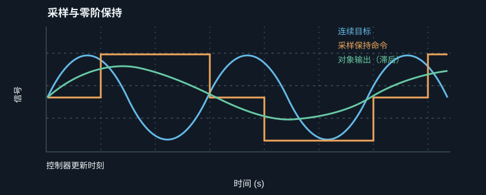
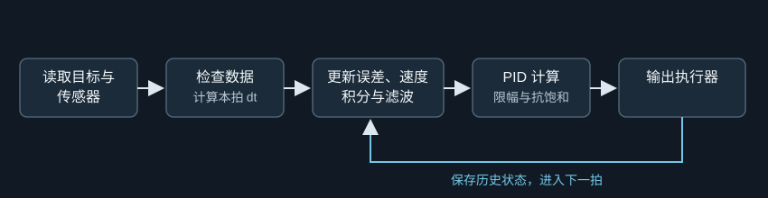

# 第 33 课：MATLAB 仿真与 C++ 控制循环

> 第 4 阶段｜从控制公式走到每一拍真正执行的程序

物理关节连续运动，机器人程序却隔一小段时间才运行一次。这一课把连续 PID 公式落实成数字控制循环：采样、计算误差、更新积分和速度估计、限幅、输出，再保存下一拍需要的历史值。

学完后，你应该能解释采样周期、零阶保持和仿真步长的区别；写出离散 PID 更新式；读懂带限幅与条件积分的 C++ 控制器；分清 MATLAB 仿真和 C++ 实时循环各自负责什么。

## 一、连续运动，离散计算

控制器在固定时刻运行：

$$
t_k=kT_s,\qquad k=0,1,2,\ldots
$$

若 $T_s=0.01$ s，程序每 10 ms 更新一次。它在 $t_k$ 读取传感器、计算力矩；下一次更新前通常保持上一拍命令。这叫零阶保持（ZOH）。

图 1：物理对象连续运动，控制程序离散更新；真实系统还有执行器动态与通信延迟。

- $T_s$：两次控制更新之间的时间，单位 s。
- $f_s=1/T_s$：采样频率，单位 Hz。
- $k$：控制循环序号，没有物理单位。
- $dt$：数值仿真推进对象用的步长，可以小于 $T_s$，不一定等于真实控制周期。

## 二、连续 PID 怎样变成每拍更新？

连续位置 PID：

$$
u(t)=K_pe(t)+K_i\int_0^t e(\xi)\,d\xi+K_d\dot e(t)
$$

数字控制器只在采样时刻计算，因此用差分和求和近似。

比例项：

$$
P_k=K_pe_k,\qquad e_k=q_{d,k}-q_k
$$

积分项用矩形面积近似：

$$
z_k=z_{k-1}+e_kT_s,\qquad I_k=K_i z_k
$$

每拍误差要乘以这拍持续时间。若漏掉 $T_s$，采样频率一变，积分效果就变了。

对误差做微分差分：

$$
\dot e_k\approx\frac{e_k-e_{k-1}}{T_s}
$$

目标突然跳变会让误差也跳变，差分可能产生尖峰。位置控制常对测量位置求差分：

$$
D_k=-K_d\frac{q_k-q_{k-1}}{T_s}
$$

目标固定时 $\dot e=-\dot q$，负号让 D 项对实际运动提供阻尼，同时避免目标阶跃直接引起微分 kick。

## 三、速度估计、滤波和限幅

差分速度会放大位置测量噪声。若两个样本差 $0.001$ rad、采样周期为 $0.001$ s，估计速度就是 $1$ rad/s。

一阶低通滤波：

$$
v_k^f=\alpha v_{k-1}^f+(1-\alpha)v_k^{raw},
\qquad \alpha=e^{-T_s/\tau_f}
$$

$\tau_f$ 是滤波时间常数。它越大，通常平滑越强，但反馈也越慢。

带测量微分的未限幅输出：

$$
u_k^*=K_pe_k+K_i z_k-K_dv_k^f
$$

执行器范围有限：

$$
u_k=\min(\max(u_k^*,-u_{max}),u_{max})
$$

若输出饱和，积分要配合 Anti-Windup，避免继续朝更饱和的方向累积。

## 四、一拍控制循环的顺序

每次循环大致如下：

1. 读取目标和测量位置。
2. 检查输入有效性和时间间隔。
3. 计算误差 $e_k=q_{d,k}-q_k$。
4. 用位置差估计速度，更新滤波器。
5. 计算 P、I、D 候选输出。
6. 应用力矩限幅和 Anti-Windup。
7. 向执行器发送命令。
8. 保存上一拍位置、积分和滤波状态。

图 2：积分、上一拍位置和滤波状态要跨循环保存；否则下一拍会丢失控制器的记忆。

## 五、C++：带内部状态的离散 PID

控制器需要保存积分、上一拍位置和滤波速度，因此它是一个有内部状态的对象。

~~~cpp
#include <algorithm>
#include <cmath>

class PositionPid {
public:
    PositionPid(double kp, double ki, double kd,
                double max_torque, double filter_tau)
        : kp_(kp), ki_(ki), kd_(kd),
          max_torque_(max_torque), filter_tau_(filter_tau) {}

    double Update(double target, double position, double dt) {
        if (!std::isfinite(target) || !std::isfinite(position) ||
            !std::isfinite(dt) || dt <= 0.0) {
            Reset();
            return 0.0;  // 实际项目应按安全策略处理异常
        }

        const double error = target - position;

        if (!initialized_) {
            previous_position_ = position;
            filtered_velocity_ = 0.0;
            initialized_ = true;
        }

        const double raw_velocity =
            (position - previous_position_) / dt;
        const double alpha = filter_tau_ > 0.0
            ? std::exp(-dt / filter_tau_)
            : 0.0;

        filtered_velocity_ =
            alpha * filtered_velocity_ +
            (1.0 - alpha) * raw_velocity;

        const double candidate =
            kp_ * error + ki_ * integral_ -
            kd_ * filtered_velocity_;
        const double limited =
            Clamp(candidate, -max_torque_, max_torque_);

        const bool saturated = candidate != limited;
        const bool drives_further =
            (candidate > max_torque_ && error > 0.0) ||
            (candidate < -max_torque_ && error < 0.0);

        if (!saturated || !drives_further) {
            integral_ += error * dt;
        }

        const double command =
            kp_ * error + ki_ * integral_ -
            kd_ * filtered_velocity_;

        previous_position_ = position;
        return Clamp(command, -max_torque_, max_torque_);
    }

    void Reset() {
        integral_ = 0.0;
        previous_position_ = 0.0;
        filtered_velocity_ = 0.0;
        initialized_ = false;
    }

private:
    static double Clamp(double value, double low, double high) {
        return std::min(std::max(value, low), high);
    }

    double kp_, ki_, kd_;
    double max_torque_, filter_tau_;
    double integral_ = 0.0;
    double previous_position_ = 0.0;
    double filtered_velocity_ = 0.0;
    bool initialized_ = false;
};
~~~

理解这些成员变量：

- integral_ 保存累计误差。
- previous_position_ 用于差分速度。
- filtered_velocity_ 保存滤波器上一拍的输出。
- initialized_ 防止第一次运行就用未初始化的历史值做差分。
- dt 表示本次真实时间间隔；固定周期系统也应检查它是否偏离预期。

这是教学用的小类。实际项目还要加故障处理、变化率限制、参数保护、线程安全和安全停车策略。

## 六、MATLAB：观察采样与零阶保持

控制器每隔 $T_s$ 读取一次正弦目标，并在下一次更新前保持命令。对象为一阶系统 $\tau\dot y+y=u$。

~~~matlab
clc;
clear;
close all;

tau = 0.08;          % 对象时间常数 (s)
Ts = 0.02;           % 控制采样周期 (s)
dt = 0.001;          % 数值仿真步长 (s)
omega = 2*pi*2;      % 目标频率：2 Hz
Tend = 2;

t = 0:dt:Tend;
target = sin(omega*t);
held = zeros(size(t));
y = zeros(size(t));

u = 0;
next_sample_time = 0;

for n = 2:length(t)
    if t(n) + 1e-12 >= next_sample_time
        u = target(n);  % 控制器读取目标并更新输出
        next_sample_time = next_sample_time + Ts;
    end

    held(n) = u;
    y(n) = y(n-1) + dt*(held(n)-y(n-1))/tau;
end

figure;
plot(t, target, 'k--', 'LineWidth', 1.2);
hold on;
stairs(t, held, 'b', 'LineWidth', 1.2);
plot(t, y, 'r', 'LineWidth', 1.5);
xlabel('时间 (s)');
ylabel('信号');
title('采样与零阶保持对跟踪的影响');
legend('连续目标','采样保持输入','一阶对象输出');
grid on;
~~~

逐渐增大 $T_s$ 或目标频率，会看到保持输入更粗糙、对象输出更难跟上。这个脚本展示采样与对象滞后，不是完整 PID 设计。

## 七、交互实验：采样周期、目标频率与对象响应

调整采样周期、目标频率和对象时间常数，观察连续目标、零阶保持输入与实际输出。

:::demo design mode=sampling
:::

试着固定频率增大 $T_s$；固定采样周期提高目标频率；再增大对象时间常数 $\tau$。采样再密也不能让电机无限快，执行器带宽、噪声、限幅和延迟仍然存在。

## 八、仿真、程序和实机之间的对应

| 阶段 | 用途 | 典型检查 |
| --- | --- | --- |
| 公式推导 | 确认量之间关系 | 单位、符号、假设 |
| MATLAB 仿真 | 快速扫参数和工况 | 响应、饱和、采样、噪声 |
| C++ 离线测试 | 检查状态更新与边界 | 初始化、异常输入、dt 变化 |
| 软件闭环或硬件在环 | 检查真实消息与时序 | 延迟、线程、通信、丢帧 |
| 低风险实机测试 | 验证机械与执行器 | 限位、急停、负载和安全策略 |

MATLAB 曲线好看，不等于 C++ 实现一定正确；C++ 单元测试通过，也不代表传感器和电机时序满足假设。

## 九、常见实现错误

- 积分更新漏乘 $dt$ 或 $T_s$。
- 速度差分漏除以采样周期。
- 第一次运行就使用未初始化的上一拍变量。
- 混淆目标变化率和测量速度的符号。
- 输出饱和后，积分仍向饱和方向累积。
- 实际循环周期变化，却假设 $dt$ 恒定。
- 角度用度，增益却按弧度设计。
- 把仿真步长 $dt$ 当作控制周期 $T_s$。
- 传感器异常时仍继续计算并输出力矩。

## 十、本课公式卡

| 名称 | 公式 | 说明 |
| --- | --- | --- |
| 采样时刻 | $t_k=kT_s$ | 第 $k$ 次控制更新 |
| 采样频率 | $f_s=1/T_s$ | 单位 Hz |
| 离散误差 | $e_k=q_{d,k}-q_k$ | 目标减测量 |
| 积分 | $z_k=z_{k-1}+e_kT_s$ | 累积误差面积 |
| 差分速度 | $v_k=(q_k-q_{k-1})/T_s$ | 位置变化率估计 |
| 一阶滤波 | $v_k^f=\alpha v_{k-1}^f+(1-\alpha)v_k$ | $\alpha=e^{-T_s/\tau_f}$ |
| PID 输出 | $u_k^*=K_pe_k+K_i z_k-K_dv_k^f$ | D 作用于测量速度 |
| 零阶保持 | $u(t)=u_k,\ t_k\le t<t_{k+1}$ | 两次采样间保持命令 |

## 十一、第 33 课课后练习

### 练习 1：积分更新

$e_k=0.3$ rad、$T_s=0.02$ s、$z_{k-1}=0.1$ rad·s，求 $z_k$。如果漏掉 $T_s$，结果会是什么，为什么不对？

### 练习 2：速度差分

位置从 0.40 rad 变到 0.43 rad，采样周期为 0.01 s。求速度估计。

### 练习 3：控制器内部状态

为什么程序要保存上一拍位置和积分？如果每次循环都重新创建 PID 对象，会发生什么？

### 练习 4：仿真步长与控制周期

若 MATLAB 仿真的 $dt=0.001$ s，而控制器每 0.01 s 更新一次，哪个数用于控制器积分？哪个数用于推进对象微分方程？说明原因。

本课核心：**可靠数字控制依赖正确的循环顺序、历史状态、时间间隔、限幅和异常处理。**

