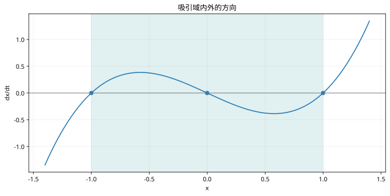

# 非线性Lyapunov与吸引域：复习

> 先独立推导，再回正文核对条件。

## 核心结论

候选函数正定还不够，需要沿真实动力学求导。子水平集给出的保证区域通常只是吸引域的内估计。

## 自查

1. 本课稳定性是局部还是全局？
2. 对象、输入与参数有哪些假设？
3. 改变初态或加入限幅后，哪个推导环节需要重做？

## 图形回顾

相线显示原点吸引区间为 (-1,1)，边界是其他平衡点。
