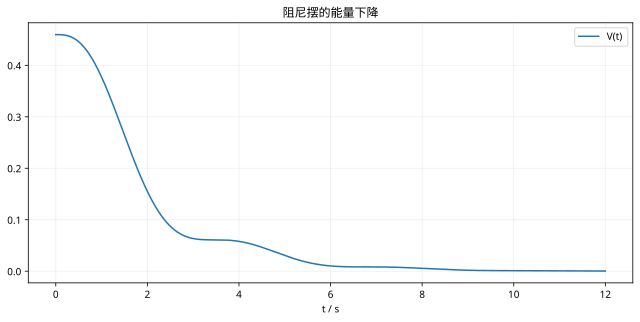

# LaSalle不变集原理：复习

> 先独立推导，再回正文核对条件。

## 核心结论

在紧致正向不变集合中，LaSalle 指向零导数集合的最大不变集。阻尼摆中 v=0 的一般点不能永远留在该集合内。

## 自查

1. 本课稳定性是局部还是全局？
2. 对象、输入与参数有哪些假设？
3. 改变初态或加入限幅后，哪个推导环节需要重做？

## 图形回顾

能量导数可瞬时为零，但轨迹继续运动，能量随后继续下降。
