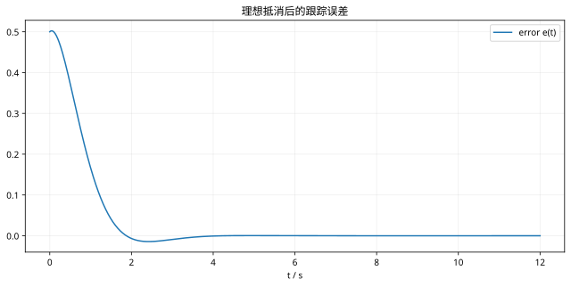

# 第 35 课：反馈线性化与模型误差

> 阶段 3 · 从模型与条件出发，推导可核对的稳定性结论。

## 1. 先指定能测到什么

假设角度、速度可用，输入为力矩，模型为

$$
J\ddot q+b\dot q+mgl\sin q=u.
$$

定义 $e=q-q_d$。若参数准确，可选

$$
u=b\dot q+mgl\sin q+J(\ddot q_d-k_d\dot e-k_pe).
$$

代回原方程，得到 $\ddot e+k_d\dot e+k_pe=0$。当 $k_p,k_d>0$，误差指数收敛。这里消去的是已知非线性项，需要参考二阶可微以及输入可实现。

## 2. 手算一个力矩

取 $J=1,b=0.2,mgl=2$，固定目标零，$q=0.5,v=0.1,k_p=4,k_d=3$。控制输入为

$$
u=0.2(0.1)+2\sin(0.5)-3(0.1)-4(0.5)\approx-1.3211.
$$

实际加速度为 $u-0.2v-2\sin q=-2.3$，恰等于期望的 $-3v-4q$。

## 3. 模型不准时还剩下什么？

若使用估计参数，消去后的误差方程会含有残余项 $d(t)$：

$$
\ddot e+k_d\dot e+k_pe=d(t).
$$

恒定残余扰动会造成偏差；对有界扰动一般讨论有界误差，不能继续宣称无条件精确收敛。力矩饱和同样会破坏理想抵消关系。

## 4. 工程验证顺序

先验证无误差、无限幅的理想模型；再单独改变惯量和重力参数；最后加入力矩限制、速度估计噪声和采样。记录位置误差与最大输入，不能只看曲线是否平滑。

```matlab
kp=4;kd=3;J=1;b=.2;g=2;
f=@(t,x)[x(2);(b*x(2)+g*sin(x(1))-J*(kd*x(2)+kp*x(1))-b*x(2)-g*sin(x(1)))/J];
[t,X]=ode45(f,[0 8],[.5;.1]);plot(t,X);grid on;
```

## 5. 自测

若执行器输出被截断为正负 0.5，误差是否仍严格满足理想二阶方程？不满足，应把截断后的实际输入重新代回模型分析。


## 图示核对



该曲线基于准确模型且没有输入饱和，不能直接代表真实执行器。
