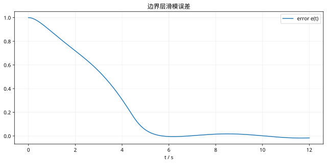

# 滑模控制与抖振：复习

> 先独立推导，再回正文核对条件。

## 核心结论

滑模面规定误差动态；切换增益超过匹配扰动上界才能使用到达保证。边界层平滑切换，也引入最终误差。

## 自查

1. 本课稳定性是局部还是全局？
2. 对象、输入与参数有哪些假设？
3. 改变初态或加入限幅后，哪个推导环节需要重做？

## 图形回顾

使用饱和函数近似切换，示例扰动为 0.2 sin(t)。
