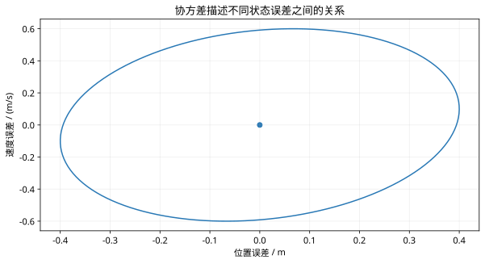

# 第 38 课：噪声协方差与状态估计

> 阶段 4 · 把测量误差变成可计算的不确定性，理解估计器到底输出什么。

## 1. 传感器读数为什么不能直接当作真实状态？

轮速计与定位系统都存在误差，位置读数还不能直接提供速度。状态估计把模型、已知输入和带噪声测量组合起来，输出状态估计及其不确定性。它不会凭空恢复传感器和模型共同遗漏的信息；可观测性仍然是前提。

设位置测量 $z=q+n$。零均值表示多次误差平均为零，不表示本次误差就是零。偏置是持续偏离的均值，不能只靠增大噪声方差来消除。

## 2. 方差与协方差要带单位

$$
\mathbb E[n]=0,\qquad R=\mathbb E[nn^{\mathsf T}],\qquad
P=\mathbb E[(x-\hat x)(x-\hat x)^{\mathsf T}].
$$

若位置标准差为 $0.2$ m，方差为 $0.04$ m²。对 $x=[q,v]^{\mathsf T}$，$P_{11}$ 单位为 m²，$P_{22}$ 为 m²/s²，交叉项为 m²/s。不能把位置误差和速度误差直接相加来“平均”。

$$
P=\begin{bmatrix}0.04&0.01\\0.01&0.09\end{bmatrix}.
$$

该矩阵对称、行列式为 $0.0035>0$，因此正定。交叉项为正说明位置估计偏大时，速度估计也倾向于偏大。置信椭圆的方向由协方差决定；其概率解释需要分布假设。

## 3. 两个位置测量怎样融合？

假设两个传感器误差独立、零均值，测得 $z_1=10.0$ m、$z_2=10.6$ m，方差分别为 $R_1=0.04$ 和 $R_2=0.36$ m²。在线性无偏融合中，最小方差权重为

$$
\hat q=\frac{R_2z_1+R_1z_2}{R_1+R_2}=10.06\ \mathrm m,\qquad
P=\frac{R_1R_2}{R_1+R_2}=0.036\ \mathrm{m^2}.
$$

可靠传感器权重更大。若二者共享同一个定位偏置，独立假设失效，套用该式会低估不确定性。高斯条件下，这也对应高斯融合的后验结果；非高斯情况下不能自动宣称获得完整最优后验分布。

## 4. 过程噪声不等于测量噪声

离散模型写作

$$
x_{k+1}=Ax_k+Bu_k+w_k,\qquad z_k=Hx_k+v_k,
$$

其中 $Q=\operatorname{Cov}(w_k)$ 表示模型推进误差，$R=\operatorname{Cov}(v_k)$ 表示测量误差。它们描述不同位置的不确定性。后续基本 Kalman 推导假设各时刻噪声白、零均值，且与初始误差及另一噪声序列独立。

常速度模型只测位置时，连续多次位置变化仍能提供速度信息；只测速度则无法确定未知的绝对初始位置。这与第 28 课可观测性一致。

## 5. 一次可复现的小实验

```matlab
rng(7);N=5000;
n1=.2*randn(N,1);n2=.6*randn(N,1);
z1=10+n1;z2=10+n2;
qhat=(.36*z1+.04*z2)/.4;
fprintf('mean=%g, variance=%g\n',mean(qhat),var(qhat,1));
```

理论融合方差为 0.036。有限样本统计会有偏差；换一个随机种子，结果也会变化。若给两个传感器同时加 0.5 m 偏置，融合均值同样会偏移。

## 6. 理解检查

为什么标准差 0.2 不能直接填入方差矩阵？为什么共享偏置不能通过独立传感器平均完全消除？请先写出单位与独立性假设，再回答。


## 图示核对



二维误差协方差轮廓：图中取误差的 Mahalanobis 距离为2，不将其误称为二维95%置信范围。
