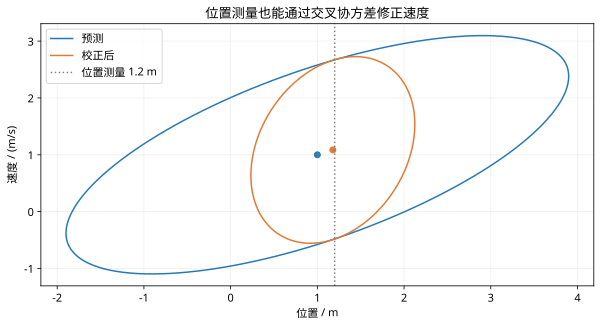

# Kalman滤波的预测与校正：复习

## 核心结论

一次循环包含状态预测、协方差预测、创新、增益和后验更新。位置测量可通过交叉协方差修正速度。

## 独立核对

1. 独立算出 S=2.35。
2. 为什么只测位置仍能修正速度？
3. 若当前测量丢失，应该跳过哪个步骤？

## 实验记录

记录模型、采样周期、噪声与约束；每次只改变一个因素，对照正文数值例子解释差异。

## 图示核对

同一数值循环中的先验与后验协方差轮廓；测量使位置不确定性下降，并改变速度估计。
