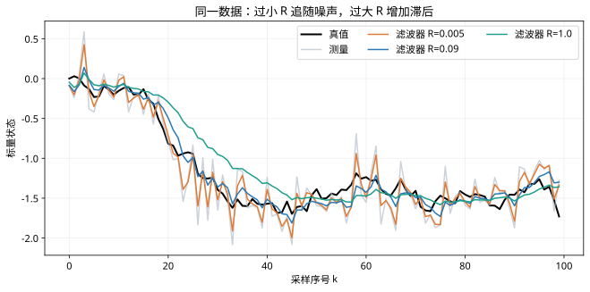

# Kalman滤波调参与一致性检查：复习

## 核心结论

Q 必须与采样周期和噪声假设一致。调参同时检查误差与不确定性是否匹配，不能仅凭曲线平滑程度判断。

## 独立核对

1. 推导区间常值加速度对应的 Q。
2. 为什么连续白噪声模型的 Q 具有不同的时间幂？
3. 模型有偏差时，增大 R 是否总能解决？

## 实验记录

记录模型、采样周期、噪声与约束；每次只改变一个因素，对照正文数值例子解释差异。

## 图示核对

固定真实过程方差0.01和测量方差0.09，只改变滤波器假设的R，比较平滑程度与动态误差。
