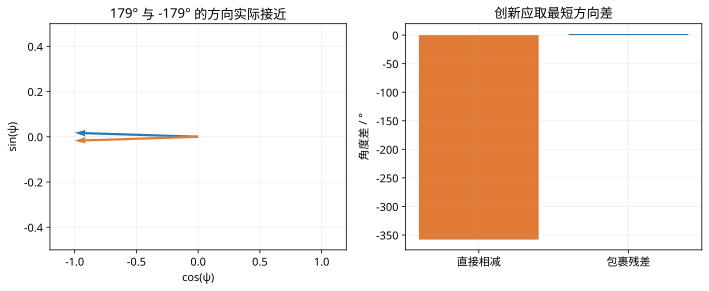

# 第 41 课：EKF与非线性状态估计

> 阶段 4 · 把 Jacobian、角度残差与非线性预测组合成可检查的 EKF。

## 1. 从 KF 到 EKF 改了哪一步？

对离散非线性系统

$$
x_k=f(x_{k-1},u_{k-1})+w_{k-1},\qquad z_k=h(x_k)+v_k,
$$

状态按非线性函数预测，协方差按当前估计附近的一阶近似传播：

$$
\hat x_k^-=f(\hat x_{k-1}^+,u_{k-1}),\quad
F_k=\left.\frac{\partial f}{\partial x}\right|_{\hat x_{k-1}^+,u_{k-1}},\quad
P_k^-=F_kP_{k-1}^+F_k^{\mathsf T}+Q.
$$

校正阶段令 $H_k=\partial h/\partial x$ 在先验处取值，再用 $\nu=z-h(\hat x^-)$、$S=H_kP^-H_k^{\mathsf T}+R$ 更新。EKF 使用局部近似，不具有一般非线性模型下的全局最优性或自动收敛保证。

## 2. 一个平面车辆的模型

用后轴中心位置和航向 $x=[X,Y,\psi]^{\mathsf T}$，已知速度 $v$、转角 $\delta$、轴距 $L$。用前向 Euler 离散化：

$$
f(x,u)=\begin{bmatrix}
X+T_sv\cos\psi\\Y+T_sv\sin\psi\\\psi+T_sv\tan\delta/L
\end{bmatrix},\qquad
F=\begin{bmatrix}1&0&-T_sv\sin\psi\\0&1&T_sv\cos\psi\\0&0&1\end{bmatrix}.
$$

若测量位置与航向，$h(x)=x,H=I$。若只测位置，$H$ 只保留前两行；静止时位置测量不能提供航向信息，运动和输入会影响可观测性。速度与转角并非永远准确，它们的误差需要传播为过程协方差或增广状态。

## 3. 手算一次非线性预测

取 $T_s=0.1$ s、$v=2$ m/s、$L=2.5$ m、$\psi=\pi/6$、$\delta=0.1$ rad，则

$$
\Delta X\approx0.173205\ \mathrm m,\quad\Delta Y=0.1\ \mathrm m,\quad
\Delta\psi\approx0.008027\ \mathrm{rad}.
$$

对应 $F_{13}=-0.1$，$F_{23}\approx0.173205$。航向误差会通过这两个交叉项影响位置不确定性。

## 4. 角度残差必须处理周期性

若预测航向为 $179^\circ$、测量为 $-179^\circ$，直接相减为 $-358^\circ$，实际最短方向残差是 $2^\circ$。因此使用

$$
\nu_\psi=\operatorname{atan2}(\sin(z_\psi-\hat\psi^-),\cos(z_\psi-\hat\psi^-)).
$$

更新后也应统一航向表示。仅仅把估计角度包裹到区间内，却不处理创新，仍然可能出现大跳变。

```matlab
wrap=@(a)atan2(sin(a),cos(a));
x=[0;0;pi/6];dt=.1;v=2;L=2.5;delta=.1;
xm=x+[dt*v*cos(x(3));dt*v*sin(x(3));dt*v*tan(delta)/L];
F=[1 0 -dt*v*sin(x(3));0 1 dt*v*cos(x(3));0 0 1];
nu=wrap(-179*pi/180-179*pi/180);disp(nu*180/pi);
```

## 5. EKF为什么可能发散？

初值偏差大、模型强非线性、低估协方差、角度处理错误或时间戳不一致，都可能使一阶近似失效。遇到问题应先检查模型和同步，再讨论更复杂滤波器；不能把每次发散都归因于 Q、R。

## 6. 练习

在零航向处写出 F，解释为什么当前航向误差主要影响下一拍横向位置。将速度设为零，再分析只测位置时的航向可观测性。


## 图示核对



角度测量跨越正负π时，直接相减会制造约一整圈的假残差；包裹后的残差只有2度。
