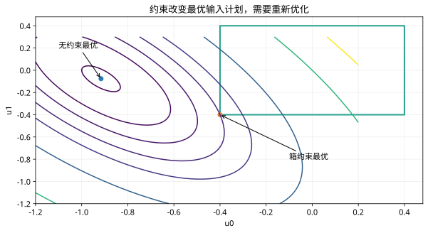

# 第 42 课：优化控制与滚动时域

> 阶段 4 · 先理解决策变量、代价和二次规划，再建立 MPC 的预测与反馈循环。

## 1. LQR为什么不足以直接处理转角限制？

LQR 的反馈律来自无显式硬约束的二次优化。实际转角、驱动与制动力都有界；把 LQR 输出事后截断，会改变原优化问题。MPC 在求解时就把这些边界放进候选输入序列中。

在时刻 k，使用当前状态估计预测未来 N 步，优化输入序列，只执行第一项；下一拍用新状态重新求解。这就是滚动时域。一次求完整段并全部照做，是开环执行，不能替代该反馈过程。

## 2. 最简单的两步优化

考虑 $x_{k+1}=x_k+u_k$，初态 $x_0=1$，目标零。令

$$
J=x_1^2+x_2^2+0.1(u_0^2+u_1^2).
$$

代入 $x_1=1+u_0$、$x_2=1+u_0+u_1$，对两个输入求偏导，得到

$$
\begin{bmatrix}2.1&1\\1&1.1\end{bmatrix}
\begin{bmatrix}u_0\\u_1\end{bmatrix}
=-\begin{bmatrix}2\\1\end{bmatrix}.
$$

解为 $u_0\approx-0.91603,u_1\approx-0.07634$。控制器此刻只执行 $u_0$。若有扰动，下一拍优化会使用实际得到的 $x_1$，而不是机械照抄旧的 $u_1$。

## 3. 二次规划中的每个对象

标准形式为

$$
\min_U\ \frac12U^{\mathsf T}HU+g^{\mathsf T}U,\qquad GU\le h.
$$

$U$ 是待优化的输入序列，$H$ 是代价曲率，$g$ 含当前状态和参考信息。$H$ 半正定给出凸二次代价；若严格正定且可行，最优解唯一。硬约束交集为空时，求解器应报告不可行，不能把未收敛的数值随意当作有效控制。

## 4. 加限制后为什么不能只截断旧最优解？

如果两步均有 $|u_i|\le0.4$，本例最优输入为 $u_0=u_1=-0.4$。这时 $x_1=0.6,x_2=0.2$，代价为 0.432。简单截断原解得到 $[-0.4,-0.07634]$，并没有重新调整第二步，因此不是此约束问题的最优解。

## 5. 计算代价与控制代价都要考虑

时域更长通常看得更远，但变量更多。MPC 的“最优”始终是相对于模型、代价、约束、时域及求解精度。实时控制还要检查求解耗时、失败策略和时间戳。

```matlab
M=[2.1 1;1 1.1];rhs=-[2;1];
U=M\rhs;X=[1+U(1);1+sum(U)];
disp(U);disp(X);
J=sum([.6;.2].^2)+.1*sum([-.4;-.4].^2);disp(J);
```

## 6. 理解检查

什么时候才执行第二个控制量？下一拍重新优化后，新的第一项通常会替代旧计划第二项。若只有模型而没有状态反馈，重新计算相同计划也不等同于抵抗实际扰动。


## 图示核对



两步积分器的代价等高线：绿色方框表示每步输入在正负0.4以内，受约束最优点与无约束解不同。
