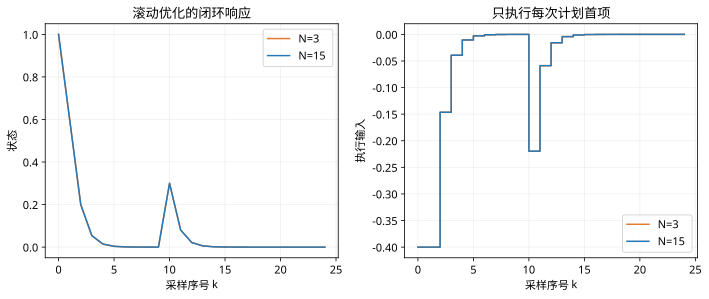

# 第 43 课：线性MPC预测模型与代价

> 阶段 4 · 把未来状态展开成矩阵，完整构造一个可求解的线性 MPC。

## 1. 先统一预测下标

对 $x_{k+1}=Ax_k+Bu_k$，记 $x_{i|k}$ 为时刻 k 对未来第 i 步的预测，$x_{0|k}=\hat x_k$。决策变量为

$$
U=\begin{bmatrix}u_{0|k}\\u_{1|k}\\\vdots\\u_{N-1|k}\end{bmatrix},\quad
X=\begin{bmatrix}x_{1|k}\\x_{2|k}\\\vdots\\x_{N|k}\end{bmatrix}=\mathcal A\hat x_k+\mathcal B U.
$$

## 2. 两步展开，避免矩阵靠背

$$
x_{1|k}=A\hat x_k+Bu_{0|k},\qquad
x_{2|k}=A^2\hat x_k+ABu_{0|k}+Bu_{1|k}.
$$

因此

$$
\mathcal A=\begin{bmatrix}A\\A^2\end{bmatrix},\qquad
\mathcal B=\begin{bmatrix}B&0\\AB&B\end{bmatrix}.
$$

若状态维数 n、输入维数 m，$\mathcal A$ 为 $Nn\times n$，$\mathcal B$ 为 $Nn\times Nm$。检查维数可以发现大量转置和错位错误。

## 3. 把跟踪要求写进代价

令参考堆叠为 $X_r$，代价为

$$
J=(X-X_r)^{\mathsf T}\bar Q(X-X_r)+U^{\mathsf T}\bar R U.
$$

可以在末步使用终端权重 $P_f$，令 $\bar Q=\operatorname{diag}(Q,\ldots,Q,P_f)$。转换为标准 QP：

$$
H=2(\mathcal B^{\mathsf T}\bar Q\mathcal B+\bar R),\qquad
g=2\mathcal B^{\mathsf T}\bar Q(\mathcal A\hat x_k-X_r).
$$

当 $\bar R>0,\bar Q\ge0$ 时，H 正定。常数项不影响最优输入，但计算完整预测代价时不能漏掉。

## 4. 连接上一课的数字

对标量积分器、N=2，有 $\mathcal A=[1,1]^{\mathsf T}$、$\mathcal B=\begin{bmatrix}1&0\\1&1\end{bmatrix}$。取 $\bar Q=I,\bar R=0.1I$，可得到上一课矩阵的两倍作为 H，并得到相同最优输入。

```matlab
AA=[1;1];BB=[1 0;1 1];Qb=eye(2);Rb=.1*eye(2);
x=1;xr=zeros(2,1);
H=2*(BB'*Qb*BB+Rb);g=2*BB'*Qb*(AA*x-xr);
U=-H\g;disp(U);
```

## 5. 时域长度与输入惩罚的交互

下方实验对标量积分器进行带输入界的滚动优化，使用投影梯度近似求解。它用于展示时域、输入惩罚与约束，不包含终端集或一般状态约束，不提供通用稳定性保证。

:::demo stage4-lab mode=mpc
:::

## 6. 有限时域不自动保证稳定

终端代价、终端集合和局部控制律可以用于建立标准 MPC 稳定性与递归可行性条件，但它们需要适配对象和约束。仅仅把 N 调大或使用一个正权重，并不构成完整证明。

## 7. 练习

把 N=2 改为 N=3，手写 $\mathcal B$。然后把输入惩罚从 0.1 增到 1，比较第一步输入；解释为什么更节省输入通常会牺牲短期响应速度。


## 图示核对



标量积分器在第10拍受到固定状态扰动；两种时域都用新状态重新优化，输入限制为正负0.4。
