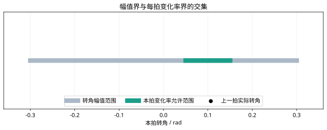

# MPC约束软化与求解检查：复习

## 核心结论

约束以实际执行输入为基准。软化范围必须明确；求解成功与真实系统满足约束是两个需要分别核验的环节。

## 独立核对

1. 重算首拍转角区间。
2. 写出三步差分矩阵 D。
3. 为什么预测约束满足不等于真实状态必然满足？

## 实验记录

记录模型、采样周期、噪声与约束；每次只改变一个因素，对照正文数值例子解释差异。

## 图示核对

上一拍转角0.1 rad、采样0.1 s、最大转角速率0.5 rad/s时，首拍转角必须位于0.05至0.15 rad。
