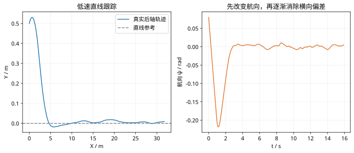

# 第 45 课：车辆横向模型与MPC轨迹跟踪

> 阶段 4 · 把车辆误差坐标、参考曲率和转向控制接到前面的预测优化框架。

## 1. 先明确参考点和符号

使用后轴中心的运动学自行车模型，轴距 L，速度 v，前轮等效转角 $\delta$。只考虑低速、轮胎侧滑可忽略的情况。实际车身定位点若在其他位置，应先做几何转换。

定义 $e_y$ 为参考曲线左侧为正的横向偏差，$e_\psi=\psi-\psi_r$。以参考弧长 s 为进度，参考曲率为 $\kappa_r$，有

$$
\dot s=\frac{v\cos e_\psi}{1-\kappa_r e_y},\quad
\dot e_y=v\sin e_\psi,\quad
\dot e_\psi=\frac vL\tan\delta-\kappa_r\dot s.
$$

要求参考投影局部唯一且 $1-\kappa_r e_y\ne0$。大偏差、尖角或多重最近点处不能盲用该坐标。

## 2. 在参考转角附近线性化

参考前馈转角为 $\delta_r=\arctan(L\kappa_r)$。在小误差附近令 $\tilde\delta=\delta-\delta_r$，完整一阶模型为

$$
\dot e\approx\begin{bmatrix}0&v\\-v\kappa_r^2&0\end{bmatrix}e+
\begin{bmatrix}0\\v\sec^2\delta_r/L\end{bmatrix}\tilde\delta.
$$

弱曲率下常忽略 $-v\kappa_r^2e_y$，并近似 $\sec^2\delta_r\approx1$。这是额外近似，不能称为任意曲率下的精确线性化。

## 3. 直线参考的离散模型

对直线参考 $\kappa_r=0$、恒定速度，连续小误差模型在零阶保持下精确离散为

$$
A_d=\begin{bmatrix}1&vT_s\\0&1\end{bmatrix},\qquad
B_d=\begin{bmatrix}v^2T_s^2/(2L)\\vT_s/L\end{bmatrix}.
$$

取 $v=2$ m/s、$L=2.5$ m、$T_s=0.1$ s，则 $A_{12}=0.2$、$B=[0.008,0.08]^{\mathsf T}$。输入为转角 rad，首个状态为横向偏差 m。

## 4. 为什么速度一变，增益和预测也会变？

v 进入 A、B，车辆相同时间内走过的距离不同。停车时横向转向对位置没有即时控制作用，不能继续把运动中的可控性结论照搬到 v=0。倒车时 v 为负，符号及参考方向的定义都需要一致。

## 5. 给控制器一个具体问题

取初始 $e=[0.5,0]^{\mathsf T}$，直线目标零，N=20，$Q=\operatorname{diag}(5,2)$、$R=0.5$、$|\delta|\le0.35$ rad。用第 43 课的矩阵构造优化，首项应把车辆朝参考线引导。按本课符号，正横向误差一般先需要负转角。

```matlab
v=2;L=2.5;dt=.1;
A=[1 v*dt;0 1];B=[v^2*dt^2/(2*L);v*dt/L];
x=[.5;0];u=-.1;
xnext=A*x+B*u;disp(xnext);
```

得到下一拍预测 $e_y=0.4992$ m、$e_\psi=-0.008$ rad。当前转角先改变航向，位置逐渐靠近，因此不能要求一拍把横向误差直接消掉。

## 6. 从公式走到泊车场景

需要另外处理参考投影、曲率连续性、换挡、速度规划、定位时延和执行器动态。障碍物避碰约束及碰撞检查也不包含在上述横向 MPC 中；轨迹跟踪不能代替路径安全规划。

## 7. 练习

把速度改为 -2，重算 A、B 并解释两个 B 元素的符号。为什么预测矩阵应随着速度更新？为什么给曲线轨迹只加零前馈转角会留下系统性误差？


## 图示核对



图中为无障碍直线参考跟踪，控制器使用小误差预测模型，真实对象按非线性自行车模型更新。
