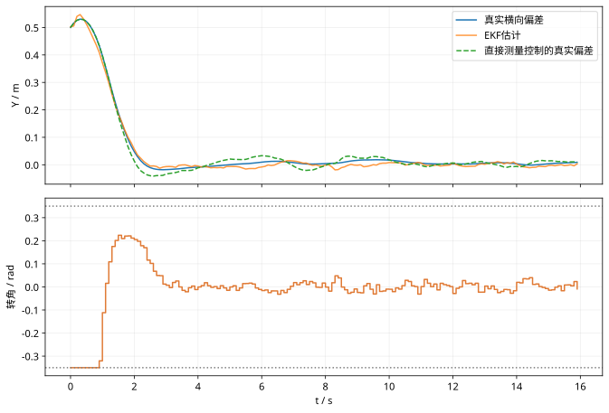

# EKF与MPC车辆跟踪综合实验：复习

## 核心结论

综合实验必须同时核对估计、优化、约束和时序。预测模型与真实对象分开，控制器不应读取仿真真值。

## 独立核对

1. 画出一拍 EKF 与 MPC 数据流。
2. 解释为何执行输入必须同时传给对象和估计器。
3. 设计一个轴距误差实验，明确改变哪一份参数。

## 实验记录

记录模型、采样周期、噪声与约束；每次只改变一个因素，对照正文数值例子解释差异。

## 图示核对

固定种子7的综合脚本结果：比较估计反馈与直接测量反馈，并检查执行转角始终处于正负0.35 rad内。
